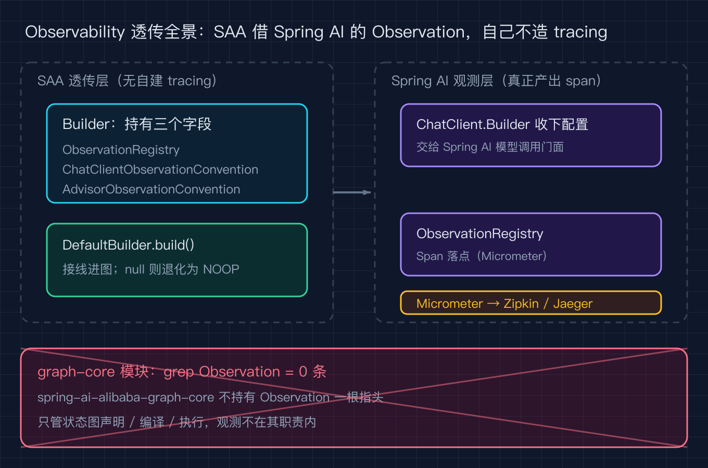
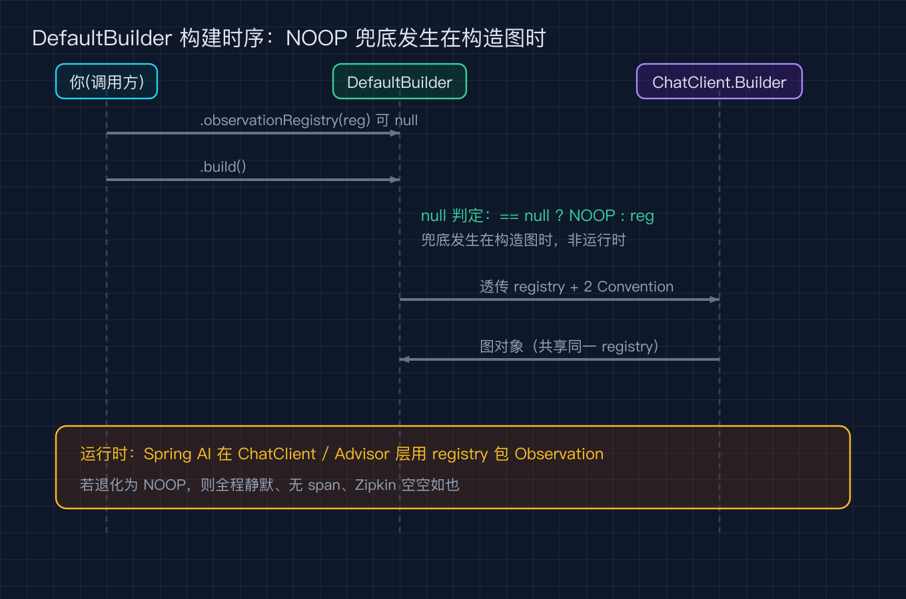
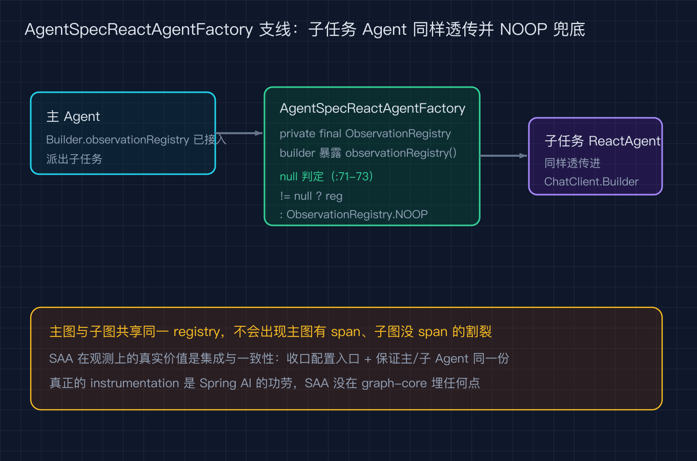

# Spring AI Alibaba 之七：我没写一行 tracing 埋点，Agent 每一步却被 Micrometer 看得清清楚楚

Spring AI Alibaba 源码级原理拆解之七（系列共九篇）。本篇按 tag v1.1.2.2（提交 7405a7d）逐行号核对，所有源码行号来自本地 `/tmp/saa`，可用文末 `code/verify_sources.py` 复跑校验。

我接手一个线上 Agent 排障，运营说模型偶尔抽风，但不确定是模型慢还是工具卡。我第一反应是去 SAA 代码里找它的 tracing 实现，心想这套多智能体框架总得自己埋点吧。结果 grep 了一圈 graph-core 模块，一个 `Observation` 都没有。再顺藤摸瓜，发现 SAA 根本没有自研的链路追踪，它只是把 Spring AI 现成的 Observation API 一路透传下去。这篇就把这条透传链路讲清楚，顺便纠正「SAA 造了一套可观测体系」这个错觉。

## 一句话结论

SAA 的观测能力是借的。Builder 上挂三个字段（一个注册表加两个命名约定），DefaultBuilder 构造图的时候把它们接进 ChatClient.Builder，真正的 span 是 Spring AI 的 ChatClient 层和 Advisor 层在产出，最后落进你配置的 Micrometer `ObservationRegistry`，再导出到 Zipkin 或 Jaeger。SAA 自己的 graph-core 不碰 Observation 一根指头。

## Builder 上只多了三个字段

先看它声明了什么。在 `agent/Builder.java` 里，跟观测相关的就是下面三个 protected 字段，外加三个 setter。

```java
// Builder.java:111
protected ObservationRegistry observationRegistry;
// Builder.java:113
protected ChatClientObservationConvention customObservationConvention;
// Builder.java:115
protected AdvisorObservationConvention advisorObservationConvention;
```

三个 setter 一脉相承，都允许为 null，意味着默认可观测但没接入任何后端。

```java
// Builder.java:309
public Builder observationRegistry(ObservationRegistry observationRegistry) {
    this.observationRegistry = observationRegistry;
    return this;
}
// Builder.java:314
public Builder customObservationConvention(ChatClientObservationConvention customObservationConvention) {
    this.customObservationConvention = customObservationConvention;
    return this;
}
// Builder.java:319
public Builder advisorObservationConvention(AdvisorObservationConvention advisorObservationConvention) {
    this.advisorObservationConvention = advisorObservationConvention;
    return this;
}
```

这两个 Convention 是 Spring AI 的接口，作用是给 span 起名和打标签。SAA 没有造自己的 span 协议，它只是让你能塞一个自定义的命名约定进去。

## DefaultBuilder 把它们接进图

真正接线发生在 `DefaultBuilder.java`。它 import 了 Micrometer 的 `ObservationRegistry`，在构造 ReactAgent 时做了一步关键的 null 兜底。

```java
// DefaultBuilder.java:24
import io.micrometer.observation.ObservationRegistry;
// DefaultBuilder.java:76-77 构造图时透传
this.observationRegistry == null ? ObservationRegistry.NOOP : this.observationRegistry,
this.customObservationConvention, this.advisorObservationConvention);
```

这一段的含义是：你没配 `observationRegistry`，SAA 不会报错，而是退化为 `ObservationRegistry.NOOP`，也就是一个什么都不做的空实现。配了，就接上你的 Micrometer 注册表。这就是「透传三件套」的全部动作。

下面这张图把整条链路串起来，注意最右的 graph-core 被划掉，因为它压根不持有 Observation。



## 构建时序：null 判定发生在 build 这一步

把 build 那一刻的时序画出来，能看清 NOOP 兜底到底在哪一层生效。



要点只有两个。第一，兜底发生在 DefaultBuilder 构造 ReactAgent 时，不是运行时，所以一次应用里所有图共享同一个 `ObservationRegistry`。第二，它传入的是 `ChatClient.Builder`，也就是说 SAA 把观测配置交给了 Spring AI 的模型调用门面，自己不拦截调用。

## 子智能体的任务 Agent 也走同一条路

你可能会想，主 Agent 是透传了，那它派出去的子任务 Agent 呢。答案是同样的透传。在 `tools/task/AgentSpecReactAgentFactory.java` 里，内部也持有一个 `ObservationRegistry`，并且用同样的 null 兜底。

```java
// AgentSpecReactAgentFactory.java:32
import io.micrometer.observation.ObservationRegistry;
// AgentSpecReactAgentFactory.java:65
private final ObservationRegistry observationRegistry;
// AgentSpecReactAgentFactory.java:71-73 兜底
this.observationRegistry = builder.observationRegistry != null
        ? builder.observationRegistry
        : ObservationRegistry.NOOP;
```

它自己的内部 Builder 也暴露了同一个 setter，所以子任务 Agent 和主 Agent 用的是同一套观测配置。

```java
// AgentSpecReactAgentFactory.java:130
private ObservationRegistry observationRegistry;
// AgentSpecReactAgentFactory.java:156-157
public Builder observationRegistry(ObservationRegistry observationRegistry) {
    this.observationRegistry = observationRegistry;
    return this;
}
```



## 真正的 span 是 Spring AI 在产出

讲到这里要澄清一个常见误解。SAA 透传出去的 `ObservationRegistry` 和那两个 Convention，最终是被 Spring AI 的 `ChatClient` 调用层和 `Advisor` 拦截层消费的。每一次模型调用、每一个 Advisor 处理，Spring AI 都会用这些约定包出一个 `Observation`，带 span 名、输入 token、耗时等标签。SAA 只是把你的注册表送到了该送的地方，并没有在图执行引擎里埋任何点。

我用 grep 在 `spring-ai-alibaba-graph-core/src/main/java` 下搜 `ObservationRegistry` 和 `Observation`，返回零条结果。这不是我漏看，是 graph-core 模块确实零 Observation 引用。它只管状态图的声明、编译和执行，观测这件事从头到尾不在它的职责里。

## 那 SAA 在观测上到底加了什么价值

把功劳归给 Spring AI 之后，公平地说 SAA 做了两件实事。第一，它在 Builder 配置面上把 Spring AI 散落的观测开关收口成一个入口，你不必去翻 ChatClient 怎么配、Advisor 怎么配，在一个 `observationRegistry(...)` 调用里就全接上了。第二，它保证主 Agent 和子任务 Agent（AgentSpecReactAgentFactory）用的是同一份配置，不会出现主图有 span、子图没 span 的割裂。

一句话，SAA 的价值是集成和一致性，不是造轮子。

## 三个容易踩的坑

第一，以为 SAA 自带 tracing 就直接去文档里找它的埋点说明，结果找不到，其实要去 Spring AI 的 Observation 文档看 span 名和标签约定。

第二，忘记在 Builder 上调 `observationRegistry(...)`，于是所有链路都退化成 `ObservationRegistry.NOOP`，你打开 Zipkin 空空如也，还以为是后端没接好。

第三，自定义 Convention 只改了 span 名没改标签，排查时还是分不清哪次慢是模型慢哪次慢是工具慢，因为耗时标签是 Spring AI 固定打的，命名约定改不了它。

## 复现模块

本篇所有源码行号都可用 `code/verify_sources.py` 复跑，它会读环境变量 `SAA_SRC`（默认 `/tmp/saa`）逐条核对 `(相对路径, 行号, 片段)`。数据源为开源仓库 `alibaba/spring-ai-alibaba`，基准 tag v1.1.2.2（提交 7405a7d）。文章 QC 用 `code/qc_article.py`，检查破折号、加粗、配图引用是否齐备。

## 结尾钩子

你现在的 Agent 接入了 Micrometer 吗。如果没，先别去翻 SAA 的埋点文档，直接去 Builder 上找 `observationRegistry(...)` 一个调用就够。如果已经接了却看不到子任务 Agent 的 span，回去查查 `AgentSpecReactAgentFactory` 这条支线有没有漏配。你接观测时踩过最离谱的坑是什么，评论区聊聊，下一篇之八我讲沙箱，正好接着聊「Agent 能跑 shell 命令时该怎么防误删和泄密」。
