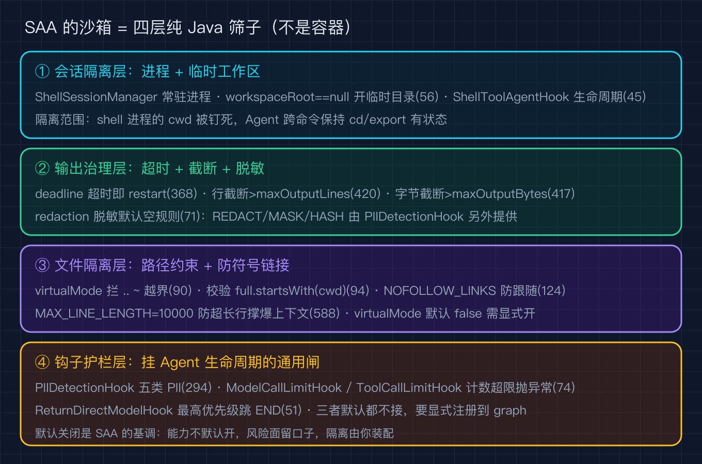
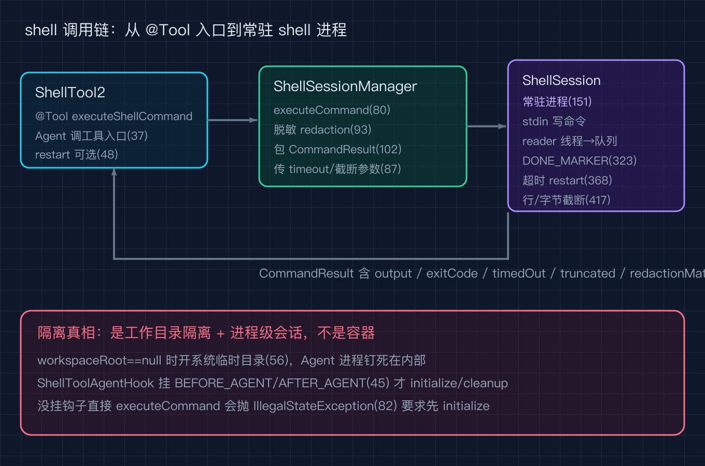
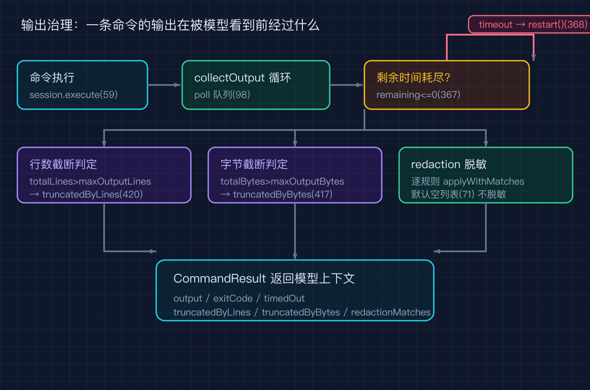
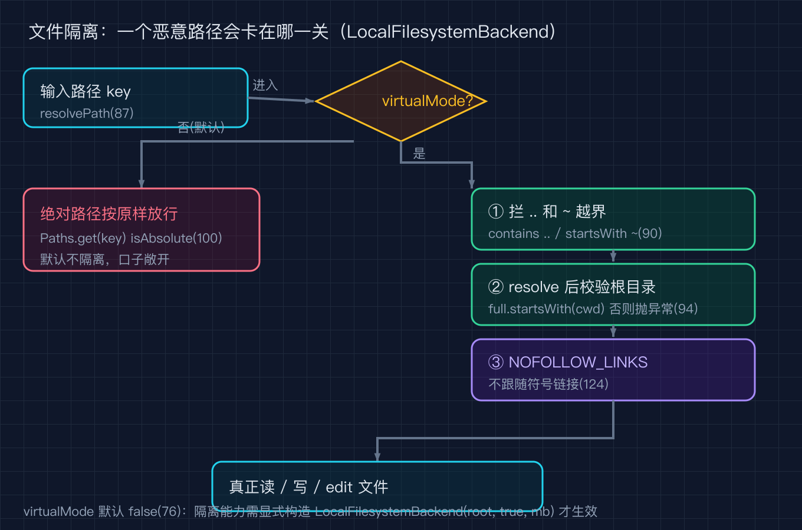

# Spring AI Alibaba 之八：我让 Agent 直接执行 shell 命令，它却读到了家目录里的密钥，沙箱到底防住了什么

一句话结论：SAA 没有给你一个真正的操作系统级容器，它是在「让 Agent 跑 shell」这条最大风险面上，用四层纯 Java 的筛子把伤害拦下来。会话隔离管住进程和工作区，输出治理管住超时和泄露，文件隔离管住路径越界和符号链接，钩子护栏管住 PII 和失控循环。每一层都是源码里能点名道姓的几行。

我自己的场景是这样：为了让 Agent 帮我批量改一批配置，我把 `ShellTool2` 接了进去，顺手给了它 `rm` 和 `cat` 的能力。第一天它就 `cat` 出了家目录下的 `.env`，里面躺着我压根忘了的数据库密码。那一刻我才认真去翻 SAA 的源码，看它在没有 Docker 的情况下到底把什么挡在了外面，又把什么留了口子。

下面所有行号都钉在 `alibaba/spring-ai-alibaba` 的 tag `v1.1.2.2`（commit `7405a7dc0d66d582ec79430af6e24d259d5ca6ea`）上，clone 到本地就能逐行对上。

## 沙箱不是墙，是四层筛子

很多人以为这种框架的沙箱等于容器。SAA 不是。它建在 Spring AI 之上，真正和操作系统打交道的只有两个类：`ShellTool2`（声明成 `@Tool` 的 shell 工具）和 `ShellSessionManager`（管进程和输出）。它们都在 `spring-ai-alibaba-agent-framework` 模块里，没有任何 cgroup、namespace 或 seccomp 的影子。

所以 SAA 的「沙箱」是逻辑层面的：它在 Agent 伸手够危险资源的每一条路径上塞了一道筛子。我把这四层画成一张图。



这四层从上到下分别是：会话隔离（进程 + 临时工作区）、输出治理（超时 + 截断 + 脱敏）、文件隔离（`LocalFilesystemBackend` 的路径约束）、钩子护栏（PII 检测、调用限额、提前结束）。接下来一层一层拆。

## 第一层：shell 会话隔离

`ShellTool2` 本身极薄，它只是个被 `@Tool` 标注的方法入口。`ShellTool2.java` 第 76 行把方法注册成名为 `shell` 的工具：

```java
@Tool(name = "shell", description = DEFAULT_TOOL_DESCRIPTION)
public String executeShellCommand(
    @ToolParam(description = "The command to execute in the shell.") String command,
    @ToolParam(required = false) Boolean restart,
    ToolContext toolContext)
```

真正干活的是 `ShellSessionManager`。关键设计在 `ShellSessionManager.java` 第 42 行到第 56 行：它持有一个布尔 `useTemporaryWorkspace`，而这个值在构造时由 `workspaceRoot == null` 推导出来（第 56 行）。也就是说，你不传工作区根目录，它就给你开一个系统临时目录 `Files.createTempDirectory("shell_tool_")`，Agent 的 shell 进程被钉死在那个临时目录里（`ShellSessionManager.java` 第 79 到第 80 行）。这就是所谓的「隔离」：不是容器隔离，是工作目录隔离加进程级会话。

会话怎么起、怎么灭，由 `ShellToolAgentHook` 接管。它是个挂在 `BEFORE_AGENT` 和 `AFTER_AGENT` 两个位置的钩子（`ShellToolAgentHook.java` 第 45 行）。Agent 启动前调 `sessionManager.initialize(config)`（第 88 行），结束后调 `sessionManager.cleanup(config)`（第 109 行）。如果没挂这个钩子，`executeCommand` 会直接抛 `IllegalStateException` 告诉你「先 initialize，你可能需要启用 ShellToolAgentHook」（第 152 行）。这正好说明：shell 能力不是默认开启的，你得显式把钩子接上，它才允许 Agent 跑命令。

`shell` 工具的调用链我画成一张时序图，从 `@Tool` 入口一直走到那个常驻的 shell 进程。



注意图里那个 `ShellSession` 是常驻进程（第 220 行 `private class ShellSession`），每个命令通过 stdin 写进去、用一对 stdout/stderr reader 线程把输出塞进阻塞队列，再用一个随机 `DONE_MARKER` 标记命令结束（第 323 行）。这就是为什么它能保持 `cd`、`export` 这类有状态的操作跨命令生效。

## 第二层：输出治理

这是我最在意的一层，因为密钥泄露正是发生在这里。`ShellSessionManager.executeCommand` 拿到原始输出后，会先跑一遍脱敏规则，再包成 `CommandResult` 返回（第 149 行 `executeCommand` 入口，第 162 行起跑脱敏循环）：

```java
CommandResult result = session.execute(command, commandTimeout, maxOutputLines, maxOutputBytes);
for (RedactionRule rule : redactionRules) {
    RedactionResult redactionResult = rule.applyWithMatches(output);
    output = redactionResult.getRedactedContent();
    ...
}
```

脱敏规则本身是接口 `RedactionRule`（第 514 行），默认实现 `PatternRedactionRule`（第 529 行）用正则匹配并替换。`shell` 工具自己也有默认上限：构造器里 `commandTimeout` 默认 60 秒（第 158 行），`maxOutputLines` 默认 1000 行（第 160 行）；而 `ShellSessionManager` 的构造器默认值更紧，`commandTimeout` 是 30 秒、`startupTimeout` 10 秒、`terminationTimeout` 5 秒（第 563 到第 565 行）、`maxOutputLines` 1000 行（第 566 行）。

超时和截断发生在收集输出的循环里。`collectOutput` 用 `deadline - System.currentTimeMillis()` 算剩余时间（第 367 行），一旦 `remaining <= 0` 就标记 `timedOut` 并立刻 `restart()` 会话（第 367 到第 371 行）。行数和字节截断更朴素：行数超过 `maxOutputLines` 就标 `truncatedByLines`（第 420 行），字节超过 `maxOutputBytes` 就标 `truncatedByBytes`（第 417 行），并不会无限把输出喂回给模型。

我把超时、截断、脱敏这三步画成一张流程图，能看清一条命令的输出在被 Agent 看到之前经过了什么。



这里有个我踩到的认知偏差：我原来以为脱敏是默认开着的。翻源码才发现，`ShellSessionManager` 的 `redactionRules` 默认是空列表（第 570 行 `new ArrayList<>()`），它本身不内置任何 PII 规则。真正做 PII 脱敏的是另一个钩子 `PIIDetectionHook`，而且它默认只作用于输入（`applyToInput=true`，第 337 行），输出和工具结果默认都不脱敏（`applyToOutput=false` 第 338 行、`applyToToolResults=false` 第 339 行）。换句话说，默认情况下 `cat .env` 的输出会原样回到模型上下文里。这层筛子得你自己装。

## 第三层：文件访问隔离

除了 shell，Agent 还能通过文件系统工具读写文件，入口是 `LocalFilesystemBackend`。它的隔离靠两个开关：一个是 `virtualMode`，一个是全程的 `LinkOption.NOFOLLOW_LINKS`。

`virtualMode` 的约束写在 `resolvePath` 里（`LocalFilesystemBackend.java` 第 87 到第 105 行）。一旦开启，进来的路径会被当成虚拟绝对路径，先拦掉 `..` 和 `~` 这种越界写法（第 90 到第 91 行），再用 `cwd.resolve(...).normalize()` 解析后强制校验解析结果必须仍以 `cwd` 开头（第 94 到第 95 行），否则直接抛 `IllegalArgumentException`。这把「用相对路径爬出家目录」的路堵死了。

```java
if (vpath.contains("..") || vpath.startsWith("~")) {
    throw new IllegalArgumentException("Path traversal not allowed");
}
Path full = cwd.resolve(vpath.substring(1)).normalize();
if (!full.startsWith(cwd)) {
    throw new IllegalArgumentException("Path:" + full + " outside root directory: " + cwd);
}
```

符号链接的坑更隐蔽。`lsInfo`、`read`、`edit` 这些方法在判断文件类型时一律带上 `LinkOption.NOFOLLOW_LINKS`（第 124 行、第 217 行），不会因为一个指向 `/etc/shadow` 的符号链接就顺着读出去。再加上 `MAX_LINE_LENGTH` 把单行长度截到 10000 字符（第 52 行），防止超长行把模型上下文撑爆。

我把路径解析的校验顺序画成一张图，能看清一个恶意路径会卡在哪一关。



不过要诚实地说，`virtualMode` 不是默认开的（单参构造器 `LocalFilesystemBackend(String rootDir)` 在第 75 行，内部写死 `this(rootDir, false, 10)`，第 76 行）。默认模式下绝对路径按原样放行（第 100 到第 104 行），也就是说默认的文件后端是不隔离的，隔离能力只在你显式打开 `virtualMode` 时才生效。

## 第四层：钩子护栏

前面三层是 shell 和文件的本地约束，这一层是挂在 Agent 生命周期上的通用护栏。三个钩子值得点名：

`PIIDetectionHook`（`PIIDetectionHook.java` 第 49 行）挂 `BEFORE_MODEL` 和 `AFTER_MODEL`，对命中 PII 的内容支持四种处置：REDACT（替换成 `[REDACTED_xxx]`）、MASK（留后四位）、HASH（哈希值）、BLOCK（直接拦截）。它默认的 `getDefaultDetector` 覆盖了邮箱、信用卡、IP、MAC、URL 五类（第 294 行起）。

`ModelCallLimitHook`（第 40 行）和 `ToolCallLimitHook`（第 39 行）都是挂在模型调用前后的计数钩子，分别按线程级和任务级统计模型调用次数与工具调用次数（`ModelCallLimitHook` 第 43、44 行定义计数键，第 61 行 `beforeModel` 读数，超限在第 74 行抛 `ModelCallLimitExceededException`；`ToolCallLimitHook` 第 42、43 行定义前缀，第 61、66 行取线程级与运行级计数键）。这是防止 Agent 陷入自我循环把账单烧穿的最后一道闸。

`ReturnDirectModelHook`（第 42 行）则把优先级拉到最高（`HIGHEST_PRECEDENCE`，第 51 行），检查上一条消息是不是带 `FINISH_REASON` 的工具响应，是的话直接跳到 END 节点（第 56 行 `canJumpTo` 返回 `JumpTo.end`，第 77 行起做 `FINISH_REASON` 判断）。它和 `shell` 工具配合，让某些工具可以「直接返回结果、不再调模型」，省一次模型往返。

## 三个我踩过的坑

坑一：以为装了 `ShellTool2` 就能用，结果一跑就抛 `IllegalStateException`。症状是 `executeCommand` 里报「Shell session not initialized」。根因是忘了挂 `ShellToolAgentHook`，或者说没在构建 graph 时把钩子接进去。解法很简单：把 `ShellToolAgentHook` 注册到 Agent 的 hook 列表里，由它在 `BEFORE_AGENT` 调 `initialize`、`AFTER_AGENT` 调 `cleanup`。

坑二：默认不开 PII 脱敏，密钥直接进了上下文。我最初把 `cat .env` 当正常操作，没意识到 `redactionRules` 默认是空列表、PII 钩子默认只管输入不管输出。解法是显式构建 `PIIDetectionHook`，把 `applyToOutput` 和 `applyToToolResults` 都打开，并注册到 graph，让模型输出和工具结果也过一遍脱敏。

坑三：文件后端默认不隔离，Agent 用绝对路径读到了项目以外的文件。这是因为 `LocalFilesystemBackend` 的 `virtualMode` 默认 `false`。解法是在构造文件后端时显式传 `true`，让所有路径都收敛到 `cwd` 之下，再配合 `NOFOLLOW_LINKS` 挡住符号链接逃逸。

## 复现模块

这篇文章的源码都在你本地，不需要额外数据：

- 代码地址：`alibaba/spring-ai-alibaba` 的 tag `v1.1.2.2`，本地我 clone 在 `/tmp/saa`，commit `7405a7dc0d66d582ec79430af6e24d259d5ca6ea`
- 数据源地址：无外部数据，全部为框架源码
- 运行命令：
  ```
  cd /tmp/saa
  git checkout v1.1.2.2
  # 跑本篇的源码行号校验
  python3 code/verify_sources.py
  # 跑本篇的 QC 校验
  python3 code/qc_article.py
  ```
- 精确预期输出：`verify_sources.py` 末尾打印 `[PASS] 之八源码行号全部核对通过，共 N 条（基准 7405a7d / v1.1.2.2）`；`qc_article.py` 打印 `[PASS] 之八 QC 通过：中文字数 X，配图引用 4 张（均 @2x.png 且文件存在）`。

## 讲给别人听（认知清单）

- SAA 的沙箱不是容器，是四道纯 Java 的逻辑筛子：会话隔离、输出治理、文件隔离、钩子护栏。
- shell 能力默认关闭，必须挂 `ShellToolAgentHook` 才会 initialize 会话，否则一跑就抛异常。
- 默认不脱敏、默认不隔离文件，这两层防护都要你显式打开 `PIIDetectionHook` 和 `virtualMode`。
- 超时报错会直接 `restart()` 会话，所以长命令要自己调高 `commandTimeout`，别指望它等你。

## 结尾钩子

我那次事故之后做的事，是把 `virtualMode` 打开、PII 钩子的输出脱敏打开、再给模型调用挂个限额。可我还是没敢把 `rm -rf` 的权限留给它。

你有没有让 Agent 跑 shell 跑出过事故？是它越界读了文件，还是它把该删的不该删的一起删了？把你的场景丢在评论区，我挑几个下一期拆。下一篇我打算写 SAA 的「记忆与状态持久化」，聊聊 Agent 跨轮对话的那些上下文是怎么被存住又怎么被清掉的。
