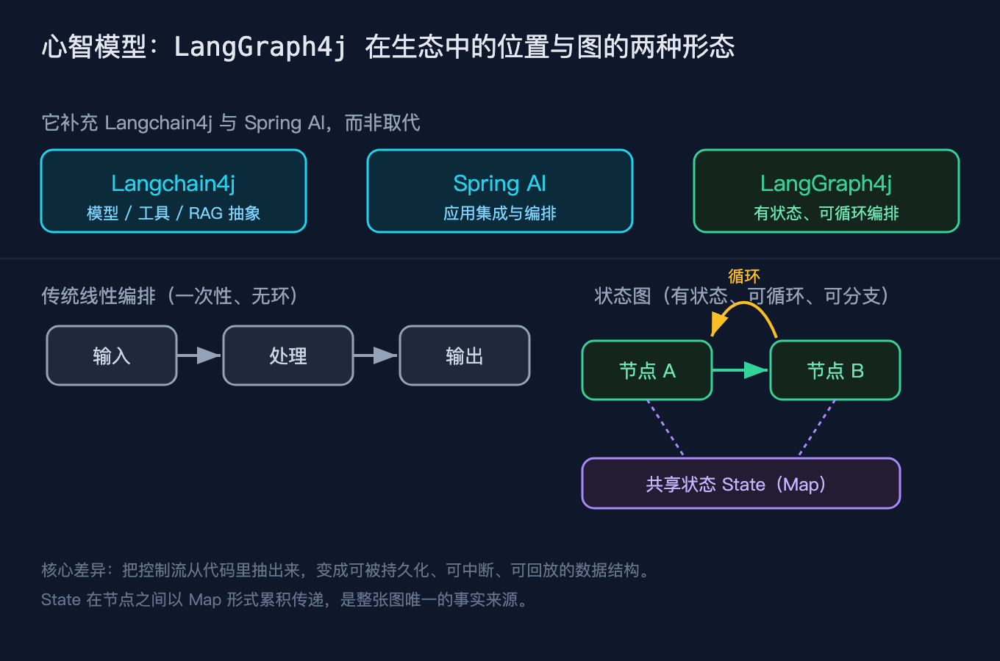
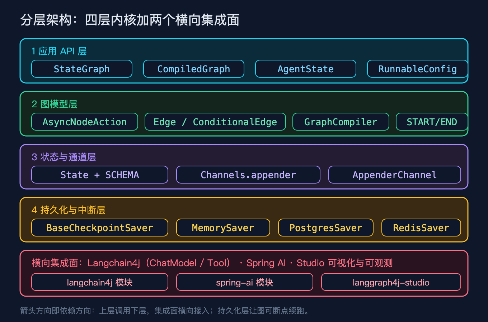
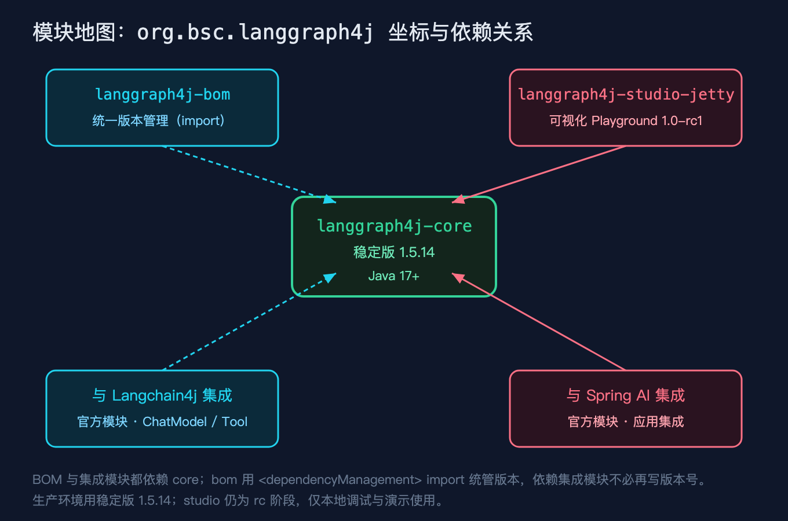
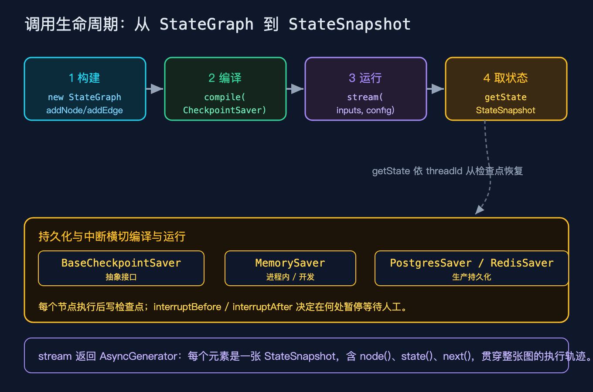

# LangGraph4j之一：客服请求分诊既要循环又要分流，我用 LangGraph4j 把控制流抽成了数据

我接过一个真实的活：客服请求进来，先分类，账单类走账单专员，其它走通用专员，账单类处理完还要做二次校验再回流。一开始我用一串 if else 加递归硬写，分支一多，循环和回溯的逻辑就糊在业务代码里，谁改谁怕。后来我换成了 LangGraph4j，把这张图当成数据结构来声明，循环和分流都成了图的边。这篇先把整体架构和「它到底是什么」讲清楚，后面的篇章再逐层拆源码。

文中所有 API 与行为都来自我对 `langgraph4j-core` 1.5.14 源码的一手复核，不是看文档猜的。

这个系列一共九篇，本篇只做一件事：把整体架构和「它到底是什么」讲清楚。后续八篇按顺序拆图模型与节点边、状态与通道、运行引擎与流式、持久化与断点续跑、人工中断、Langchain4j 集成、Spring AI 集成、可视化与可观测。规划不单列成文档，跟着正文走就行。

## 三个先要厘清的概念

很多人第一次听到 LangGraph4j，会把它和 Langchain4j 混为一谈。动手之前，有三个概念必须先分清。

### 它不是 Langchain4j 的替代品

Langchain4j 给你的是模型、工具、RAG 这些抽象；Spring AI 给你的是应用集成与编排。LangGraph4j 不做这些，它只解决一件事：把有状态、可循环、可分支的控制流，从你的代码里抽出来，变成可被持久化、可中断、可回放的数据结构。三者是互补关系，不是谁取代谁。你照样在节点里调 Langchain4j 的 ChatModel，只不过编排这块交给 LangGraph4j。



### 图不是 DAG，它支持环和分支

传统编排是一张有向无环图，跑一遍就结束。LangGraph4j 的图是通用状态图，节点之间可以循环，也可以按条件走不同分支。我那个「二次校验再回流」的需求，本质就是一个循环边，用状态图声明只要一条回边，用普通编排就得自己压栈递归。这也是为什么它叫 LangGraph 而不是 LangDAG。

### State 是一个被节点共享的 Map

图里没有「我把变量传给下一个节点」这种事。所有节点读写的是同一份状态，这份状态底层就是一个 Map。每个节点只返回自己要更新的那一小块键值，框架按通道规则把小块合并回大 Map。节点之间唯一的真相来源，就是这个被共享的 State。理解这一点，后面所有关于持久化、回溯、并发的讨论才站得住脚。

## 它到底是什么：一句话定义与分层架构

先把本质钉死：LangGraph4j 是一个用 Java 写、把「有状态、可循环、可分支」的执行流建模成图的库。你声明节点和边，框架负责按图驱动执行、维护共享状态、在每一步落检查点。

把 LangGraph4j 拆开看，核心由四层内核加两个横向集成面组成。



最上面是应用 API 层，你日常打交道的是 `StateGraph`、`CompiledGraph`、`AgentState`、`RunnableConfig`。`StateGraph` 是构建期的入口，你往里加节点和边；`CompiledGraph` 是运行期的入口，你拿它来 stream 或 invoke。往下一层是图模型层，节点动作 `AsyncNodeAction`、边与条件边、`START` 和 `END` 这两个哨兵节点都在这里。再往下是状态与通道层，`State` 加它的 schema、各种 `Channel` 决定状态怎么合并。最底下的持久化与中断层，是 `BaseCheckpointSaver` 和它的几个实现，让图能断点续跑。横向的集成面，把 Langchain4j、Spring AI 和 studio 可视化接进来。

这四层里有一个动作要特意拎出来讲：从 `StateGraph` 到 `CompiledGraph` 之间有一个 `compile`。它不是编译成字节码，而是把你在构建期声明的图做一次装配，校验边的连通性、把检查点保存器挂上去、把状态序列化器接好。编译之后你拿到的是一个随时可以跑、并且自带持久化能力的可执行对象。这条「先声明再编译后运行」的链路，是整个库的心跳。

## Maven 坐标与模块地图

生产上你只需要依赖一个稳定核心：

```
org.bsc.langgraph4j:langgraph4j-core:1.5.14
```

它要求 Java 17 及以上。还有一张 BOM 用 `dependencyManagement` 统一版本管理，集成模块（Langchain4j 模块、Spring AI 模块）都依赖这张核心，引入 BOM 之后就不必再写版本号。studio 那张可视化 Playground 目前还是 rc 阶段，只适合本地调试和演示。



## 一次调用会经历什么：从 StateGraph 到 StateSnapshot

你声明完图，整段执行会走四个阶段：先用 `new StateGraph` 配合 `addNode`、`addEdge` 构建；再 `compile` 并挂上检查点保存器；然后 `stream` 或 `invoke` 带着输入和配置运行；最后用 `getState` 按线程号把状态快照取回来。



`stream` 返回的是一个异步生成器，每个元素是一张 `StateSnapshot`，里面带着当前节点名、状态体和下一个要跑的节点。编译时挂上的检查点保存器会横切编译与运行两个阶段，每跑完一个节点就写一次检查点，所以你能在任意节点之后暂停、等人工处理、再从检查点恢复。这里有个细节值得记住：`getState` 在没有挂保存器、也没有检查点时会直接抛 `IllegalStateException`，不是返回空，这点后面讲持久化时会再展开。

## 一个能跑的最小例子

下面这张图不调任何真实大模型，全部是确定性逻辑，所以输出可以逐字符复现。它正是我开头说的「客服请求分诊」的简化版：先 classify 分类，账单类走 handleBilling，其它走 handleGeneral，两类处理完都指向 END。

```java
// 自定义状态：本质仍是一个共享的 Map，额外提供工厂方法供框架重建状态对象
static class MyState extends AgentState {
    public MyState(Map<String, Object> initData) { super(initData); }
    static final AgentStateFactory<MyState> FACTORY = MyState::new;
}

// 状态 schema：messages 是累积通道，列表跨节点追加而不是覆盖
Map<String, Channel<?>> channels = new HashMap<>();
channels.put("messages", Channels.appender(() -> new ArrayList<>()));

StateGraph<MyState> g = new StateGraph<>(channels, MyState.FACTORY);

// 节点：classify 读 request，决定走哪条分支
g.addNode("classify", node(s -> {
    String req = (String) s.value("request").orElse("");
    String lane = req.contains("账单") ? "billing" : "general";
    return Map.of("lane", lane);
}));
g.addNode("handleBilling", node(s -> Map.of("messages", List.of("账单专员已受理"))));
g.addNode("handleGeneral", node(s -> Map.of("messages", List.of("通用客服已受理"))));

// 边：START -> classify；classify 之后按 lane 条件路由；两个处理节点都指向 END
g.addEdge(StateGraph.START, "classify");
AsyncEdgeAction<MyState> route = s ->
    CompletableFuture.completedFuture((String) s.value("lane").orElse("general"));
g.addConditionalEdges("classify", route,
    Map.of("billing", "handleBilling", "general", "handleGeneral"));
g.addEdge("handleBilling", StateGraph.END);
g.addEdge("handleGeneral", StateGraph.END);

// 编译，并挂上内存检查点（按线程隔离的持久化）
CompiledGraph<MyState> graph =
    g.compile(CompileConfig.builder().checkpointSaver(new MemorySaver()).build());
```

这段代码里有两个点值得停一下。`StateGraph` 的构造器接收通道 schema 和状态工厂，框架序列化的是状态里的那份 Map，而不是 `MyState` 对象本身，重建时再用工厂把 Map 变回对象。`Channels.appender` 返回的是累积通道，同名的消息列表会跨节点追加，所以账单专员追加的那条记录不会覆盖分类阶段写下的 `lane`。

场景 A 是含「账单」的请求，走 billing 分支，我用 `stream` 把整条生命周期打出来；场景 B 是不含「账单」的请求，我用 `invoke` 直接拿最终状态。实际运行结果（已实跑，可复现）如下：

```
场景A 生命周期        = [__START__, classify, handleBilling, __END__]
场景A final.lane      = billing
场景A final.messages  = [账单专员已受理]
场景A checkpoint.lane = billing
场景B final.lane      = general
场景B final.messages  = [通用客服已受理]
场景B checkpoint.lane = general
```

你可以对照开篇那张调用生命周期图：生命周期 `[__START__, classify, handleBilling, __END__]` 正是四个阶段在跑通之后的节点轨迹。`checkpoint.lane` 等于 `final.lane`，说明检查点确实把状态落了下来，后面换线程号取回的也是同一份事实。

## 复现模块

代码地址：本篇工作目录下的 `code/repro/`（后续会镜像到 GitHub 仓库 `beverlyLee/ai-passage`，目前尚未推送）。

数据源地址：`org.bsc.langgraph4j:langgraph4j-core:1.5.14`，来自 Maven Central。

运行命令（在 `code/repro/` 目录下）：

```
mvn -q compile
mvn dependency:build-classpath -Dmdep.outputFile=cp.txt
java -cp "target/classes:$(cat cp.txt)" org.example.langgraph4j.Demo1
```

精确预期输出：

```
场景A 生命周期        = [__START__, classify, handleBilling, __END__]
场景A final.lane      = billing
场景A final.messages  = [账单专员已受理]
场景A checkpoint.lane = billing
场景B final.lane      = general
场景B final.messages  = [通用客服已受理]
场景B checkpoint.lane = general
```

复现性自测：

```
java -cp "target/classes:$(cat cp.txt)" org.example.langgraph4j.Demo1 --self-test
```

预期打印 `self-test PASS`，退出码为 0。

## 结尾钩子

回到开头那个场景：如果你的分诊逻辑也像我一样，既要循环又要分流，你现在的控制流是写死在代码里的，还是被抽成了可以回放的数据？你手上正在做的编排，哪一部分其实是一张状态图？下一篇我们拆之二，从 `StateGraph` 的声明与编译开始，看这张图在编译期到底被做成了什么。

## 如果你要把它讲给别人听

三句话就够了：LangGraph4j 不是 Langchain4j 的替代品，它补的是有状态、可循环的控制流；它画的图不是 DAG，可以循环可以分支；节点之间共享的那份真相是一个 Map，每个节点只返回自己要更新的小块，由通道规则合并回去。
