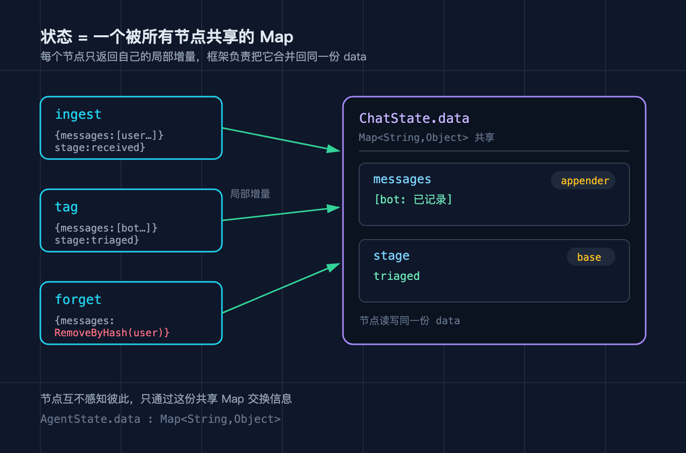
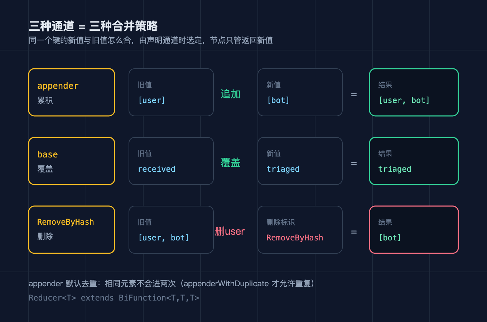
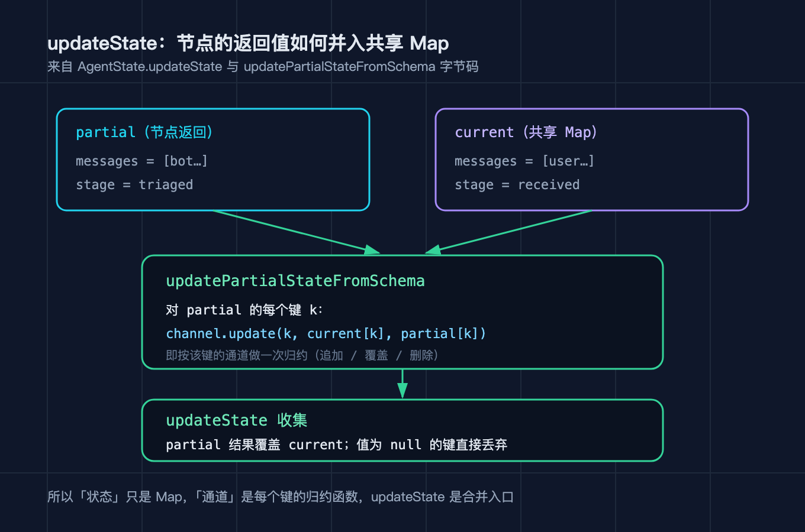

# LangGraph4j之三：状态与通道

我把上一篇那个客服分流器往下做了一层。分流器跑起来之后，我很快撞上一个真实需求：机器人越聊话越多，每一轮都得把之前的对话都带在状态里，可有些话是临时的，比如用户发错、改口，或者我不该记住的敏感内容，得能让它忘掉。更麻烦的是，不同信息的合并方式根本不一样：对话历史要一条条累加，当前处理阶段是后来的覆盖前一个，而某一条具体消息要能按内容删掉。我一开始在一个大 Map 里手动写 if else 去区分这三种合并，写到三十行就越写越乱，还老分不清哪条消息该留该删。后来我才看懂，LangGraph4j 把这件事拆成了两半：状态本身只是一个被所有节点共享的 Map，每个键配一个通道，通道专门决定这个键的新值怎么和旧值合并。这篇我专门拆状态与通道这一层。

文中所有 API 与行为都来自我对 `langgraph4j-core` 1.5.14 源码和字节码的一手复核，不是看文档猜的。

这个系列一共九篇，本篇只做一件事：把状态与通道这一层拆透，重点讲一份共享 Map 是怎么被合并出来的。后续六篇按顺序拆运行引擎与流式、持久化与断点续跑、人工中断、Langchain4j 集成、Spring AI 集成、可视化与可观测。规划不单列成文档，跟着正文走就行。

## 三个先要厘清的概念

很多人一上手就以为状态是「每个节点各自一份、用完再合并回来」，于是拼命在节点之间倒腾数据。动手之前，有三个概念必须先分清。

### 状态只是一个被所有节点共享的 Map

`AgentState` 这个类，源码里核心就一个字段：`private final Map<String,Object> data`。它对外暴露 `data()`、`value(String)` 这些方法，但底下都是在这一份 Map 上读读写写。节点之间从不直接传对象，一个节点跑完，返回的是「我想更新的那几个键值」，也就是一张局部的小 Map，框架再把它合并进那份共享的 `data`。所以状态不是流水线上的包裹，不是从这个节点递到那个节点，它是一块所有节点都能读写的公共黑板。这也解释了为什么下一篇要讲的子图能和父图共享状态：它们操作的自始至终是同一份 `data`。



### 通道是每个键的合并策略

那「新值怎么和旧值合并」这件事，到底谁说了算？答案是通道。声明图的时候你会传一张 `Map<String,Channel<?>>`，一个键对应一个 `Channel`，这个通道就绑定了该键的合并规则。通道背后是一个 `Reducer<T>`，它的定义是 `interface Reducer<T> extends BiFunction<T,T,T>`，也就是「旧值和新值进去，一个新值出来」。最常用的两个工厂方法在 `Channels` 接口上：`Channels.appender(Supplier)` 得到的是会把新 List 追加进旧 List 的通道，`Channels.base(Supplier)` 得到的是新值直接覆盖旧值的通道。换句话说，状态里每个键是累加还是覆盖，不是节点运行时决定的，是你在建图时用通道声明死的。



### updateState 是合并的入口

节点返回的局部 Map，不是直接 `put` 进共享 Map 的，中间隔着一层 `AgentState.updateState`。我把它的字节码读了一遍，流程是这样的：先调 `updatePartialStateFromSchema`，对着局部 Map 的每个键，取该键对应的通道，执行一次 `channel.update(键, 当前旧值, 节点新值)`，拿到归约后的值；然后再把旧状态和这份归约结果并起来，归约结果覆盖旧值，值为 null 的键直接丢弃。所以一次合并其实是两步：先逐键按各自的通道归约，再整体收集、新值胜出、扔到 null。这也解释了为什么你不能靠返回一个 null 去「清空」某个键。



## AgentState 到底装着什么

把 `AgentState` 拆开看，它比你想象的空。一个 `private final Map<String,Object> data`，外加一个静态的合并入口。它提供两类读方法：`value(String)` 返回 `Optional`，`value(String, T)` 和 `value(String, Supplier)` 提供带默认值的读法。真正关键的是那两个静态方法 `updateState(Map current, Map partial, Map<String,Channel<?>>)` 和它的 `AgentState` 重载。前者是引擎每个节点跑完后调用的地方。我读字节码时特别确认了参数顺序：引擎调用通道时传的是 `channel.update(key, currentState.get(key), entry.getValue())`，也就是第二个参数是旧值、第三个参数才是节点返回的新值。这个顺序在理解 appender 的删除分支时是决定性的，我一开始就把它搞反了。

## 三种合并，逐个拆

回到我那个要能「忘记」的机器人。我用了两个通道：`messages` 挂 `Channels.appender`，`stage` 挂 `Channels.base`。

appender 通道的实现在 `AppenderChannel` 里，它自己重写了 `update`。节点返回的 List 会被规范化之后追加进旧 List。默认的 `Channels.appender(Supplier)` 用的 reducer 是 `ReducerDisallowDuplicate`，也就是相同的元素不会进第二次；如果你确实想留重复，得显式用 `Channels.appenderWithDuplicate(Supplier)`，它换成了 `ReducerAllowDuplicate`。这就是为什么同样是「往列表里加」，加两条一样的文本，第二次会凭空消失。

base 通道走的是 `Channel` 接口的默认 `update`：新值非空时 `reducer.apply(新值, 旧值)`，它的 reducer 是最后写赢的 `(a, b) -> a`，所以新值直接覆盖旧值。我的 `stage` 从 received 被下一个节点写成 triaged，靠的就是这个。

最妙的是删除。`AppenderChannel.update` 里有一条分支：当旧值是 List、而新值是一个 `RemoveIdentifier` 时，它走的是 `remove`，只删不加。框架给了一个现成的删除标识 `RemoveByHash`，它按元素内容比对，`compareTo` 返回 0 就删。于是我在 forget 节点返回 `RemoveByHash.of("user: 我要退货")`，那条消息就被从累积列表里精准摘掉了，别的消息原地不动。

## 我踩过的四个坑

第一个坑，appender 默认去重。我往 `messages` 里连着加了两条一模一样的确认语，结果第二条像掉进了黑洞。排查半天才发现 `Channels.appender` 默认挂的是去重 reducer。解法是要么保证每条消息内容唯一，要么改用 `appenderWithDuplicate`。

第二个坑，一个节点里既想删又想加，行不通。我图省事，在 forget 节点里同时返回一条新消息和一个 `RemoveByHash`，结果只有删除生效，新消息没进去。回头看字节码就明白了：新值是 `RemoveIdentifier` 时走的是「只删不加」的 remove 分支。解法是把追加和删除拆成两个节点。

第三个坑，返回 null 清空不了键。我想把某个标记重置成空，节点里返回了 `key -> null`，结果旧值还在。因为 `updateState` 收集时会把值为 null 的键直接丢弃，根本到不了覆盖那一步。解法是想清空就写一个空值（比如空字符串或空列表），而不是 null。

第四个坑，appender 的默认值给了不可变 List。我一开始用 `List.of()` 当默认列表，一追加就抛 `UnsupportedOperationException`。`AppenderChannel` 会捕获这个异常、打一条日志提示「可能用了不可变 List」再抛出来。解法是默认 provider 必须返回 `new ArrayList<>()`。

## 一个能跑的最小例子

下面这张图不调任何真实大模型，全部是确定性逻辑，所以输出可以逐字符复现。它演示三种合并：ingest 和 tag 各自往 `messages` 追加一条（累积），并把 `stage` 覆盖成新值（覆盖），最后 forget 用 `RemoveByHash` 删掉那条用户消息（删除）。

```java
// 状态 schema：messages 是 appender 累积通道，stage 是 base 覆盖通道
Map<String, Channel<?>> channels = new HashMap<>();
channels.put("messages", Channels.appender(() -> new ArrayList<>()));
channels.put("stage", Channels.base(() -> ""));

StateGraph<ChatState> g = new StateGraph<>(channels, ChatState.FACTORY);

// ingest：追加一条用户消息，同时把 stage 覆盖成 received
g.addNode("ingest", node(s -> Map.of(
        "messages", List.of("user: 我要退货"),
        "stage", "received")));
// tag：再追加一条机器人消息（于是累积成两条），stage 覆盖成 triaged
g.addNode("tag", node(s -> Map.of(
        "messages", List.of("bot: 已记录"),
        "stage", "triaged")));
// forget：返回一个 RemoveByHash 删除标识，删掉「user: 我要退货」这一条
g.addNode("forget", node(s -> Map.of(
        "messages", RemoveByHash.of("user: 我要退货"))));

g.addEdge(StateGraph.START, "ingest");
g.addEdge("ingest", "tag");
g.addEdge("tag", "forget");
g.addEdge("forget", StateGraph.END);
```

实际运行结果（已实跑，可复现）如下：

```
生命周期          = [__START__, ingest, tag, forget, __END__]
final.messages   = [bot: 已记录]
final.stage      = triaged
```

你可以对照着看：`final.messages` 只剩 `[bot: 已记录]`，说明 ingest 和 tag 各自追加过一条、累积成功，随后 forget 又按内容把 `user: 我要退货` 删掉，只剩 bot 那条；`final.stage` 是 `triaged` 而不是 received，说明 base 通道是后来的值覆盖前一个。三种合并语义，一张共享 Map，全在这三行输出里。

## 复现模块

代码地址：本篇工作目录下的 `code/repro/`（后续会镜像到 GitHub 仓库 `beverlyLee/ai-passage`，目前尚未推送）。

数据源地址：`org.bsc.langgraph4j:langgraph4j-core:1.5.14`，来自 Maven Central。

运行命令（在 `code/repro/` 目录下）：

```
mvn -q compile
mvn dependency:build-classpath -Dmdep.outputFile=cp.txt
java -cp "target/classes:$(cat cp.txt)" org.example.langgraph4j.Demo3
```

精确预期输出：

```
生命周期          = [__START__, ingest, tag, forget, __END__]
final.messages   = [bot: 已记录]
final.stage      = triaged
```

复现性自测：

```
java -cp "target/classes:$(cat cp.txt)" org.example.langgraph4j.Demo3 --self-test
```

预期打印 `self-test PASS`，退出码为 0。这个自测把三种合并的结论写成了断言：messages 最终只剩一条且不含被删的那条，stage 被覆盖成 triaged。

## 结尾钩子

回到开头那个要「忘记」的机器人：你现在系统里的那份对话历史，每一轮是有人按规则逐条合并的，还是干脆整体替换？如果哪天产品说「把用户半小时前那条敏感消息从上下文里抹掉」，你的状态层是能按内容精准删除，还是只能连锅端、整段重来？想清楚这个，你就明白通道不是语法糖，是状态合并的决策点。下一篇我们拆运行引擎与流式，看节点是凭什么顺序被一个个驱动起来的，`stream` 吐出来的每一帧又到底承载了什么。

## 如果你要把它讲给别人听

三句话就够了：状态只是一个被所有节点共享的 Map，节点返回局部增量、由框架合并，彼此不直接传对象；每个键配一个通道，通道就是该键的合并策略，appender 累积、base 覆盖、RemoveByHash 按内容删除；合并的入口是 AgentState.updateState，先逐键按通道归约，再整体让新值胜出、丢掉 null。
