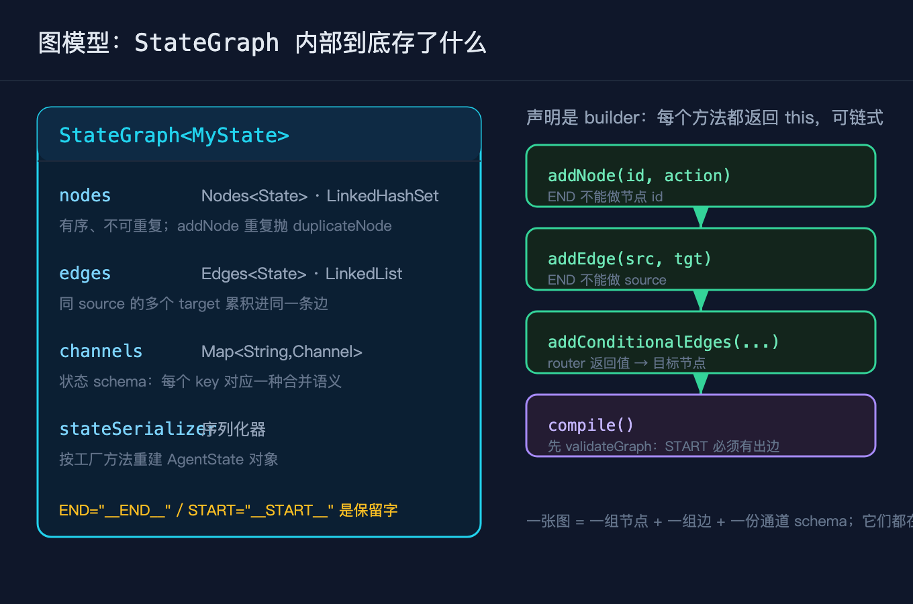
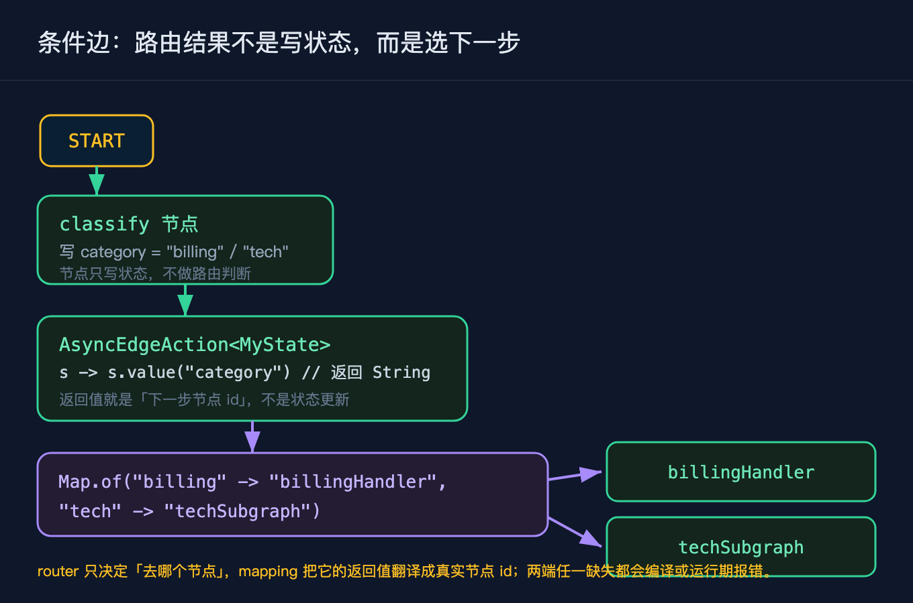
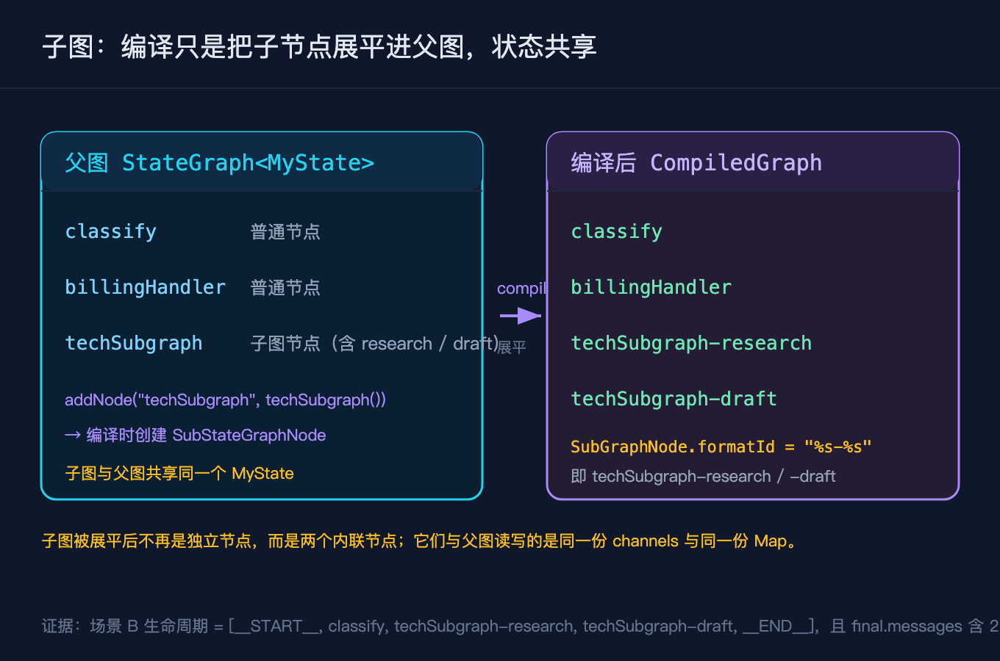

# LangGraph4j之二：图模型与节点边

我前一篇把整体架构讲完之后，就动手写了一个真实的客服分流器。需求是这样的：一条用户消息进来，先分类，说退款的丢进退款工单队列，说技术问题的，丢给一个「检索论文加起草方案」的子流程。一开始我把分类、路由、子流程全部揉在一段循环加递归里，子流程一多，状态在父子之间怎么传、怎么回，就成了说不清的黑箱。后来我用 LangGraph4j 把这张图画成了数据，分类是一个节点，路由是一条条件边，子流程是另一张图被当成一个节点挂进来。这篇我专门拆图模型这一层：节点和边到底怎么声明，条件边凭什么能决定下一步去哪，子图又为什么不会变成嵌套调用。

文中所有 API 与行为都来自我对 `langgraph4j-core` 1.5.14 源码的一手复核，不是看文档猜的。

这个系列一共九篇，本篇只做一件事：把图模型与节点边这一层拆透，重点讲条件边和子图。后续七篇按顺序拆状态与通道、运行引擎与流式、持久化与断点续跑、人工中断、Langchain4j 集成、Spring AI 集成、可视化与可观测。规划不单列成文档，跟着正文走就行。

## 三个先要厘清的概念

很多人一上手就调 `addNode`、写路由，结果跑起来和预期对不上。动手之前，有三个概念必须先分清。

### StateGraph 是构建期的容器，不是执行引擎

`StateGraph` 这个名字容易让人以为它是「图」本身。源码里它就是一个容器，内部持着 `nodes`（一个按插入顺序的 `LinkedHashSet`）、`edges`（一个 `LinkedList`）、`channels`（一张 `Map<String,Channel<?>>`）和 `stateSerializer`。你调 `addNode`、`addEdge` 只是往这些集合里塞数据，图不会在这时候跑起来。真正能跑的是 `compile` 之后拿到的 `CompiledGraph`。所以 `StateGraph` 是声明期，`CompiledGraph` 才是运行期，两者不能混为一谈。



### 条件边返回的不是状态，是下一步的节点 id

普通节点返回的是状态里要更新的那一小块键值，框架拿去合并。条件边不一样：`addConditionalEdges` 的第一个参数是一个 `AsyncEdgeAction<S>`，它的签名是 `Function<S, CompletableFuture<String>>`，返回值是一个字符串，这个字符串就是「下一步去哪个节点」。它根本不碰状态合并那套逻辑。很多人第一次写会以为条件边也要回写某个字段，其实它只负责选路。真正的路由翻译发生在第二个参数 `Map<String,String>`：把 `AsyncEdgeAction` 的返回值映射到真实节点 id，比如 `"billing"` 映射到 `"billingHandler"`。



### 子图是被展平的，不是运行期递归调用

把一张 `StateGraph` 当成节点挂进父图，用的是 `addNode(String, StateGraph)`。源码里这会创建一个 `SubStateGraphNode`。但子图不会在运行期被当成「独立的小图递归遍历」，而是在编译期被展平：父图里那个 `techSubgraph` 节点，编译之后变成了 `techSubgraph-research` 和 `techSubgraph-draft` 两个内联节点。这一点很关键，因为它决定了子图和父图之间的关系：它们读写的是同一份状态，子图追加的消息会直接落进父图的 `messages` 通道，不存在「子图自己的状态然后合并回来」这回事。



## StateGraph 到底装着什么

把 `StateGraph` 拆开看，声明一张图时你其实在填三样东西加一个序列化器。第一样是节点集合 `nodes`，每个节点是一对 `String id` 加它的动作 `AsyncNodeAction`。`END` 这两个下划线包裹的保留字不能当节点 id 用，重复加同一个 id 会抛 `duplicateNodeError`。第二样是边集合 `edges`，分普通边和条件边，同一个源节点挂多条普通边，目标会累积进同一条 `Edge` 记录里。`END` 不能作普通边的源，因为它是终点。第三样是 `channels`，这张 `Map` 决定了状态里每个键怎么合并，这也是下一篇要专门讲的内容。最后 `stateSerializer` 负责把状态序列化，给后面的断点续跑用。

这里有两个声明期就要踩到的坑。第一，普通边和条件边都要从合法的源出发，`validateGraph` 会检查 `START` 必须有一条出边，否则抛 `missingEntryPoint`。第二，`addConditionalEdges` 的映射表不能是空，`Map` 为空会抛 `edgeMappingIsEmpty`，重复挂同一源的条件边会抛 `duplicateConditionalEdgeError`。这些都不是运行期才报，而是在 `compile` 的时候就把图结构验一遍。

## 条件边：路由是怎么选出来的

回到我那个分流器。分类节点 `classify` 只做一件事：读 `request`，含「退款」就写 `category="billing"`，否则写 `category="tech"`。注意它只写状态，不决定下一步去哪。决定下一步的是 `AsyncEdgeAction`：它从状态里取 `category` 的值，作为字符串返回。然后 `Map.of("billing","billingHandler","tech","techSubgraph")` 把这个字符串翻译成真实节点 id。两段拼起来，才完成一次路由。

这里面有一个容易混淆的点：路由的判断逻辑（读 `category`）和路由的翻译表（`Map`）是分开的。判断逻辑写在 `AsyncEdgeAction` 里，返回的是「语义值」；翻译表写在 `addConditionalEdges` 的第三个参数里，负责把语义值变回节点 id。好处是同一套判断可以换一张翻译表就接到不同的物理节点上，路由的「含义」和「落点」解耦了。

## 子图：为什么它不会变成嵌套迷宫

我的技术分支是一个独立的小流程：`research` 检索论文，`draft` 起草方案，二者串成 `START → research → draft → END`。它本身就是一张 `StateGraph`，通过 `g.addNode("techSubgraph", techSubgraph())` 挂进父图。编译之后，父图里不再有 `techSubgraph` 这个独立节点，而是直接多出 `techSubgraph-research` 和 `techSubgraph-draft`，节点 id 的拼接规则是 `SubGraphNode.formatId` 用的 `"%s-%s"`。

证据就在运行结果里：场景 B 走技术分支，它的生命周期是 `[__START__, classify, techSubgraph-research, techSubgraph-draft, __END__]`，你能直接看到子图的两个节点被展平进了父图的生命周期。而且场景 B 的 `final.messages` 是两条，分别是子图两个节点各追加的一条，它们和父图 `classify` 写下的 `category` 同处一份状态，没有经过任何跨图合并。所以我说子图和父图共享状态，不是在打比方，是源码结构和实跑结果共同印证的。

## 一个能跑的最小例子

下面这张图不调任何真实大模型，全部是确定性逻辑，所以输出可以逐字符复现。它正是我那个客服分流器的完整版：先 `classify` 分类，退款走 `billingHandler`，技术走 `techSubgraph` 子图，两个分支都指向 `END`。

```java
// 父图 channels：messages 是累积通道，category 用 base 通道（最后写赢），只用于路由
Map<String, Channel<?>> channels = new HashMap<>();
channels.put("messages", Channels.appender(() -> new ArrayList<>()));
channels.put("category", Channels.base(() -> ""));

StateGraph<MyState> g = new StateGraph<>(channels, MyState.FACTORY);

// 节点一：classify 只写状态 category，不做路由判断
g.addNode("classify", node(s -> {
    String req = (String) s.value("request").orElse("");
    String cat = req.contains("退款") ? "billing" : "tech";
    return Map.of("category", cat);
}));
g.addNode("billingHandler", node(s -> Map.of("messages", List.of("[账单] 已进入退款工单队列"))));

// 节点二：把另一张 StateGraph 当成一个节点挂进来（子图）
g.addNode("techSubgraph", techSubgraph());

// 边：START -> classify；classify 之后按 category 条件路由
g.addEdge(StateGraph.START, "classify");
AsyncEdgeAction<MyState> route = s ->
    CompletableFuture.completedFuture((String) s.value("category").orElse("tech"));
g.addConditionalEdges("classify", route,
    Map.of("billing", "billingHandler", "tech", "techSubgraph"));
g.addEdge("billingHandler", StateGraph.END);
g.addEdge("techSubgraph", StateGraph.END);
```

子图本身也是一张 `StateGraph`，自成一个小流程，挂进父图后与其共享状态：

```java
static StateGraph<MyState> techSubgraph() {
    var g = new StateGraph<>(MyState.FACTORY);
    g.addNode("research", node(s -> Map.of("messages", List.of("[子图] 已检索相关论文"))));
    g.addNode("draft", node(s -> Map.of("messages", List.of("[子图] 已起草技术方案"))));
    g.addEdge(StateGraph.START, "research");
    g.addEdge("research", "draft");
    g.addEdge("draft", StateGraph.END);
    return g;
}
```

这段代码里有两个点值得停一下。`StateGraph` 在声明期只装数据，`compile` 之后才拿到能跑的 `CompiledGraph`，编译这一步会校验 `START` 出边、把检查点保存器挂上、把子图展平。`addNode("techSubgraph", techSubgraph())` 创建的是 `SubStateGraphNode`，但编译时被展平成 `techSubgraph-research` 和 `techSubgraph-draft`，它们和父图读写同一份状态，所以子图追加的消息直接进父图的 `messages`。

场景 A 是含「退款」的请求，走 billing 分支；场景 B 是不含「退款」的请求，走 tech 分支并进入子图。实际运行结果（已实跑，可复现）如下：

```
场景A 生命周期       = [__START__, classify, billingHandler, __END__]
场景A final.category = billing
场景A final.messages = [[账单] 已进入退款工单队列]
场景B 生命周期       = [__START__, classify, techSubgraph-research, techSubgraph-draft, __END__]
场景B final.category = tech
场景B final.messages = [[子图] 已检索相关论文, [子图] 已起草技术方案]
场景B 子图共享状态    = true
```

你可以对照前面两张图：场景 A 的生命周期 `[__START__, classify, billingHandler, __END__]` 印证了 `classify` 把 `category` 写成 billing，条件边翻译到 `billingHandler`。场景 B 的生命周期直接出现了 `techSubgraph-research` 和 `techSubgraph-draft`，正是子图被展平进父图的证据；而 `final.messages` 的两条分别来自子图两个节点，说明子图没有自己的状态副本，它和父图共用那一份 Map。

## 复现模块

代码地址：本篇工作目录下的 `code/repro/`（后续会镜像到 GitHub 仓库 `beverlyLee/ai-passage`，目前尚未推送）。

数据源地址：`org.bsc.langgraph4j:langgraph4j-core:1.5.14`，来自 Maven Central。

运行命令（在 `code/repro/` 目录下）：

```
mvn -q compile
mvn dependency:build-classpath -Dmdep.outputFile=cp.txt
java -cp "target/classes:$(cat cp.txt)" org.example.langgraph4j.Demo2
```

精确预期输出：

```
场景A 生命周期       = [__START__, classify, billingHandler, __END__]
场景A final.category = billing
场景A final.messages = [[账单] 已进入退款工单队列]
场景B 生命周期       = [__START__, classify, techSubgraph-research, techSubgraph-draft, __END__]
场景B final.category = tech
场景B final.messages = [[子图] 已检索相关论文, [子图] 已起草技术方案]
场景B 子图共享状态    = true
```

复现性自测：

```
java -cp "target/classes:$(cat cp.txt)" org.example.langgraph4j.Demo2 --self-test
```

预期打印 `self-test PASS`，退出码为 0。

## 结尾钩子

回到开头那个分流器：如果你也写过类似的「先分类再分流、分流里还套着子流程」的逻辑，你现在的子流程状态，是和主流程共用一份真相，还是各自维护一份然后费力合并？你手上的图，编译之后子图节点是真的被展平进了父图，还是藏在一层递归里？下一篇我们拆之三，从 `AgentState` 和 `Channel` 开始，看那份被所有节点共享的状态，到底是怎么合并出来的。

## 如果你要把它讲给别人听

三句话就够了：StateGraph 是声明期的容器，不是执行引擎，真正能跑的是 compile 之后的 CompiledGraph；条件边返回的是下一步的节点 id，不碰状态合并；子图在编译期被展平进父图，和父图共享同一份状态，不递归、不独立。
