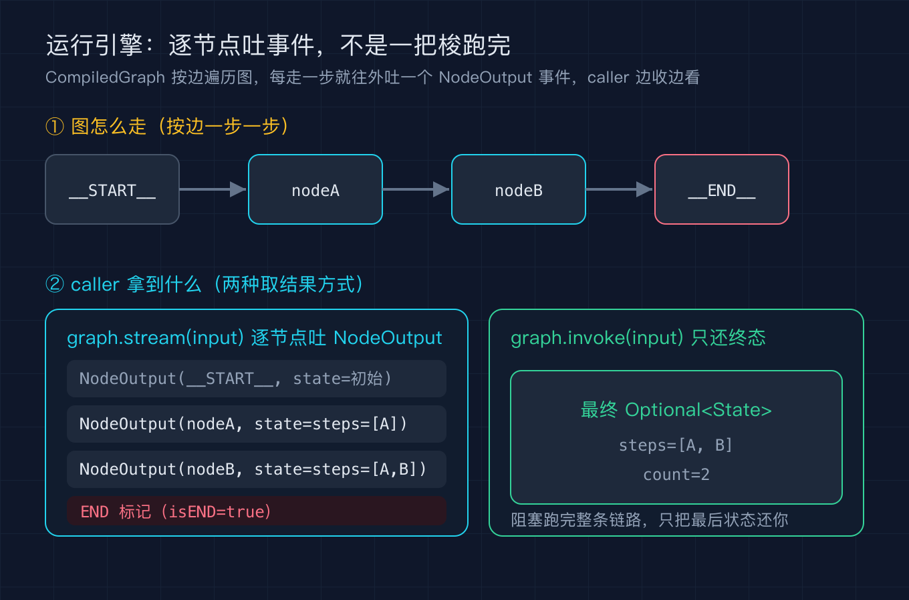
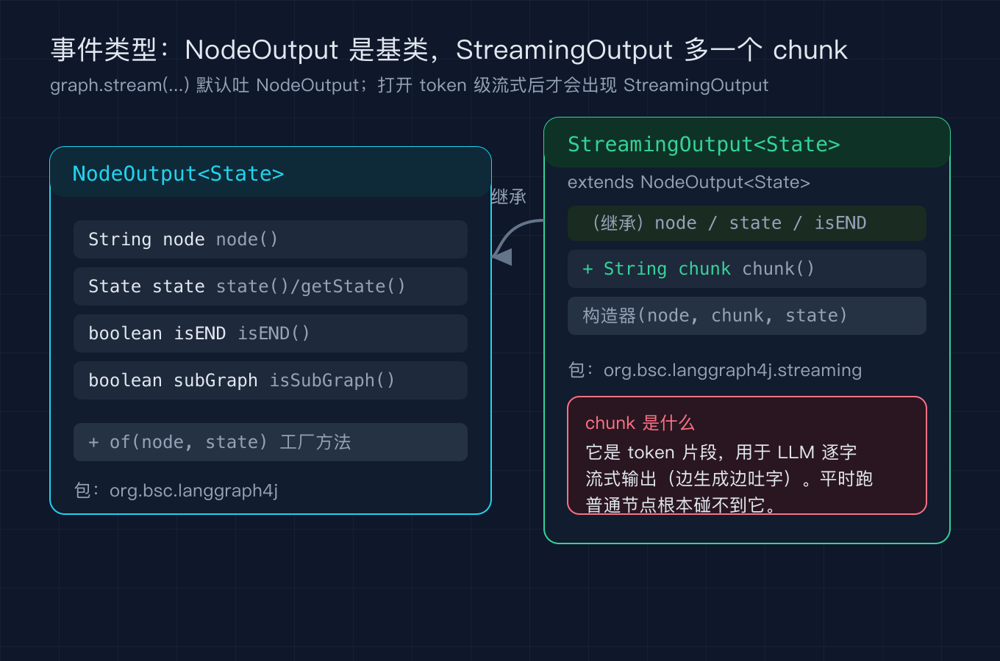
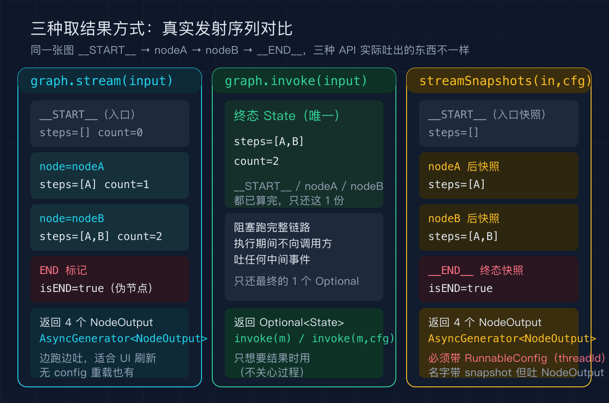

# LangGraph4j之四：运行引擎与流式

系列规划一句话：本篇只讲一件事，编译出来的图是怎么一边沿着边往前走、一边把过程吐给你的，这是后面讲持久化和断点续跑的地基。

我在前面三篇把图的建模、状态通道、条件分支拆完了。这一篇往下走一层，看 `StateGraph.compile()` 之后拿到的 `CompiledGraph` 到底是怎么跑的。很多人第一次用 langgraph4j 都会卡在一个问题上：我调的是 `graph.stream(...)` 还是 `graph.invoke(...)`，它们返回的东西为什么长得不一样。这个问题的答案不在文档里，在字节码里，所以我这一篇依然用 `javap` 对着 `langgraph4j-core 1.5.14` 的 class 文件逐一核实，不靠猜。

## 概念澄清一：编译后的图是个状态机，引擎只是沿边推进

先建立一个最朴素的画面。`StateGraph` 在 `compile()` 之后变成一个 `CompiledGraph`，它内部持有所有节点、边、条件函数和状态模式。运行的时候，引擎从一个固定的入口伪节点 `__START__` 出发，按你连的边一个节点一个节点地走，直到走到出口伪节点 `__END__` 才停。中间每一个节点跑完，都会用它的返回值去更新状态通道，再决定下一个要走哪个节点。

我用一条最简单的线性图来演示，三个真实节点之间的推进关系如下。



图①里 `__START__` 和 `__END__` 是框架内置的常量，`StateGraph` 里写成 `START`（值是 `__START__`）和 `END`（值是 `__END__`）。你连边的时候写 `g.addEdge(START, "nodeA")`，引擎就把入口和你的第一个节点接上。这一步没有任何魔法，就是一个按邻接表推进的状态机。

## 概念澄清二：stream 吐的是 NodeOutput 事件，不是最终答案

这是本篇最关键的一个点。`graph.stream(input)` 返回的是 `AsyncGenerator<NodeOutput<State>>`，也就是说它一个节点一个节点地往外吐事件，每个事件带着那个节点跑完之后的状态。我对照字节码确认了 `NodeOutput` 的三个核心字段：

- `String node`：这个事件来自哪个节点（`node()` 取）
- `State state`：该节点执行之后的状态（`state()` 或 `getState()` 取）
- `boolean isEND`：是不是走到了出口（`isEND()` 取）

另外还有一个 `boolean subGraph` 标记这是不是子图的事件（`isSubGraph()` 取）。`StreamingOutput` 是它的子类，在 `org.bsc.langgraph4j.streaming` 包里，多带了一个 `String chunk`（`chunk()` 取），那是 LLM 做 token 级流式输出时才会出现的片段。你平时跑普通节点根本碰不到它，所以默认看到的就都是 `NodeOutput`。



图②左边是 `NodeOutput` 的全部字段，右边是 `StreamingOutput` 在继承基础上多出来的 `chunk`。一句话记住：你拿到的每一个流事件都是 `NodeOutput`，只有开了 token 级流式才会变成 `StreamingOutput`。

## 概念澄清三：invoke 和 streamSnapshots 取结果的语义不一样

`CompiledGraph` 提供了三种拿结果的方式，很多人混着用，结果对不上预期。我用 `javap` 核对了方法签名，把三者的真实行为列清楚。

- `graph.stream(Map)`：逐节点吐 `NodeOutput`，你能边跑边看，包含入口 `__START__` 和终态 `__END__` 的伪事件。
- `graph.invoke(Map)`：不吐中间事件，把整条链路跑完，只还一个 `Optional<State>`（最终状态）。
- `graph.streamSnapshots(Map, RunnableConfig)`：注意它只有带 `RunnableConfig` 的重载，没有省略 config 的版本。我专门写了探针确认它吐的也是普通的 `NodeOutput`（不是 `StateSnapshot`），但语义是每一步结束后的完整状态快照，包含入口 `__START__` 与终态 `__END__`。



图③把三种方式在同一张图上的真实发射序列并排摆了出来：`stream` 逐节点吐 4 个 `NodeOutput`（`__START__`、nodeA、nodeB、END 标记）；`invoke` 不吐任何中间事件，只还最终那一个 `Optional<State>`；`streamSnapshots` 同样吐 4 个事件，但每个都是一步完整快照，而且必须带 `RunnableConfig`（里面能放 `threadId`），这正是下一篇讲持久化时要用到的线索。

## 最小可运行例子

完整的 Maven 模块在 `code/repro/`，这里只贴出建图和取结果的核心片段，方便你对照上文的三个概念。

```java
// 建图：steps 是追加型通道，count 是覆盖型通道
Map<String, Channel<?>> schema = new HashMap<>();
schema.put("steps", Channels.appender(() -> new ArrayList<String>()));
schema.put("count", Channels.base(() -> 0));
StateGraph<MyState> g = new StateGraph<>(schema, MyState::new);
g.addNode("nodeA", (AsyncNodeAction<MyState>) s ->
        CompletableFuture.completedFuture(Map.of("steps", List.of("A"), "count", 1)));
g.addNode("nodeB", (AsyncNodeAction<MyState>) s ->
        CompletableFuture.completedFuture(Map.of("steps", List.of("B"), "count", 2)));
g.addEdge(START, "nodeA");
g.addEdge("nodeA", "nodeB");
g.addEdge("nodeB", END);
CompiledGraph<MyState> graph = g.compile();

// stream：逐节点事件
for (NodeOutput<MyState> o : graph.stream(initialInput())) {
    if (o.isEND()) { System.out.println("  -> 到达 END 标记"); continue; }
    if (START.equals(o.node())) { /* 入口初始状态 */ continue; }
    System.out.println("  node=" + o.node() + " steps=" + o.state().steps());
}

// invoke：只还最终状态
Optional<MyState> fin = graph.invoke(initialInput());

// streamSnapshots：必须带 RunnableConfig
RunnableConfig snapCfg = RunnableConfig.builder().threadId("demo4-snapshot-run").build();
for (NodeOutput<MyState> o : graph.streamSnapshots(initialInput(), snapCfg)) {
    System.out.println("  node=" + o.node() + " isEND=" + o.isEND());
}
```

`MyState` 继承 `AgentState`，`steps()` 从 `steps` 通道取一个 `List<String>`，`count()` 从 `count` 通道取一个 `int`。节点返回 `Map.of("steps", List.of("A"), "count", 1)` 这样的局部更新，框架会按通道规则合并进全局状态。

## 精确预期输出

下面这段是我本机实跑 `java org.example.langgraph4j.Demo4 --self-test` 的真实 stdout，一行不删，末尾 `self-test PASS` 是自检断言通过（`seen` 收集到 `nodeA`、`nodeB` 两个真实节点，最终 `steps=[A, B]`、`count=2`）。

```
[stream] 逐节点往外吐的 NodeOutput 事件：
  node=__START__（入口，初始状态） steps=[] count=0
  node=nodeA steps=[A] count=1
  node=nodeB steps=[A, B] count=2
  -> 到达 END 标记
[invoke] 只还最终状态：steps=[A, B] count=2
[streamSnapshots] 每一步的状态快照（含入口 __START__ 与终态 __END__）：
  node=__START__ steps=[] isEND=false
  node=nodeA steps=[A] isEND=false
  node=nodeB steps=[A, B] isEND=false
  node=__END__ steps=[A, B] isEND=true
self-test PASS
```

注意 `stream` 那一节里我特意把 `__START__` 和 `END` 标记过滤掉再打印，所以你只看到 `nodeA`、`nodeB` 两个真实节点。`streamSnapshots` 那一节我保留了下来，你能看到入口和终态的伪节点也都作为快照出现，这正是它和普通 `stream` 在语义上的细微差别。

## 复现模块

代码地址：`code/repro/`（本目录下的 Maven 工程，模块名 `langgraph4j-demo4`）。

数据源：本例不依赖任何外部数据，输入是内置的空 `steps` 与 `count=0`，可离线复现。

运行命令（需要 JDK 17+，依赖已在 Maven 中央仓库和 aliyun 镜像可用）：

```bash
cd code/repro
mvn -q compile
mvn -q exec:java -Dexec.mainClass=org.example.langgraph4j.Demo4 -Dexec.args="--self-test"
```

或先用 `javac --release 17` 配合本地已下载的 jar 直接编译运行（工程 `pom.xml` 里已钉死 `langgraph4j-core 1.5.14`、`async-generator 3.2.0`、`slf4j-api 2.0.16` 三个坐标）。

配图重渲染：`diagram/render_svgs.py` 会调用 baoyu-diagram 技能把三张 SVG 生成 1360x900 的 `@2x.png`，无白边。

## 结尾钩子

这一篇你看到引擎是沿着边一个节点一个节点走的，每一步都会留下一个状态快照，而 `streamSnapshots` 必须带一个 `RunnableConfig`，里面能塞一个 `threadId`。那么问题来了：如果图跑到一半崩溃了，这些快照能不能下次接着跑，而不是从头再来一遍？下一篇我就用 `MemorySaver` 和 `FileSystemSaver` 把这个问题讲透，顺便你也能想想自己手上的长任务，现在重跑一次要花多少冤枉钱。

## 三句话总结

第一，`CompiledGraph` 是个按邻接表推进的状态机，从 `__START__` 走到 `__END__`，每个节点跑完更新状态通道再决定下一个节点。第二，`graph.stream` 逐节点吐 `NodeOutput` 事件让你看过程，`graph.invoke` 只还最终 `Optional<State>`，`graph.streamSnapshots` 必须带 `RunnableConfig` 且吐的是每一步的完整快照。第三，默认见到的流事件都是 `NodeOutput`，只有开 token 级流式才会变成多带 `chunk` 的 `StreamingOutput`，普通节点碰不到它。
