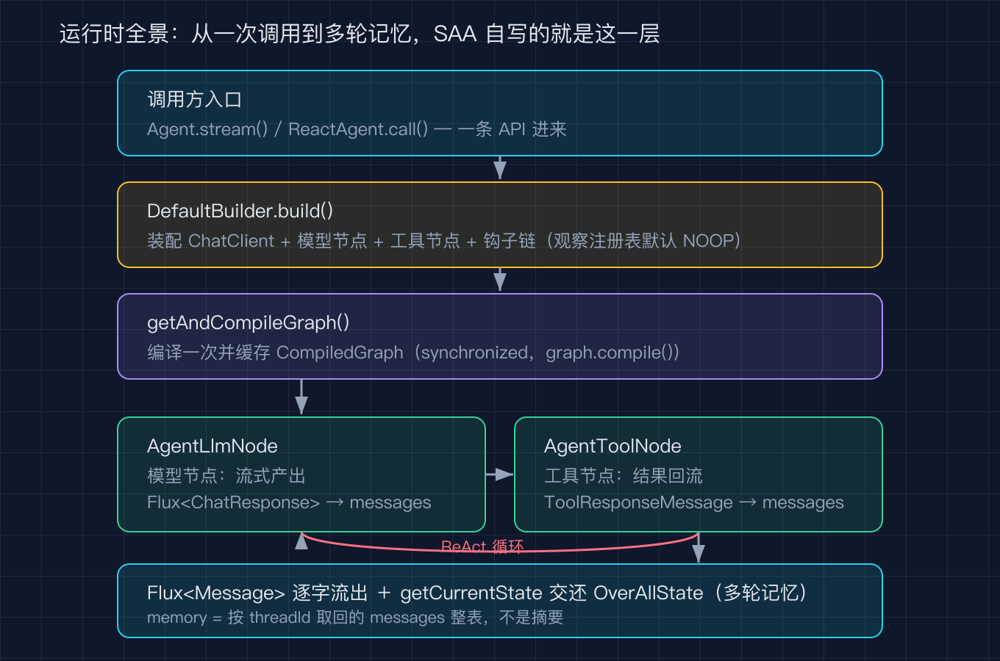
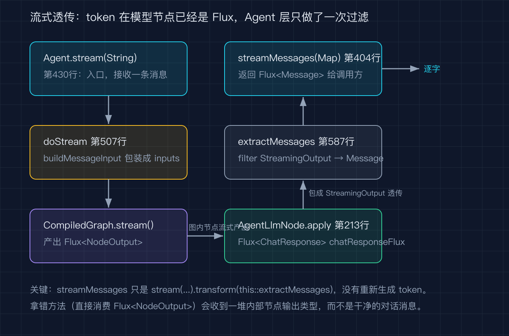
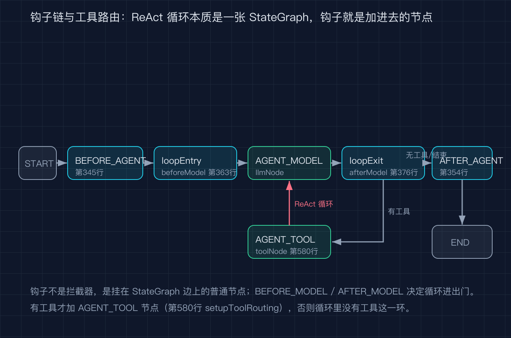
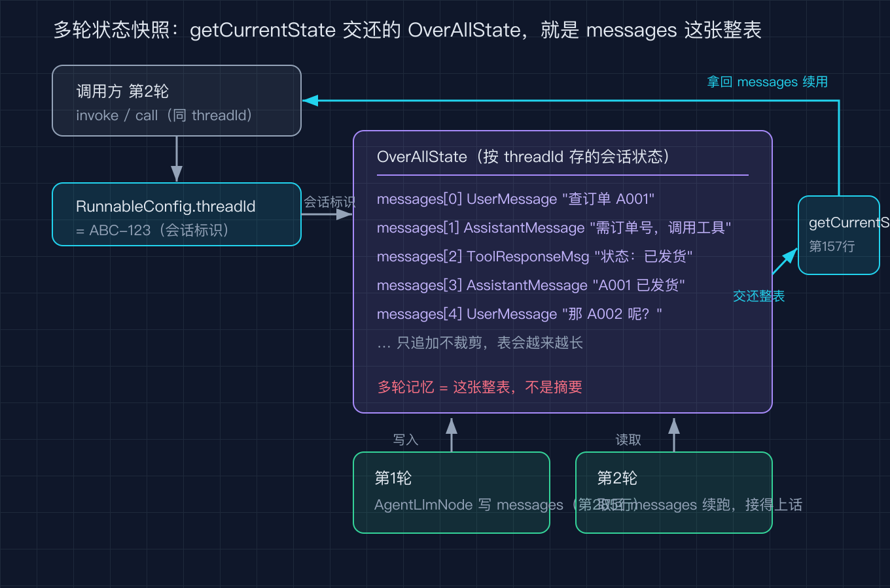

# Spring AI Alibaba 之九：我让 Agent 接着上一轮往下聊，它却只还给我一条消息，多轮记忆到底藏在哪

一句话结论：SAA 的 Agent 运行时说白了就两件事，一是把你给的 message 送进一张 StateGraph，图的节点（模型节点、工具节点、钩子节点）轮流往一个叫 OverAllState 的共享黑板上写，最后把整块黑板还给你；二是多轮记忆不靠框架帮你总结摘要，而是把整张黑板按 threadId 存住，下一轮你带着同一个 threadId 再来，它就接着往下聊。stream 和 call 这两条门面方法，只是给你不同粒度的返回：stream 给你会流动的 Flux，call 给你最后那一条助手消息。每一个返回形状都钉死在源码里。

我自己的场景是这样：我想给客服 Agent 做一个连续对话，用户第一轮问「我的订单到哪了」，第二轮接着问「那能改地址吗」。我一开始用 `agent.stream("那能改地址吗")` 想去接流式输出，结果拿到的是一堆 NodeOutput，根本不是我想要的干净 Message；改用 `agent.call(...)` 之后，它倒是返回一个 AssistantMessage，但我想拿回整段对话历史自己再处理时，发现 call 只吐最后一条。我这才去翻 `agent-framework` 模块，看它到底把多轮记忆放在了哪个角落。

下面所有行号都钉在 `alibaba/spring-ai-alibaba` 的 tag `v1.1.2.2`（commit `7405a7dc0d66d582ec79430af6e24d259d5ca6ea`）上，clone 到本地就能逐行对上。

## 运行时全景：一个入口进来，一张黑板出去

Agent 这个类本身就是个包装。它不自己跑循环，而是持有一张编译好的图。`Agent.java` 第 104 行 `getGraph()` 返回一张 `StateGraph`，第 116 行 `getAndCompileGraph()` 把它 compile 成 `CompiledGraph`（第 124 行 `this.compiledGraph = graph.compile()`）。真正会动的，是这张图里的节点。

我把一次调用的全景画成一张图。



入口方法分两族。`stream(String message)` 在第 430 行，它先把消息包成输入 Map，再调 `doStream`（第 507 行），`doStream` 拿到 `getAndCompileGraph()` 之后直接 `compiledGraph.stream(...)` 返回一个 `Flux<NodeOutput>`。也就是说，stream 这条线从头到尾都在和 `CompiledGraph` 打交道，Agent 这一层只做了两件事：拼输入、转接返回。

`call` 这条线也类似。`ReactAgent.call(String)` 在第 165 行，它走 `doMessageInvoke`（第 260 行），而 `doMessageInvoke` 内部还是调了从 `Agent` 继承来的 `doInvoke`（第 497 行），`doInvoke` 同样是 `getAndCompileGraph()` 之后 `compiledGraph.invoke(...)`。区别在尾巴：`doMessageInvoke` 拿到 `Optional<OverAllState>` 之后，再过一道 `extractAssistantMessage`（第 269 行），只把最后一条 `AssistantMessage` 抠出来返回。所以 call 和 stream 的差别，不是算不算图，而是图跑完之后你拿到的切片有多大。

## 流式透传：streamMessages 只是过滤，不重新生成 token

这是我最想讲清楚的一段，因为它最容易让人误以为框架又调了一次模型。

`streamMessages(Map)` 在第 404 行，全方法就一行：

```java
public Flux<Message> streamMessages(Map<String, Object> inputs) throws GraphRunnerException {
    return stream(inputs).transform(this::extractMessages);
}
```

它等于 `stream(inputs)` 之后接一个 `transform(extractMessages)`。`stream` 已经在图里把模型跑过了，`streamMessages` 没有重新发起任何模型调用，它只是把上游吐出的 `Flux<NodeOutput>` 过滤一遍。过滤逻辑在 `extractMessages`（第 587 行）：只保留那些 `StreamingOutput` 类型、且 `OutputType` 是 `AGENT_MODEL_STREAMING` 或 `AGENT_TOOL_FINISHED`、且内嵌 Message 非空的元素，其余的（钩子中间输出、工具中间输出）一律丢掉。

我把这条透传链画成一张图，能看清 token 从模型节点出来到 streamMessages 返回，中间没有第二个模型调用。



这里的关键认知是：图里真正产 token 的是模型节点 `AgentLlmNode`。它的 `apply` 方法在第 135 行，第 213 行 `buildChatClientRequestSpec(request, config).stream().chatResponse()` 拿到一个 `Flux<ChatResponse>`，逐块往 `OverAllState` 的 messages 上追加（第 285 行 `updatedState.put("messages", modelResponse.getMessage())`）。streamMessages 站在图外面，用 `extractMessages` 把这部分干净 Message 捞出来给你。所以如果你直接调 `stream()` 而不是 `streamMessages()`，你会收到 `NodeOutput` 这种图内部对象，里面混着钩子和工具的输出，不是给最终用户看的干净流。

## 钩子不是拦截器，是 StateGraph 里的普通节点

我最初以为 Hook 是 AOP 那种环绕拦截器，能在方法前后切一刀。翻源码才发现不是。`ReactAgent` 在 `initGraph` 里把每个 Hook 直接 `addNode` 进 `StateGraph`（第 345 行遍历 `beforeAgentHooks`，第 354 行 `afterAgentHooks`，第 363 行 `beforeModelHooks`，第 376 行 `afterModelHooks`，每条都是 `graph.addNode(Hook.getFullHookName(hook) + ".before", ...)` 这种写法）。钩子本质上和模型节点、工具节点是同一类东西：都是图上的一格，输入输出都是 `OverAllState`。

我把钩子怎么插进图、以及有没有工具时工具节点怎么接，画成一张图。



图里你能看到，START 之后先走 `BEFORE_AGENT` 的钩子节点，再进模型；模型出来走 `AFTER_MODEL` 钩子；如果这一轮模型产生了工具调用，才会经过 `AGENT_TOOL` 节点（`setupToolRouting` 在第 580 行处理这条边，只有 `hasTools` 为真才把工具节点接进环），工具结果回来再回模型，如此循环，直到没有工具调用，最后走 `AFTER_AGENT` 到 END。那个红色回环就是 ReAct 循环本身：模型节点和工具节点用一条边串成圈，钩子只是挂在圈的关键位置上。

这也解释了为什么钩子能改状态：因为它就是节点，`apply` 拿到的就是 `OverAllState`，它往黑板上写什么，下游节点就看到什么。所谓 `BEFORE_MODEL` 去压上下文、`AFTER_MODEL` 去做 HITL 审批，都只是把一段处理 OverAllState 的代码插在某个节点位置。

## 多轮记忆：Agent 还给你整张黑板，不是摘要

现在回到我最开始的问题：连续对话的记忆到底在哪。答案在返回类型上。

`Agent.invoke(...)` 这一系列方法（第 163 行起）返回的是 `Optional<OverAllState>`，也就是整块共享状态。而 `call(...)` 之所以只给你一条 `AssistantMessage`，是 `extractAssistantMessage`（第 269 行）在第 278 到 284 行从 `OverAllState` 的 `messages` 列表里筛出 `AssistantMessage` 并 `reduce((first, second) -> second)` 只留最后一条。所以框架从来没丢过历史，是 call 这个方法替你做了只取最后一条的裁剪。

多轮记忆的实体，就是 `OverAllState` 里那个名为 `messages` 的列表。模型节点每次把新消息追加进去（`AgentLlmNode.java` 第 161 行 `state.value("messages").get()` 读出整列，第 285 行写回）；工具节点拿到上一轮的 messages，把工具结果也追加进去（`AgentToolNode.java` 第 155 行读出，第 250 行或第 474 行写回）。整个一轮下来，messages 只追加快不裁剪，是一份完整对话转录，不是摘要。

我把多轮状态怎么按 threadId 取回、怎么整表续用的过程画成一张图。



那这块黑板跨轮是怎么存住的？两条线。一条在 Agent 这一层：`ReactAgent` 用一张 `threadIdStateMap`（一个 `ConcurrentHashMap`，以 `threadId` 为键）记住每个线程的中断反馈等现场（`ReactAgent.java` 第 256 行 `computeIfAbsent(threadId, ...)` 就是凭 `config.threadId()` 取键，第 253 行要求 `RunnableConfig` 必须带 `threadId`）。另一条在 graph-core 那一层，是真正的字节级持久化：之三已经拆过，`CompiledGraph` 背后有 Saver 一族，按 `threadId` 把 `OverAllState` 落盘（内存或 Redis），下一轮 `compiledGraph.invoke(input, config)` 时凭同一个 `threadId` 把上一次的整块黑板重新加载进来。所以你做连续对话，唯一要做的就是把同一个 `RunnableConfig`（带着同一个 `threadId`）传给每一轮；忘带 `threadId`，`interrupt` 这类方法会直接抛 `IllegalArgumentException`（第 253 行）。

想主动看当前整块状态，可以调 `getCurrentState(config)`（`Agent.java` 第 157 行，内部是 `compiledGraph.getState(config)`），它把整张 `OverAllState` 交还给你，不止是最后一条消息。

## 四个我踩过的坑

坑一：调 `stream()` 想接流式输出，结果收到 `NodeOutput` 而不是干净 `Message`。症状是拿到一堆图内部对象，里面混着钩子和工具的中间结果，没法直接展示给用户。根因是 stream 返回的是 `Flux<NodeOutput>`（第 430 行），要拿到用户级流必须改调 `streamMessages`（第 404 行），让它过一遍 `extractMessages` 过滤。

坑二：用 `call()` 想拿回整段对话历史自己处理，结果只得到最后一条 `AssistantMessage`。根因是 `call` 走 `extractAssistantMessage`（第 269 行），它专门 `reduce` 只留最后一条。解法是改用 `invoke(...)`，它直接返回 `Optional<OverAllState>`，从里面读 `messages` 就能拿到完整转录。

坑三：多轮对话第二轮起不记得第一轮说了什么。根因是每一轮都重新 new 了一个 `RunnableConfig`、没带 `threadId`，图的 Saver 凭 `threadId` 取不到上一轮的 `OverAllState`。解法是每一轮传同一个 `RunnableConfig`（同一个 `threadId`），让 graph-core 把整块黑板重新加载续聊。

坑四：以为 Hook 是环绕拦截器，想在里面直接拦下模型调用却拦不住。根因是 Hook 被 `addNode` 成了 StateGraph 的普通节点（第 345 行起），它不是 AOP 切点，只能通过对 `OverAllState` 的读写来影响下游，想改流程得靠 `Command.gotoNode` 那种节点级跳转，而不是抛异常截断。

## 复现模块

这篇文章的源码都在你本地，不需要额外数据：

- 代码地址：`alibaba/spring-ai-alibaba` 的 tag `v1.1.2.2`，本地我 clone 在 `/tmp/saa`，commit `7405a7dc0d66d582ec79430af6e24d259d5ca6ea`
- 数据源地址：无外部数据，全部为框架源码（仅 `spring-ai-alibaba-agent-framework` 模块，graph-core 的 Saver 字节级持久化在之三已拆）
- 运行命令：
  ```
  cd /tmp/saa
  git checkout v1.1.2.2
  # 跑本篇的源码行号校验
  python3 code/verify_sources.py
  # 跑本篇的 QC 校验
  python3 code/qc_article.py
  ```
- 精确预期输出：`verify_sources.py` 末尾打印 `[PASS] 之九源码行号全部核对通过，共 53 条（基准 7405a7d / v1.1.2.2）`；`qc_article.py` 打印 `[PASS] 之九 QC 通过：中文字数 X，配图引用 4 张（均 @2x.png 且文件存在）`。

## 讲给别人听（认知清单）

- SAA 的 Agent 运行时就是：把 message 送进一张 StateGraph，节点轮流往 OverAllState 黑板上写，最后把整块黑板还给你。
- stream 和 call 不是两套执行逻辑，call 只是在图跑完后用 extractAssistantMessage 只抠最后一条 AssistantMessage。
- streamMessages 只是 stream 之后 transform 过滤，不重新调模型；直接调 stream 会收到图内部的 NodeOutput。
- 多轮记忆是整张 messages 转录按 threadId 存住再加载，不是摘要；忘带 threadId 就续不上。
- Hook 是 StateGraph 的普通节点，不是 AOP 拦截器，它只能通过读写 OverAllState 影响下游。

## 结尾钩子

我那次连续对话的事故之后，把 call 换成了 invoke，把每一轮的 RunnableConfig 都钉上同一个 threadId，总算让 Agent 接得住「那能改地址吗」这种指代上一轮的话。

你做 Agent 连续对话时，是卡在 stream 拿不到干净 token，还是卡在 call 只还一条、历史拿不回来？把你的场景丢在评论区，我挑几个下一期拆。下一篇我打算把 SAA 的 graph-core 持久化再往深里讲一层，聊聊 Saver 落盘和按 threadId 恢复这件事在工程上还有哪些坑。
