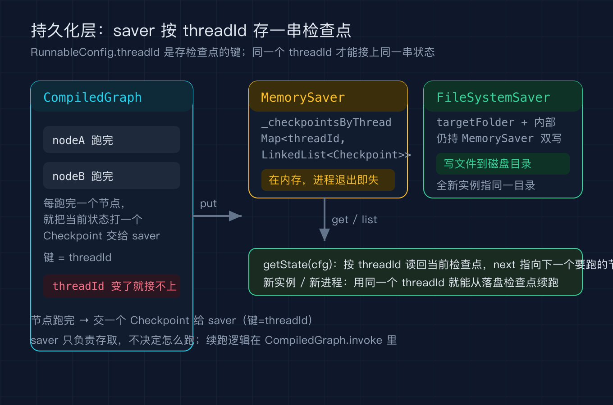
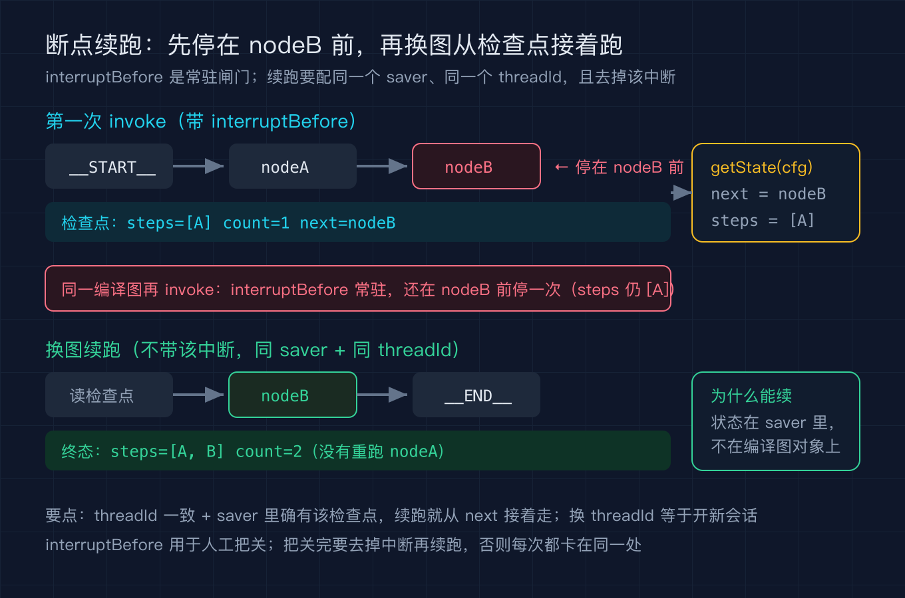
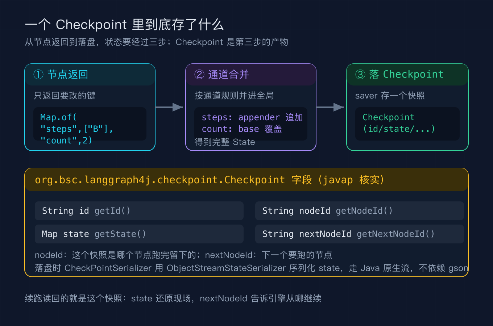

# LangGraph4j之五：持久化与断点续跑

系列规划一句话：本篇讲检查点是怎么存的、凭什么能接着跑，这是把一个跑很久的图从“一崩就从头再来”变成“从断点续上”的关键。

上一篇结尾我留了个问题：图跑到一半崩了，那些快照能不能下次接着跑。这一篇就把这个问题拆开。结论先说，能做到，但有两个前提你容易踩空：一是续跑必须带同一个 `threadId`，二是 `interruptBefore` 这种中断闸门是常驻的，不先拆掉它，你每次都卡在同一个地方。我把 `langgraph4j-core 1.5.14` 的相关类用 `javap` 逐个核实过，下面讲的每个字段、每个方法都能在字节码里对上。

## 概念澄清一：saver 是持久化层，检查点按 threadId 存

引擎每跑完一个节点，就会把当前状态打成一个 `Checkpoint`，交给一个 checkpoint saver 存起来。saver 只负责存取，不决定图怎么跑。区分两种 saver 很简单：

- `MemorySaver`：内部是一个 `Map<threadId, LinkedList<Checkpoint>>`，全在内存里，进程一退出就全没了。
- `FileSystemSaver`：构造时传一个目录，把检查点序列化后写文件进去，同时内部仍然持一个 `MemorySaver` 做双写。

这里最要紧的是那个键。`RunnableConfig` 上有一个 `threadId`，它就是存和取检查点的钥匙。同一个 `threadId` 才能接上同一串状态，换了 `threadId` 等于开一个全新的会话，前面的进度一点都接不到。



图①左边是引擎每跑完一个节点就往 saver 里 `put` 一个检查点，右边是两种 saver 的区别。我用一个细节证明 FileSystemSaver 真的写到了磁盘：第一次 invoke 停在半路之后，我换一个指向同一目录的全新 `FileSystemSaver` 实例，依然能读回检查点续跑。如果是纯内存，新实例是不可能读到的。

## 概念澄清二：interruptBefore 是常驻闸门，续跑要先拆闸

`interruptBefore("nodeB")` 的意思是“每次要跑 nodeB 之前都停一下”，这是给人工把关用的。我在实跑里确认了一个容易误解的点：第一次 invoke 带着它，会在 nodeB 前停下，检查点里的 `next` 指向 nodeB；这时候如果你拿同一个编译图再 invoke 一次，它不会往前跑，而是又在 nodeB 前停一次，因为闸门还在。我也试过用 `updateState` 推进，同样过不去，`next` 还是 nodeB。

真正续跑的做法是：用一个不带这个中断的编译图，配同一个 saver、同一个 `threadId` 去 invoke。引擎会从检查点的 `nextNode` 接着往下跑，而不是从 `__START__` 重来。判断它确实没重来的依据很硬：续跑之后 `steps` 是 `[A, B]`，如果是从头再跑，追加型通道会变成 `[A, A, B]`。



图②上半是第一次 invoke 停在 nodeB 前，右上角 `getState` 读回 `next=nodeB`；中间那句提醒闸门常驻；下半是换图续跑，从检查点读到 nodeB 一路跑到 `__END__`。核心就一句：状态存在 saver 里按 threadId 索引，跟编译图对象是解耦的，所以换个图对象、甚至换个进程，都能接上。

## 概念澄清三：一个 Checkpoint 到底存了什么

从节点返回到落盘，状态要经过三步，`Checkpoint` 是第三步的产物。

第一步，节点只返回要改的键，比如 `Map.of("steps", List.of("B"), "count", 2)`。第二步，框架按通道规则把这些局部更新并进全局状态，`steps` 是 appender 通道所以追加，`count` 是 base 通道所以覆盖，合出来一份完整 `State`。第三步，这份 `State` 连同几个元数据打成一个 `Checkpoint` 交给 saver。

`Checkpoint` 的字段我用 `javap` 核实的就四个：`id`（快照自己的编号）、`state`（那份完整状态）、`nodeId`（这个快照是哪个节点跑完留下的）、`nextNodeId`（下一个要跑的节点）。续跑读回的就是它，`state` 还原现场，`nextNodeId` 告诉引擎从哪继续。



还有一个落盘细节值得记住：`FileSystemSaver` 内部用的是 langgraph4j 自带的 `CheckPointSerializer`，它再调 `ObjectStreamStateSerializer`，走的是 Java 原生对象序列化，不依赖 gson 或 jackson。所以这个最小例子不用额外引 JSON 库就能落盘。

## 最小可运行例子

完整 Maven 模块在 `code/repro/`，这里贴出编译、中断、读回、续跑的核心片段。

```java
// 编译：挂一个 saver，并在 nodeB 前设中断
MemorySaver saver = new MemorySaver();
CompiledGraph<MyState> g = buildGraph().compile(
        CompileConfig.builder()
                .checkpointSaver(saver)
                .interruptBefore("nodeB")
                .build());

// 每次调用都带同一个 threadId，它是存取检查点的钥匙
RunnableConfig cfg = RunnableConfig.builder().threadId("demo5-memory-run").build();

// 第一次 invoke：跑完 nodeA，在 nodeB 前停下，检查点写进 saver
Optional<MyState> r1 = g.invoke(initialInput(), cfg);

// 读回检查点，next 指向被中断处要跑的节点
StateSnapshot<MyState> snap = g.getState(cfg);
System.out.println("next=" + snap.next());          // nodeB

// 续跑：换一个不带该中断的编译图，配同一个 saver、同一个 threadId
CompiledGraph<MyState> resume = buildGraph().compile(
        CompileConfig.builder().checkpointSaver(saver).build());
Optional<MyState> r2 = resume.invoke(initialInput(), cfg);   // 从 nodeB 续跑到 END
```

FileSystemSaver 版本只差在构造时传目录和一个序列化器：

```java
Path dir = Files.createTempDirectory("lg4j-demo5-fs-");
FileSystemSaver fs = new FileSystemSaver(dir, new ObjectStreamStateSerializer<>(MyState::new));
// 之后 compile(...).checkpointSaver(fs)... 与上面完全一致；
// 换一个 new FileSystemSaver(dir, ...) 新实例也能从磁盘读回续跑。
```

## 精确预期输出

下面这段是我本机实跑 `java org.example.langgraph4j.Demo5 --self-test` 的真实 stdout，逐行未改，末尾 `self-test PASS` 是自检断言通过。

```
=== 场景一：MemorySaver 断点续跑 ===
[第一次 invoke] steps=[A]
[getState] next=nodeB steps=[A] count=1
[同一图再 invoke] steps=[A]（中断闸门常驻，仍在 nodeB 前停下）
[换图续跑] steps=[A, B] count=2
=== 场景二：FileSystemSaver 落盘续跑 ===
[第一次 invoke] 落盘检查点文件数=1
[换 saver 续跑] steps=[A, B] count=2 落盘文件数=1
self-test PASS
```

第三行是重点：同一个编译图再 invoke，`steps` 还是 `[A]`，证明中断闸门常驻、没有放行 nodeB。第四行换图续跑才到 `[A, B]`。场景二用一个全新的 FileSystemSaver 实例指向同一目录也能续跑，证明检查点真的落到了磁盘。

## 复现模块

代码地址：`code/repro/`（本目录下的 Maven 工程，模块名 `langgraph4j-demo5`）。

数据源：本例不依赖任何外部数据，输入是内置的空 `steps` 与 `count=0`，可离线复现；FileSystemSaver 会在系统临时目录下自建一个目录落盘。

运行命令（需要 JDK 17+）：

```bash
cd code/repro
mvn -q compile
mvn -q exec:java -Dexec.mainClass=org.example.langgraph4j.Demo5 -Dexec.args="--self-test"
```

或用 `javac --release 17` 配合本地已下载的 jar 直接编译运行。工程 `pom.xml` 只钉了 `langgraph4j-core 1.5.14`、`async-generator 3.2.0`、`slf4j-api 2.0.16` 三个坐标，落盘走 Java 原生序列化，不引 gson 或 jackson。

配图重渲染：`diagram/render_svgs.py` 调用 baoyu-diagram 技能把三张 SVG 生成 1360x900 的 `@2x.png`，无白边。

## 结尾钩子

这一篇你看到检查点按 threadId 存、能换图换进程续上，但有一个隐含前提我还没碰：这些状态是被追加型通道一点点堆起来的，跑久了 `steps` 会越来越长，context 迟早被撑爆。下一篇我就讲长会话里怎么裁剪和总结状态，顺便你可以先想想，如果让你给一个跑了三千步的会话瘦身，你会先砍哪一段。

## 三句话总结

第一，检查点由 saver 按 `threadId` 存取，`MemorySaver` 全在内存、进程退出即失，`FileSystemSaver` 落盘、换实例指同一目录也能读回。第二，`interruptBefore` 是常驻闸门，续跑要用一个不带该中断的编译图配同一个 saver 和 `threadId`，引擎从检查点的 `nextNodeId` 接着跑而不是从头再来。第三，一个 `Checkpoint` 就四个字段，`id`、`state`、`nodeId`、`nextNodeId`，落盘走 `ObjectStreamStateSerializer` 的 Java 原生序列化，不依赖 JSON 库。
