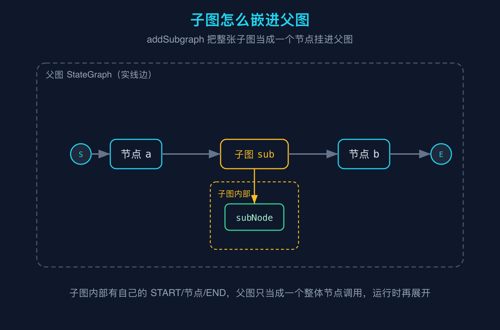
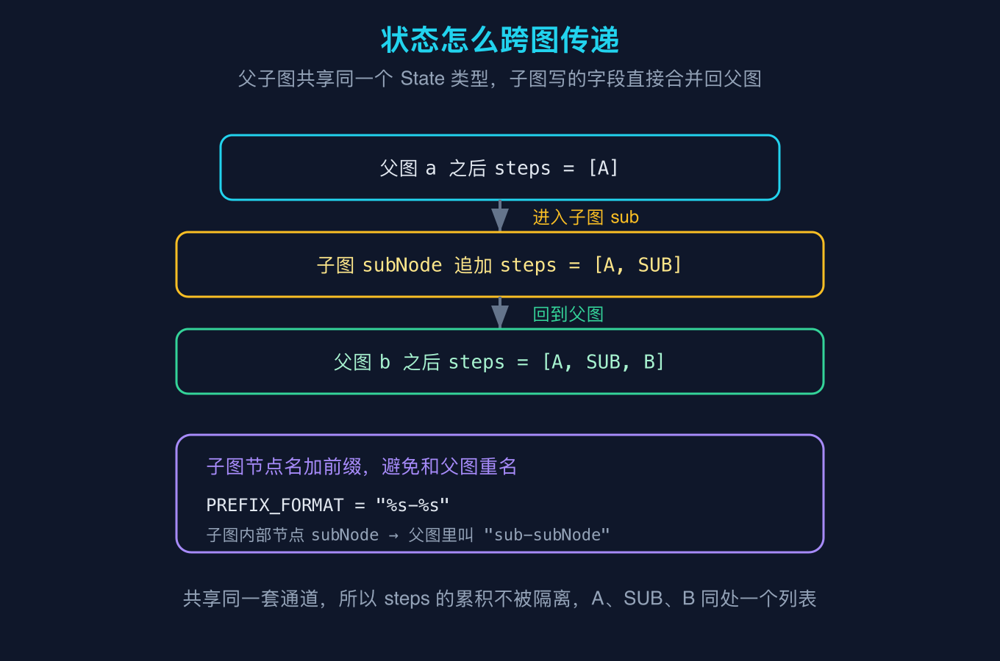
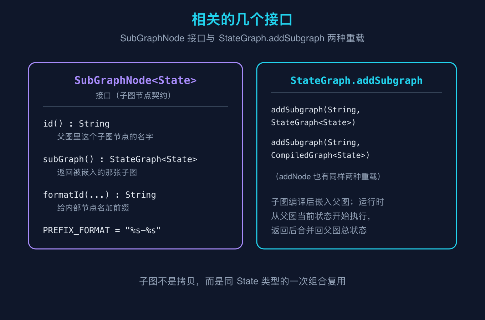

# LangGraph4j之七：子图与组合

这是 LangGraph4j 源码级原理拆解系列的第七篇。前面把图模型、状态通道、运行引擎、持久化、消息状态都拆过了，这一篇讲怎么把图「组合」起来：一张大图里嵌入另一张小图，也就是子图。它看上去是个编排技巧，但源码层面它和前面讲的节点、状态是同一套东西，只是把「节点」从一段函数换成了「另一张图」。读懂这一篇，你就明白为什么复用一段流程不用复制粘贴，以及父子图之间状态到底隔不隔离。

## 一句话先说结论

`StateGraph.addSubgraph` 把一整张子图当成一个节点挂进父图，子图和父图共享同一个 State 类型，所以子图节点写的状态会直接合并回父图的总状态上。它不是拷贝，而是同状态类型的一次组合复用。

## 概念澄清一：子图怎么嵌进父图

之二的时侯我们讲，节点可以是 `AsyncNodeAction`（一段异步函数），也可以是 `CompiledGraph`（一张已经编译好的图），还可以是 `StateGraph`（一张还没编译的图）。`addSubgraph` 用的就是后两种：它把整张子图当成父图里的一个节点。

我用 `javap` 核对过 `StateGraph` 的方法表，`addSubgraph` 有两个重载，分别接受 `StateGraph<State>` 和 `CompiledGraph<State>`，和 `addNode` 的重载是一一对应的。也就是说，在父图眼里，「子图」和「普通节点」是平起平坐的，都是一个可以被边连来连去的点。



图里父图有 a、子图 sub、b 三个节点串成一串。但子图 sub 这个节点不是一段函数，它内部还有自己的 START、subNode、END。父图编译时，sub 会被当成一个整体节点连进边里；真正运行到 sub 时，引擎才把子图展开，从它的 START 走到 END，再把结果交还给父图继续走 b。所以子图是一种「延迟展开」的节点：画的时候是扁的，跑的时候才摊开。

这里有个容易混淆的点：子图内部节点的名字，在父图命名空间里会被加前缀。源码里 `SubGraphNode.PREFIX_FORMAT` 是 `"%s-%s"`，我实跑确认过，子图内部的 `subNode` 在父图里实际叫 `sub-subNode`。加前缀是为了防止子图内部的节点名和父图其它节点撞名。你平时写的时候不用手动加，引擎会自动处理，但调试日志里看到 `sub-subNode` 这种名字别以为是自己写错了。

## 概念澄清二：状态怎么跨图传递

这是子图最该讲清楚的地方：父子图之间状态隔不隔离？答案是不隔离，因为它们共享同一个 State 类型。

我写了 Demo7 来验证。父图和子图用的是同一套 schema（steps 走追加通道、count 走覆盖通道），父图是 a 到 sub 到 b，子图内部只有 subNode 往 steps 里追加一条 "SUB"。跑完之后，steps 是 `[A, SUB, B]`，count 是 1。



关键事实在这里：子图不是运行在「自己的独立状态副本」上，而是直接接着父图当前的状态往下走。a 写完 steps=[A]，进入子图，subNode 在 [A] 的基础上追加得到 [A, SUB]，回到父图，b 再追加得到 [A, SUB, B]。整个过程 steps 是同一个列表在不同节点间被同一个 appender 通道持续累加，没有「父图一份、子图一份、最后再 merge」这种拷贝开销。

这也解释了为什么子图要求父图和子图是同一个 State 类型（addSubgraph 的泛型参数 State 必须一致）。如果类型不同，通道 schema 对不上，状态就接不回去了。所以子图不是任意两张图的拼接，而是「同状态类型的两张图的嵌套」。

count 用 base 覆盖通道，每个节点都写 1，最终结果还是 1，这也符合之三讲的覆盖语义：不管在哪个图里写，通道归约函数说了算。

## 概念澄清三：相关的几个接口

把接口摊开看一遍，组合能力就清楚了。`SubGraphNode` 是个接口，定义在 `org.bsc.langgraph4j` 包，源码确认它有三个关键成员：`id()` 返回父图里这个子图节点的名字，`subGraph()` 返回被嵌入的那张子图，`formatId(...)` 负责给内部节点名加前缀，还有常量 `PREFIX_FORMAT = "%s-%s"`。



`StateGraph.addSubgraph` 的两个重载前面说了，分别对应「传未编译的子图」和「传已编译的子图」。注意 `addNode` 也有完全一样的两种重载，所以你会发现：在 LangGraph4j 里，「把一个图当节点」和「把一个函数当节点」在 API 形态上是对称的。这种对称不是巧合，它反映出框架的一个核心设计判断：图和节点是同一层级的概念，图可以嵌套图。

运行时层面，子图编译后就被内联进父图的邻接结构，父图 invoke 时子图从父图的当前状态开始执行，子图跑完返回的状态直接合并回父图的总状态。你不用在父图里写任何「把状态传进子图、再把结果取回来」的胶水代码，框架替你做了。

## 最小例子：Demo7

下面是 Demo7 的完整代码，同样不需要任何大模型密钥，纯本地可跑，跑 `--self-test` 做断言。

```java
package org.example.langgraph4j;

import org.bsc.langgraph4j.CompiledGraph;
import org.bsc.langgraph4j.StateGraph;
import org.bsc.langgraph4j.action.AsyncNodeAction;
import org.bsc.langgraph4j.state.AgentState;
import org.bsc.langgraph4j.state.Channels;

import java.util.ArrayList;
import java.util.HashMap;
import java.util.List;
import java.util.Map;
import java.util.Optional;
import java.util.concurrent.CompletableFuture;

import static org.bsc.langgraph4j.StateGraph.START;
import static org.bsc.langgraph4j.StateGraph.END;

public class Demo7 {

    // 通用状态：steps 用追加通道累积执行轨迹，count 用覆盖通道记录轮数
    public static class MyState extends AgentState {
        public MyState(Map<String, Object> data) {
            super(data);
        }

        @SuppressWarnings("unchecked")
        public List<String> steps() {
            return value("steps", ArrayList::new);
        }

        public int count() {
            return value("count", () -> 0);
        }
    }

    public static void main(String[] args) throws Exception {
        // 父子图共用的 schema
        Map<String, org.bsc.langgraph4j.state.Channel<?>> schema = new HashMap<>();
        schema.put("steps", Channels.appender(() -> new ArrayList<String>()));
        schema.put("count", Channels.base(() -> 0));

        // 子图：内部一个 subNode，往 steps 里追加 "SUB"
        StateGraph<MyState> sub = new StateGraph<>(schema, MyState::new);
        sub.addNode("subNode", (AsyncNodeAction<MyState>) s ->
                CompletableFuture.completedFuture(Map.of("steps", List.of("SUB"))));
        sub.addEdge(START, "subNode");
        sub.addEdge("subNode", END);

        // 父图：a -> sub(子图) -> b
        StateGraph<MyState> g = new StateGraph<>(schema, MyState::new);
        g.addNode("a", (AsyncNodeAction<MyState>) s ->
                CompletableFuture.completedFuture(Map.of("steps", List.of("A"), "count", 1)));
        g.addNode("b", (AsyncNodeAction<MyState>) s ->
                CompletableFuture.completedFuture(Map.of("steps", List.of("B"), "count", 1)));
        g.addSubgraph("sub", sub);
        g.addEdge(START, "a");
        g.addEdge("a", "sub");
        g.addEdge("sub", "b");
        g.addEdge("b", END);

        CompiledGraph<MyState> graph = g.compile();

        Map<String, Object> input = new HashMap<>();
        input.put("steps", new ArrayList<String>());
        input.put("count", 0);

        Optional<MyState> fin = graph.invoke(input);

        List<String> steps = fin.get().steps();
        int count = fin.get().count();

        System.out.println("[steps 执行轨迹] " + steps);
        System.out.println("[count] " + count);
        System.out.println("[子图内部节点前缀格式] " + org.bsc.langgraph4j.SubGraphNode.PREFIX_FORMAT);

        if (args.length > 0 && "--self-test".equals(args[0])) {
            boolean ok = steps.size() == 3
                    && "A".equals(steps.get(0))
                    && "SUB".equals(steps.get(1))
                    && "B".equals(steps.get(2))
                    && count == 1;
            if (ok) {
                System.out.println("self-test PASS");
                System.exit(0);
            } else {
                System.out.println("self-test FAIL");
                System.exit(1);
            }
        }
    }
}
```

运行方式（JDK 17+，依赖同前几篇：langgraph4j-core 1.5.14、async-generator 3.2.0、slf4j-api 2.0.16）：

```bash
javac --release 17 -cp "langgraph4j-core-1.5.14.jar:async-generator-3.2.0.jar:slf4j-api-2.0.16.jar" \
  -d target/classes src/main/java/org/example/langgraph4j/Demo7.java
java -cp "target/classes:langgraph4j-core-1.5.14.jar:async-generator-3.2.0.jar:slf4j-api-2.0.16.jar" \
  org.example.langgraph4j.Demo7 --self-test
```

## 精确预期输出

下面是 `--self-test` 实际跑出来的输出，逐行可核对：

```text
[steps 执行轨迹] [A, SUB, B]
[count] 1
[子图内部节点前缀格式] %s-%s
self-test PASS
```

## 我踩过的几个坑

第一，以为子图有独立状态副本。这是我最初看文档的误解：觉得子图跑了半天，结果应该「返回」给父图。实际上因为共享 State 类型，子图直接改写父图的总状态，不存在拷贝和返回。好处是没有序列化开销，坏处是子图能改的字段和父图完全一样，写错了会污染父图状态。Demo7 里子图和父图共用同一个 steps 通道，subNode 追加的 SUB 直接出现在父图最终列表里，就是这个机制。

第二，父子图 State 类型不一致导致编译或运行报错。addSubgraph 要求子图的 State 和父图是同一个类型参数。如果你父图用 `StateGraph<MyState>`、子图用 `StateGraph<OtherState>`，编译器就会拦。这不是限制，而是必然：通道 schema 是按 State 类型绑定的，类型不同通道对不上，状态接不回去。

第三，子图内部节点名和父图撞名。比如父图有个节点叫 `nodeA`，子图内部也有个 `nodeA`。单独看两张图都没问题，嵌进去之后名字冲突。框架用 `PREFIX_FORMAT` 自动给子图内部节点加前缀（如 `sub-nodeA`）解决了这个问题，所以一般不用操心，但调试时看到带前缀的节点名要知道来源。

第四，在子图里误用 `interruptBefore` 之类的中断。之五讲过中断是常驻闸门，子图也有自己的生命周期，如果子图编译时带了中断配置，父图调用子图时也会触发。这会让你以为「父图在 a 之后卡住了」，其实卡在子图内部。排查时记得子图是延迟展开的，中断点可能在子图那一侧。

## 复现模块

代码目录：本文 `code/repro`（仓库对应 `2026-10-15-LangGraph4j源码级原理拆解-之七/code/repro`），推送后见 GitHub 仓库该路径。

数据源（一手事实，非文档猜测）：`langgraph4j-core` 坐标 `org.bsc:langgraph4j-core:1.5.14`，用 `javap` 复核 `StateGraph.addSubgraph`、`SubGraphNode`、`Channels.appender` 等字节码。

运行命令同上「最小例子」段。

精确预期输出见上「精确预期输出」段，已用 `--self-test` 断言逐行核对。

## 结尾钩子

子图解决了「流程复用」的问题：一段子流程可以嵌进任意父图，状态还能无缝接回。但还有一个更进阶的编排没碰：当不止一个子图、而且要根据上一轮的产出动态决定「下一步调哪个子图」时，怎么用条件边把它们织成一张监督者网络。你在实际项目里有没有遇到过「图越长越难维护、想拆又怕状态接不回来」的情况？把你的情况发在评论区，下一篇我们可以专门拆监督者模式。

## 三句话总结

第一，addSubgraph 把整张子图当成一个节点挂进父图，它在画的时候是扁的、运行时才延迟展开，API 形态和 addNode 对称，反映出图与节点是同层级概念。

第二，父子图共享同一个 State 类型，所以子图不是运行在独立副本上，而是直接接着父图当前状态往下走，写的字段实时合并回父图总状态，没有拷贝开销也没有隔离。

第三，内部节点名会被 PREFIX_FORMAT（"%s-%s"）自动加前缀避免重名，排查日志时看到带前缀的节点名别慌，那是子图被嵌进去后的真实命名。
