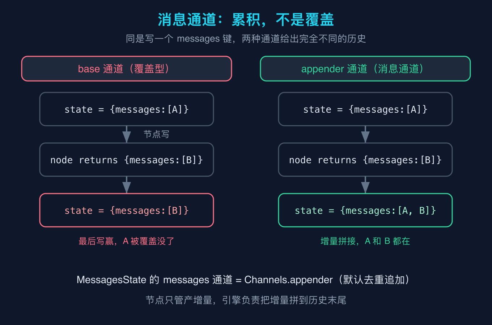
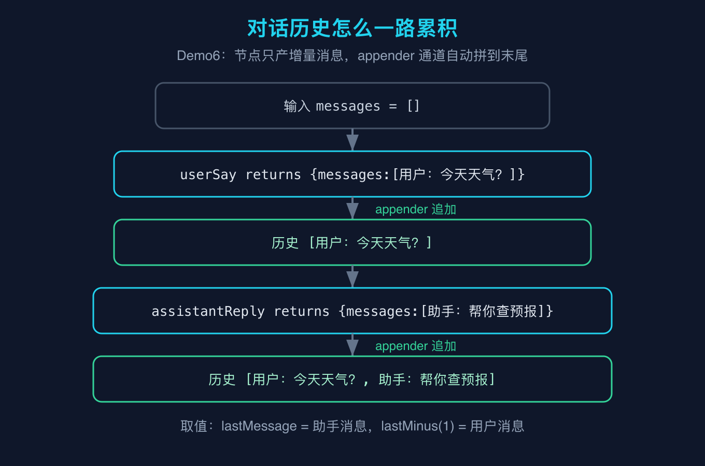
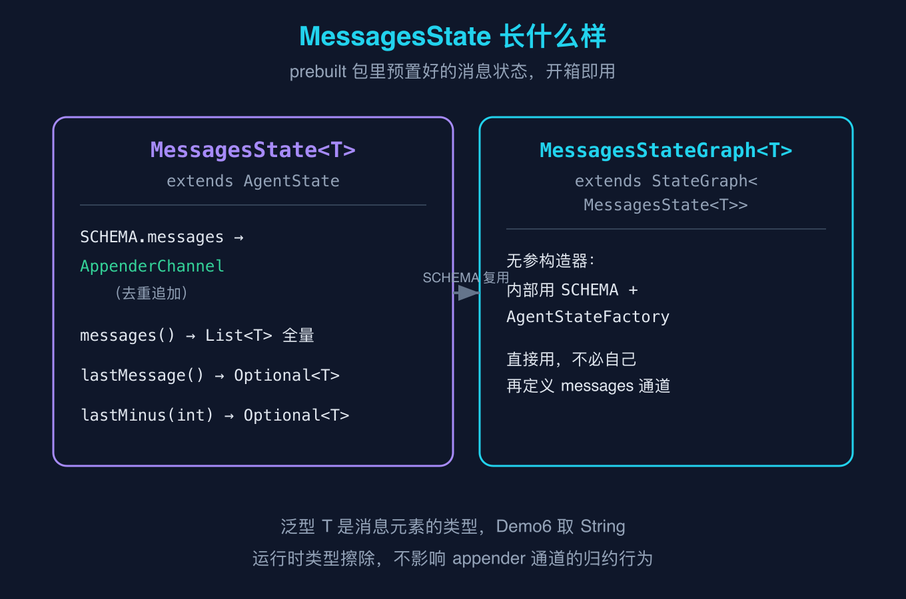

# LangGraph4j之六：消息状态与消息通道

这是 LangGraph4j 源码级原理拆解系列的第六篇。前几篇把图模型、状态与通道、运行引擎、持久化都拆过了，这一篇专讲一个你做对话类 Agent 一定会碰到的东西：消息状态。它看上去只是「把聊天记录存起来」，但源码里它和之三讲的通用状态是同一套机制，只差一个归约函数。读懂这一篇，你就明白为什么对话历史能自动越长越长，而不是每轮被冲掉。

## 一句话先说结论

MessagesState 把「对话历史」建模成一个追加型通道（appender），节点只负责产出增量消息，引擎把这些增量拼到历史末尾。它不是新发明的状态类型，只是把之三讲过的通道机制用对了地方。

## 概念澄清一：消息通道是累积，不是覆盖

之三我们讲过一个核心事实：状态本质是个 Map，节点返回的每个键都要经过通道的归约函数，才合并进总状态。当时讲了两种通道：base 是覆盖型（最后写赢），appender 是累积型（逐元素追加）。我当时特意提醒，做对话历史千万别用 base，否则每轮把上一轮冲掉。

这一篇要补的，就是这个判断背后的源码事实。我用 `javap` 把 `org.bsc.langgraph4j.prebuilt.MessagesState` 看了一遍，它的静态字段 `SCHEMA` 里，「messages」这个键对应的通道，正是 `Channels.appender`。也就是说，消息状态在源码层面的全部秘密，就是这么一行：把 messages 当成一个追加通道。



图里左边是 base 通道：同一个 messages 键，节点写了一次 B，前面那条 A 就被整条覆盖，state 里只剩 B。右边是 appender 通道：同样是写一次 B，引擎把它追加到已有的 A 后面，state 里变成 [A, B]。对话历史要的就是右边这种效果。注意 `Channels.appender` 默认是「去重追加」，也就是如果新来的元素和已有元素完全相等，它不会重复塞进去。这一点后面会单独说，是个容易踩的坑。

所以消息状态不是什么高深封装，它就是「messages 键走 appender 通道」这件事被预置好了。理解到这一层，你就不用背 API，直接用之三的知识也能造出一个等价实现。

## 概念澄清二：对话历史怎么一路累积

光说通道还不够，得看它在一张图里怎么流动。我写了个最小例子 Demo6：一张图两个节点，第一个节点模拟「用户说了一句话」，第二个节点模拟「助手回复」，中间没有显式去维护一个 list，历史却自动变长了。



关键点在于：每个节点返回的，不是「完整历史」，而是「这一轮的新消息」。比如 userSay 只返回 `{"messages": ["用户：今天天气怎么样？"]}`，assistantReply 只返回 `{"messages": ["助手：我查不到实时天气，但可以帮你查预报"]}`。这两个节点都没碰过完整历史，可最终 state 里的 messages 是两条都在。原因就是 messages 走的是 appender 通道，引擎把每轮的增量悄悄追加进去。

这也是 LangGraph 设计哲学里很妙的一点：节点只管「我这一轮产生了什么」，历史怎么攒是引擎的活。你写节点的时候，心智负担从「维护一个不断变长的 list」降到了「返回我刚说的一句话」。

MessagesState 还顺手给了几个取值方法，源码确认过：
- `messages()` 返回 `List<T>`，就是全量历史；
- `lastMessage()` 返回 `Optional<T>`，取最后一条，通常是最近一次助手或用户的消息；
- `lastMinus(int)` 从末尾往前数着取，比如 `lastMinus(1)` 就是倒数第二条，常用在「拿上一条用户消息」这种场景。

这几个方法都是从 appender 攒出来的那个 list 上直接取的，没有额外魔法。

## 概念澄清三：MessagesState 长什么样

把类的真实结构摊开看，会更踏实。MessagesState 在 `org.bsc.langgraph4j.prebuilt` 包，是个泛型类 `MessagesState<T>`，继承 `AgentState`。它干的事就两件：定义好 `SCHEMA`（里面 messages 指向 AppenderChannel），再提供那几个取值方法。



还有一个配套的 `MessagesStateGraph<T>`，它继承 `StateGraph<MessagesState<T>>`，而且有一个无参构造器。我把那个无参构造器反编译看了一眼，里面就是用 `MessagesState.SCHEMA` 加上一个 `AgentStateFactory` 去调父类构造器。换句话说，你 `new MessagesStateGraph<>()` 之后，messages 通道已经配好了，直接 `addNode`、`addEdge` 就能画图，不用自己再定义一遍 schema。

泛型参数 T 是消息元素的类型。Demo6 里我取 `String`，把每条消息当成一句话。这里有个运行时细节：Java 的泛型会被擦除，所以 T 在运行期其实不存在，但 appender 通道的归约行为不依赖 T，无论你用 String 还是自定义消息对象，累积逻辑都不变。自定义消息对象时，记得 appender 默认按「相等」去重，如果你的消息对象没正确实现 equals，去重可能不生效，这点稍后会讲。

## 最小例子：Demo6

下面是 Demo6 的完整代码。它不需要任何大模型密钥，纯本地就能跑，跑 `--self-test` 会做断言校验。

```java
package org.example.langgraph4j;

import org.bsc.langgraph4j.CompiledGraph;
import org.bsc.langgraph4j.StateGraph;
import org.bsc.langgraph4j.action.AsyncNodeAction;
import org.bsc.langgraph4j.prebuilt.MessagesState;
import org.bsc.langgraph4j.state.AgentState;

import java.util.ArrayList;
import java.util.HashMap;
import java.util.List;
import java.util.Map;
import java.util.Optional;
import java.util.concurrent.CompletableFuture;

import static org.bsc.langgraph4j.StateGraph.START;
import static org.bsc.langgraph4j.StateGraph.END;

public class Demo6 {

    // 自定义消息状态：直接继承预置的 MessagesState，复用它配好的 messages 通道和取值方法
    public static class MyState extends MessagesState<String> {
        public MyState(Map<String, Object> data) {
            super(data);
        }
    }

    public static void main(String[] args) throws Exception {
        // 用预置的消息 schema 建图，messages 通道已经自带
        StateGraph<MyState> g = new StateGraph<>(MessagesState.SCHEMA, MyState::new);

        // 节点 userSay：模拟用户说了一句话，只产出一条增量消息
        g.addNode("userSay", (AsyncNodeAction<MyState>) s ->
                CompletableFuture.completedFuture(
                        Map.of("messages", List.of("用户：今天天气怎么样？"))));

        // 节点 assistantReply：模拟助手回复，再产出一条增量消息
        g.addNode("assistantReply", (AsyncNodeAction<MyState>) s ->
                CompletableFuture.completedFuture(
                        Map.of("messages", List.of("助手：我查不到实时天气，但可以帮你查预报"))));

        g.addEdge(START, "userSay");
        g.addEdge("userSay", "assistantReply");
        g.addEdge("assistantReply", END);

        CompiledGraph<MyState> graph = g.compile();

        Map<String, Object> input = new HashMap<>();
        input.put("messages", new ArrayList<String>());

        Optional<MyState> fin = graph.invoke(input);

        List<String> all = fin.get().messages();
        Optional<String> last = fin.get().lastMessage();
        Optional<String> prev = fin.get().lastMinus(1);

        System.out.println("[messages 全量历史] " + all);
        System.out.println("[lastMessage] " + last.orElse("null"));
        System.out.println("[lastMinus(1)] " + prev.orElse("null"));

        if (args.length > 0 && "--self-test".equals(args[0])) {
            boolean ok = all.size() == 2
                    && "用户：今天天气怎么样？".equals(all.get(0))
                    && "助手：我查不到实时天气，但可以帮你查预报".equals(all.get(1))
                    && last.isPresent()
                    && "助手：我查不到实时天气，但可以帮你查预报".equals(last.get())
                    && prev.isPresent()
                    && "用户：今天天气怎么样？".equals(prev.get());
            if (ok) {
                System.out.println("self-test PASS");
                System.exit(0);
            } else {
                System.out.println("self-test FAIL");
                System.exit(1);
            }
        }
    }
}
```

运行方式（需要 JDK 17+，依赖 langgraph4j-core 1.5.14、async-generator 3.2.0、slf4j-api 2.0.16）：

```bash
javac --release 17 -cp "langgraph4j-core-1.5.14.jar:async-generator-3.2.0.jar:slf4j-api-2.0.16.jar" \
  -d target/classes src/main/java/org/example/langgraph4j/Demo6.java
java -cp "target/classes:langgraph4j-core-1.5.14.jar:async-generator-3.2.0.jar:slf4j-api-2.0.16.jar" \
  org.example.langgraph4j.Demo6 --self-test
```

## 精确预期输出

下面是 `--self-test` 实际跑出来的输出，逐行可核对：

```text
[messages 全量历史] [用户：今天天气怎么样？, 助手：我查不到实时天气，但可以帮你查预报]
[lastMessage] 助手：我查不到实时天气，但可以帮你查预报
[lastMinus(1)] 用户：今天天气怎么样？
self-test PASS
```

## 我踩过的几个坑

第一，把对话历史放 base 通道。这是我刚接触 LangGraph 时干过的事：以为 messages 就是个普通字段，节点返回完整 list。结果因为 base 是覆盖型，每次节点返回的 list 把上一轮整段覆盖，多轮对话永远只剩最后一轮。换成 MessagesState（appender）之后，历史才真正累积。

第二，节点返回完整历史而不是增量。即使用了 appender，如果你每轮都返回「全部历史」，appender 会把这一整段再追加一遍，历史就翻倍了。正确做法是节点只返回「这一轮新产生的消息」，让引擎去攒。Demo6 里每个节点都只返回一条新消息，就是这个道理。

第三，忽略 appender 默认去重。前面说过 `Channels.appender` 是去重追加，如果某轮产出的消息和历史上某条逐字节相等，它不会被重复塞进去。多数时候这不是问题，因为每轮消息内容通常不同。但如果你用自定义消息对象，又没实现正确的 equals，去重判断会基于对象身份，可能出现「本想去重却没去成」或「本想保留却丢了」的意外。需要强制保留重复项时，用 `Channels.appenderWithDuplicate`。

第四，忘了 messages 通道的值是 List，不是单条。新手容易写成 `Map.of("messages", "一条消息")`（字符串），但通道期望的是 `List`。类型擦除不会在编译期拦你，运行时归约才会报类型不对。Demo6 里我始终用 `List.of(...)` 包一层，这是必须的。

## 复现模块

代码目录：本文 `code/repro`（仓库对应 `2026-10-15-LangGraph4j源码级原理拆解-之六/code/repro`），推送后见 GitHub 仓库该路径。

数据源（一手事实，非文档猜测）：`langgraph4j-core` 坐标 `org.bsc:langgraph4j-core:1.5.14`，用 `javap` 复核 `MessagesState`、`MessagesStateGraph`、`Channels.appender` 等字节码。

运行命令同上「最小例子」段。

精确预期输出见上「精确预期输出」段，已用 `--self-test` 断言逐行核对。

## 结尾钩子

消息状态解决了「历史怎么攒」的问题，但还有一个更现实的问题没碰：真实 Agent 里，助手那一轮往往不是直接给答案，而是先决定「要不要调工具」，调完工具再把结果喂回对话，继续下一轮。这时消息历史在循环里怎么保证不丢、工具结果以什么形状回灌通道，就是下一篇要拆的。你在项目里用 MessagesState 时，有没有遇到过「明明该累积却丢了」的诡异现象？把你踩的坑发在评论区，我挑几个在下一篇里一并讲。

## 三句话总结

第一，MessagesState 的 messages 通道是追加型（`Channels.appender`），节点只产增量、引擎拼到末尾，对话历史才累积得起来，它不是新状态类型，只是把之三的通道机制用对了。

第二，它和之三的 base 覆盖型通道是同一套状态机制的两面，只差归约函数，所以消息状态没有神秘感，你自己用 appender 也能造一个等价物。

第三，`lastMessage` 和 `lastMinus` 从累积列表末端取值，`MessagesStateGraph` 把这个 schema 封装好开箱即用，但要注意 appender 默认去重、且通道值必须是 `List` 而不是单条。
