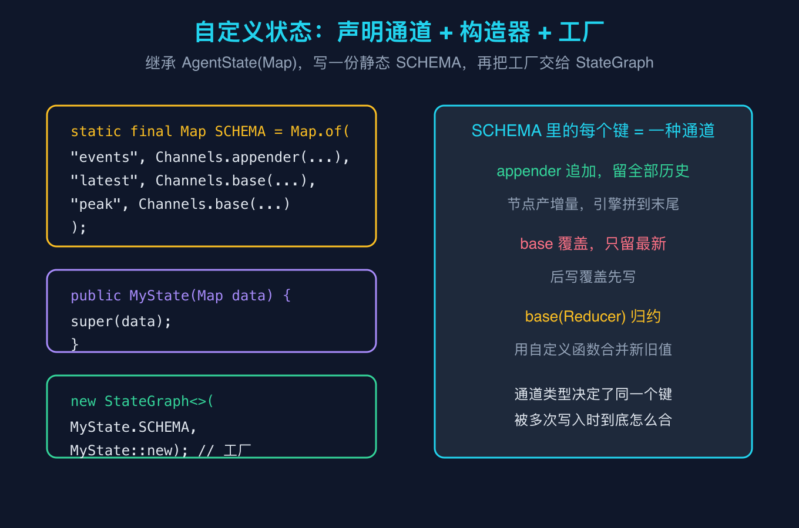
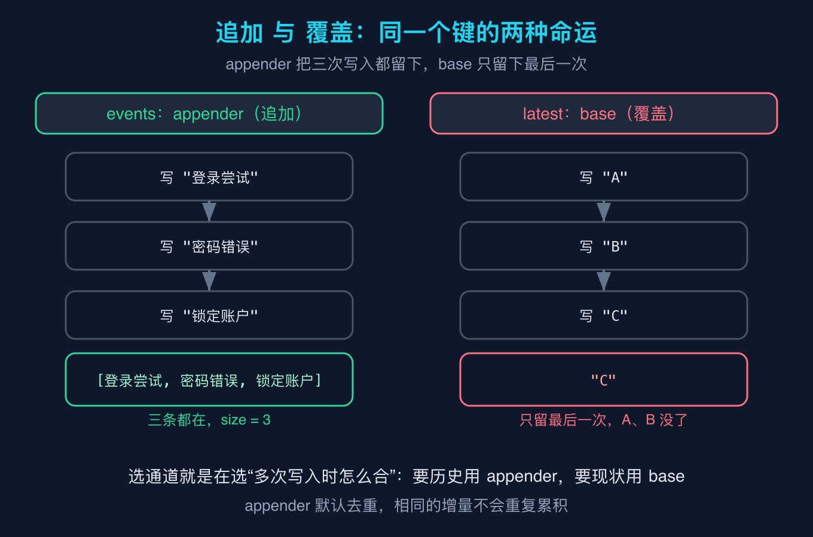
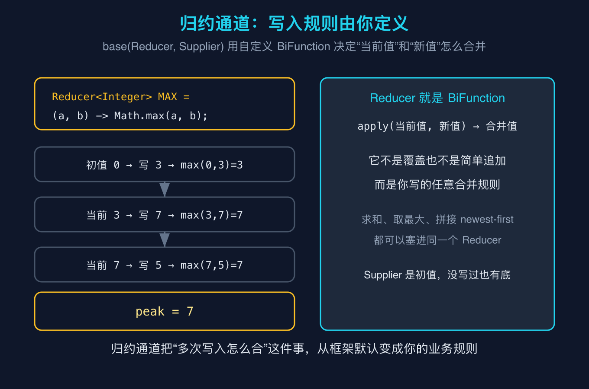

# LangGraph4j之九：自定义状态类型与自定义通道

本篇是 LangGraph4j 源码级原理拆解系列之九。上一篇之八用了一个最小自定义状态 `MyState` 来承载路由结果，这一篇就把那个状态本身拆开：它的三个通道到底怎么声明、为什么 messages 能累积成历史、除了覆盖和追加还有没有第三种玩法。整个系列的目标不变，拿一手字节码说话。

## 一个让我重新理解 state 的场景

我刚用 LangGraph4j 的时候，一直以为 state 就是一张普通的 Map，节点往里写什么，读的时候就能拿到什么。直到我要记录一个流程里的“全部告警事件”，又同时想知道“最近一次状态”，还想知道“出现过的最高风险分”。用普通 Map 的思路，我得在节点里手写一堆合并逻辑，代码又臭又长。

后来我翻了字节码才明白，LangGraph4j 的 state 根本不是裸 Map，它背后是“通道（Channel）”机制。同一个键被不同节点多次写入时，怎么合并完全由这个键对应的通道类型决定。声明对了，合并逻辑一行都不用写。

举个具体的例子。我有一个风控流程，第一步记下“登录尝试”，第二步记下“密码错误”，第三步记下“锁定账户”。我希望 events 这个键把三次都留着，latest 这个键只留最后一次的标签，peak 这个键在三次风险分里永远记住最大的那个。如果 state 是裸 Map，我得在每一步里先读旧值、再算新值、再写回去，三个键三套样板代码。有了通道，这三行声明写完，节点只管往键上写，引擎替我把合并做对。这也是为什么 MessagesState 的 messages 能自动累积出一整段对话历史，它底层不过就是一个 appender 通道。

所有事实都来自 langgraph4j-core 1.5.14 的字节码复核。

## 概念澄清一：自定义状态的三件套

自定义状态必须继承 `AgentState`，并且要做三件事：写一份静态的 `SCHEMA` 声明每个键用哪种通道，写一个接收 `Map` 的构造器把它交给父类，最后把工厂方法交给 `StateGraph`。

`AgentState` 的构造器在字节码里就是 `AgentState(Map<String, Object>)`，`StateGraph` 有一个构造器是 `StateGraph(Map<String, Channel<?>>, AgentStateFactory<State>)`。`AgentStateFactory` 本身就是 `Function<Map<String,Object>, State>`，所以 `MyState::new` 正好就是那个工厂。

```java
public static class MyState extends AgentState {
    public static final Map<String, Channel<?>> SCHEMA = Map.of(
            "events", Channels.appender(ArrayList::new),
            "latest", Channels.base(() -> ""),
            "peak",   Channels.base(MAX, () -> 0));

    public MyState(Map<String, Object> data) {
        super(data);
    }
}
```

注意 `SCHEMA` 里每个键对应的不是数据类型，而是通道类型。`events` 用了 `appender`，`latest` 用了 `base`，`peak` 用了带归约器的 `base`。这三行就决定了后面三种完全不同的合并行为。



## 概念澄清二：appender 追加 与 base 覆盖

这是最容易混淆的一对。`appender` 是追加型通道，节点只管产出“增量”，引擎把增量拼到历史末尾，所以多次写入全部保留。`base` 是覆盖型通道，后一次写入直接盖掉前一次，最后只留最新值。

我在复现脚本里让三个步骤分别写 `events` 三次、`latest` 三次。结果 `events` 累积成三条，而 `latest` 只留下最后写的 "C"。这就是两种通道在同一个键上被多次写入时的不同命运。



要记住一个细节：`appender` 默认是去重的。如果两次写入了完全相同的内容，它不会重复累积。所以“事件日志”这种场景用 `appender` 很自然，但你若想保留重复的相同事件，得改用 `appenderWithDuplicate`。选通道本质上就是在选“多次写入时怎么合”：要历史用追加，要现状用覆盖。这里有一个判断的抓手：先问自己这个键在多次写入后该长什么样。要的是一份完整清单，就用 appender；要的是最新快照，就用 base；以上两种都表达不了你的合并意图，才上 Reducer。

## 概念澄清三：归约通道，写入规则由你定义

覆盖和追加都还是框架替你定的规则。真正有趣的是第三种：`base(Reducer, Supplier)`。这里的 `Reducer<T>` 在字节码里就是 `BiFunction<T, T, T>`，它的 `apply` 接收“当前值”和“新值”，返回合并结果。

```java
public static final Reducer<Integer> MAX = (a, b) -> Math.max(a, b);
```

把 `MAX` 塞进 `peak` 通道后，每次写 `peak` 都不会简单覆盖，而是和已有值取更大者。脚本里依次写 3、7、5，合并过程是 max(0,3)=3、max(3,7)=7、max(7,5)=7，最终 `peak` 稳定停在 7。那个 `Supplier` 是初值，没写过也有 0 兜底。



归约通道把“多次写入怎么合”从框架默认变成了你的业务规则。求和、取最大、把新值拼到最前面，全部可以塞进同一个 `Reducer`。这也是 MessagesState 的 `messages` 通道为什么能自动累积对话历史：它底层就是 `appender`，而那套机制你现在可以原样用到自己的任何键上。

## 复现模块

本篇所有结论都来自下面这份可以本地跑通的脚本，不需要任何大模型密钥。

代码地址：`code/repro/src/main/java/org/example/langgraph4j/Demo9.java`

数据源：无外部依赖，纯 langgraph4j-core 1.5.14 本地库。

运行命令（在项目根目录 `code/repro` 下）：

```bash
mvn -q compile exec:java -Dexec.mainClass=org.example.langgraph4j.Demo9 -Dexec.args="--self-test"
```

精确预期输出（逐行与实际 stdout 一致，下方为脚本 `--self-test` 的真实输出）：

```text
[events] [登录尝试, 密码错误, 锁定账户]
[latest] C
[peak] 7
self-test PASS
```

脚本让三个步骤分别写入 events、latest、peak 三个键，可以直观看到 events 保留了三条、latest 只留 "C"、peak 在归约后停在 7。把 `MAX` 换成求和的 `(a, b) -> a + b`，重新跑一次，你会看到 peak 变成 15，归约规则就是这么直接。

## 结尾钩子

你现在的 Agent 里，有没有哪些“合并逻辑”是手写在不同节点里的？比如到处都在重新算最高分、重新拼历史。回去把那些键改成对应的通道声明，把合并规则收拢到 `SCHEMA` 一处，节点就能只管产增量。如果哪天你想要的合并规则 `Reducer` 表达不了，那大概率是你的状态建模本身该拆了。你打算先拿哪个键动手？

## 三句话总结

自定义状态继承 `AgentState`，靠一份静态 `SCHEMA`（声明每个键用哪种通道）加一个接收 Map 的构造器，再把 `MyState::new` 作为工厂交给 `StateGraph`。

通道类型决定了同一个键被多次写入时怎么合并：`appender` 追加留全量历史，`base` 覆盖只留最新，`base(Reducer)` 用你写的任意规则合并。

`Reducer<T>` 就是 `BiFunction<T,T,T>`，把“多次写入怎么合”从框架默认变成你的业务规则，MessagesState 的 messages 累积历史本质上也是这套机制。
