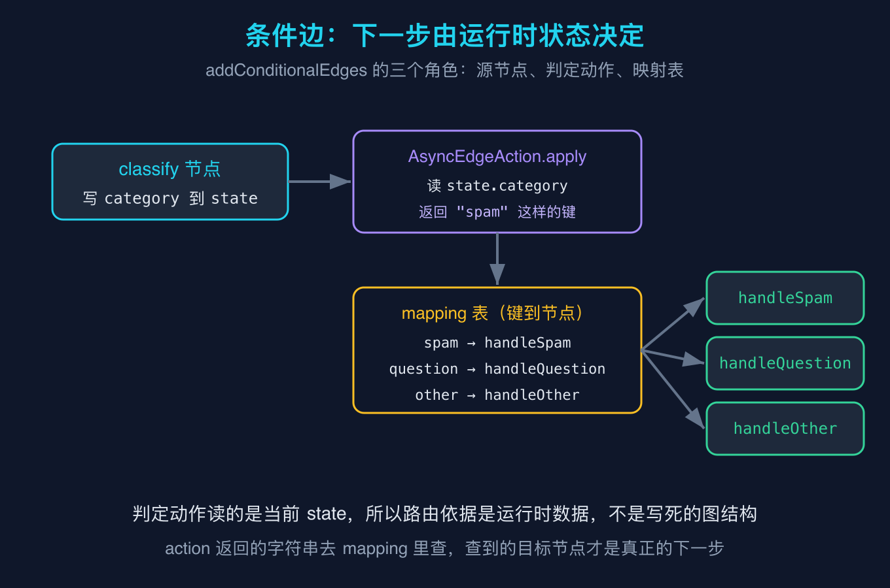
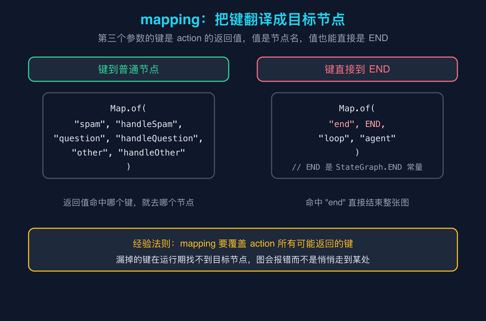
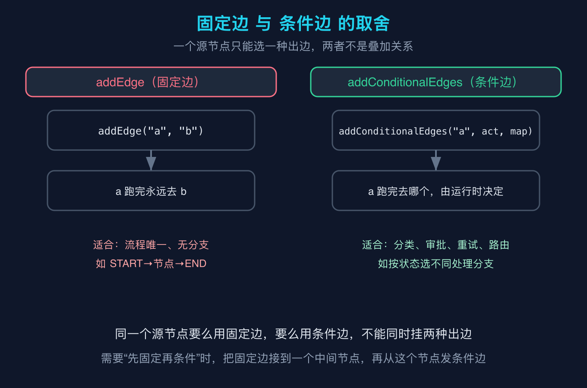

# LangGraph4j之八：条件边与动态路由

本篇是 LangGraph4j 源码级原理拆解系列之八。上一篇之六讲了消息状态与消息通道，这一篇我们拆条件边和动态路由，下一篇之九会从第一性原理把自定义状态类型和自定义通道讲透。整个系列的目标只有一个：拿一手字节码说话，不靠猜。

## 一个让我卡了半小时的场景

我第一次用 LangGraph4j 写客服分流的时候，脑子里的图是这样的：用户留言进来，先分类，再按类别走不同的处理分支。我当时想当然地写了三条固定边，从分类节点分别连到三个处理节点。结果一编译就报错，说一个源节点不能同时挂多条普通边。

后来我才明白，固定边 `addEdge("a", "b")` 的意思是 a 跑完永远去 b，它根本没有“选”的能力。要让下一步由数据决定，必须用条件边 `addConditionalEdges`。这篇就把条件边到底做了什么，从字节码层面拆开。

所有事实都来自 langgraph4j-core 1.5.14 的字节码复核，不是看文档猜的。

## 概念澄清一：条件边的三个参数

`StateGraph.addConditionalEdges` 的方法签名在字节码里是这样的：

```java
public StateGraph<State> addConditionalEdges(
    java.lang.String source,
    org.bsc.langgraph4j.action.AsyncEdgeAction<State> action,
    java.util.Map<java.lang.String, java.lang.String> mapping)
```

第一个参数 `source` 是源节点，也就是从哪个节点出来之后要做选择。第二个参数 `action` 是一个判定动作，第三个参数 `mapping` 是一张映射表。

关键在第二个参数。`AsyncEdgeAction<S>` 这个接口继承自 `Function<S, CompletableFuture<String>>`，也就是说它的 `apply` 方法接收一个 state，返回一个字符串。这个返回的字符串，就是“下一步想去哪”的键。它读的是当前 state 里的数据，所以路由依据是运行时状态，而不是写死在图结构里的东西。这就是“动态路由”四个字的全部含义。



我在这篇的复现脚本里写了一个最小自定义状态 `MyState`，它有三个通道：`messages` 走 appender 用来累积对话历史，`category` 和 `reply` 走 base 用来覆盖式存储。分类节点 `classify` 读出用户留言，判定出类别，把结果写进 `category` 通道。紧接着的条件边，它的 action 就只做一件事：把 `state.category` 读出来，原样返回。

## 概念澄清二：mapping 把键翻译成目标节点

第三个参数 `mapping` 容易被误解成“路由规则本身”，其实它只是一张查表。action 返回的那个字符串，去这张表里查，查到的值才是真正的目标节点名。

```java
g.addConditionalEdges("classify", router,
    Map.of(
        "spam",     "handleSpam",
        "question", "handleQuestion",
        "other",    "handleOther"));
```

这里 action 返回 "spam"，查表得到 "handleSpam"，图就去 `handleSpam` 节点。所以映射表的键是 action 的返回值，值是节点名。

一个容易忽略的点：值不仅能是普通节点名，还能直接是 `END` 这个常量。比如做循环守卫的时候，可以写 `Map.of("end", END, "loop", "agent")`，命中 "end" 就直接结束整张图。



还有一个坑要提醒：mapping 必须覆盖 action 所有可能返回的键。如果 action 返回了一个表里没有的键，运行期找不到目标节点，图会直接报错，而不是悄悄走到某个默认分支。所以我习惯在 action 里给一个兜底返回值，并且在 mapping 里也写上对应的兜底键。

## 概念澄清三：固定边和条件边怎么选

一句话：同一个源节点，要么挂固定边，要么挂条件边，不能同时挂两种出边。它们不是叠加关系，是二选一。

固定边 `addEdge("a", "b")` 适合流程唯一、没有任何分支的场景，比如 `START` 连到第一个节点，最后一个节点连到 `END`。它简单、可读、不会出错。

条件边 `addConditionalEdges("a", act, map)` 适合一切“下一步取决于数据”的场景：分类、审批、重试、路由。它把选择权从图结构搬到了运行时的 action 里。



如果你遇到“先固定走一段，再按条件分叉”的需求，正确做法不是给同一个节点同时挂两种边，而是把固定边先连到一个中间节点，再从那个中间节点发条件边。图的每个源节点只拥有一种出边类型，结构才合法。

## 复现模块

本篇所有结论都来自下面这份可以本地跑通的脚本，不需要任何大模型密钥。

代码地址：`code/repro/src/main/java/org/example/langgraph4j/Demo8.java`

数据源：无外部依赖，纯 langgraph4j-core 1.5.14 本地库。

运行命令（在项目根目录 `code/repro` 下）：

```bash
mvn -q compile exec:java -Dexec.mainClass=org.example.langgraph4j.Demo8 -Dexec.args="--self-test"
```

精确预期输出（逐行与实际 stdout 一致，下方为脚本 `--self-test` 的真实输出）：

```text
[category] spam
[reply] 已归档
[messages] [用户留言：你们的发票怎么开？有没有优惠, 回复：这条营销/发票类留言已归档，不再跟进]
[lastMessage] 回复：这条营销/发票类留言已归档，不再跟进
self-test PASS
```

脚本里输入的是一条含“发票”“优惠”的留言，分类节点判定为 spam，条件边据此走到 `handleSpam`，最终 messages 累积成两条，category 为 spam，reply 为“已归档”。把输入换成含“吗”的问句，你会看到它走 `handleQuestion` 分支，这就是动态路由在起作用。

## 结尾钩子

你现在的项目里，有没有哪张图是“假装没有分支”的？比如一个永远走同一条路的流程，其实在某些输入下本该走另一条。回去翻一下你用 `addEdge` 写死的那几条边，试着把它们换成 `addConditionalEdges`，看看条件边能不能替你省掉一堆 if else。下一篇之九，我们会讲清楚 `MyState` 里那三个通道到底是怎么声明出来的，以及除了覆盖和追加，还有没有第三种玩法。

## 三句话总结

条件边 `addConditionalEdges` 用三个参数描述一次动态路由：从哪个节点出发、用一个 action 读 state 返回键、用一张 mapping 把键翻译成目标节点。

action 读的是运行时 state，所以“下一步去哪”由数据决定，而不是由图结构写死，这就是动态路由的本质。

同一个源节点只能挂一种出边，要“先固定后分叉”就把固定边连到中间节点，再从中间节点发条件边。
