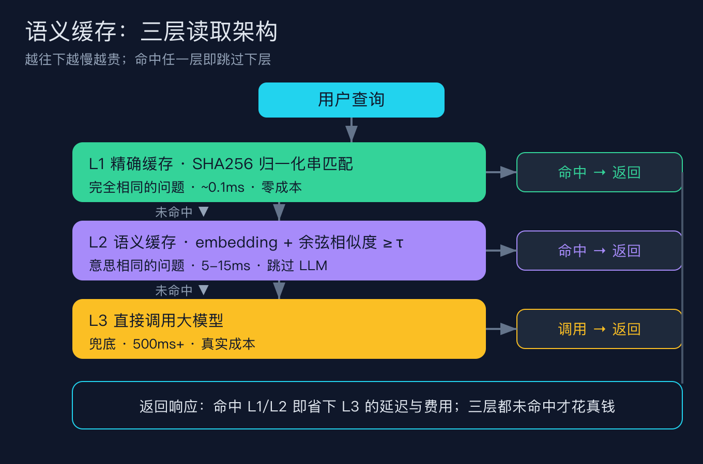
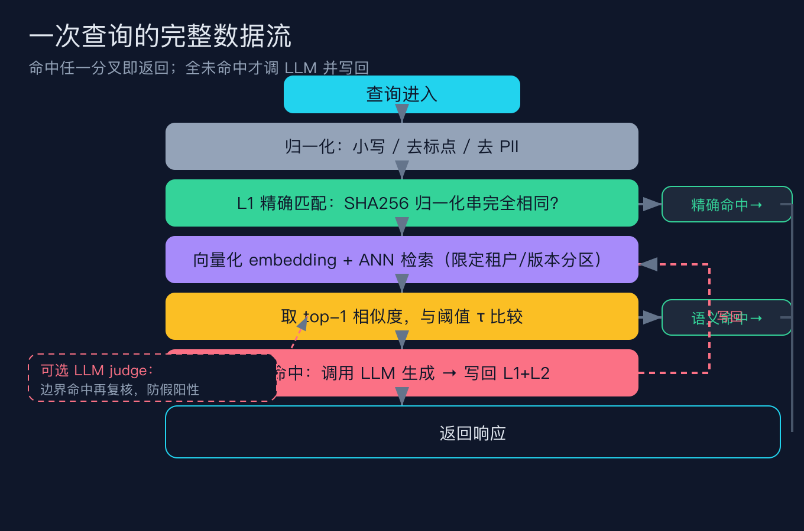
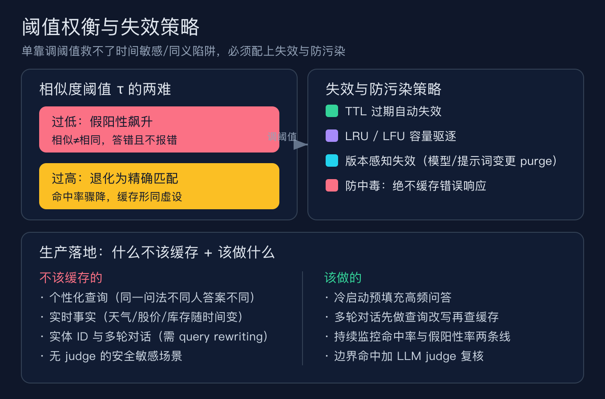

# 我给大模型问答加了层语义缓存，命中率上去了，却把问「今天天气」的人答成了「明天天气」

（这是「AI 工程基础设施原理」系列的第一篇。这个系列我想把面试里常被追问、文档却很少讲透的底层件拆开讲，包括语义缓存、向量检索、上下文压缩、流式网关与限流。本篇先把最容易被低估也最容易踩坑的语义缓存讲清楚。）

我上个月给一个问答接口加了层语义缓存，本意很简单：用户老拿差不多的问法反复问，与其每次都调大模型花钱花时间，不如把答过的存起来，意思相近就直接返。上线第一周命中率看着漂亮，账单也下来了。直到有个用户问「北京明天天气怎么样」，系统笑眯眯地回了「北京今天晴，最高 22 度」那条缓存，对方一头雾水。

这不是我手抖写错分支，是语义缓存最典型的失败模式：它把「相似」当成了「相同」。这篇我就用一次具体的翻车，把语义缓存到底是什么、查询怎么走、阈值怎么调、哪些坑会半夜叫醒你，逐层讲透。所有数字都来自我附在文末的可复现脚本，生产案例我会标出处和口径。

## 一、先说清楚它到底是什么（概念澄清①：不是精确缓存，更不是 prompt caching）

传统缓存靠字符串精确匹配。问题是人问同一个意图有无数种说法：「怎么重置密码」「我忘了密码咋办」「密码重置步骤是什么」，精确缓存把这三句当成三个完全不同的请求，命中率永远上不去。语义缓存不比字面，它比的是意思，把查询变成向量，在向量库里找最近的邻居，相似度过了阈值就直接返旧答案，根本不调大模型。

最经典的开源实现是 GPTCache（zilliztech/GPTCache），背后的论文 GPT Semantic Cache（arXiv:2411.05276，Regmi 和 Pun，2024）在多个查询类别上把 API 调用量降了最多 68.8%，命中率区间 61.6% 到 68.8%，正向命中率（命中里答对的比例）超过 97%。

它的读取分三层，越往下越慢越贵，命中任一层就跳过下面所有层。



L1 是精确缓存，对归一化后的查询做 SHA256，完全相同才命中，大约 0.1 毫秒、零成本。L2 是语义缓存，把查询向量化后做近似最近邻检索，取最相似的那个算余弦相似度，过了阈值 τ 就算命中，大约 5 到 15 毫秒，跳过一次大模型调用。L3 是兜底，真正去调大模型，五百毫秒往上，花的是真金白银。这里有个很多人混淆的点：语义缓存和省钱的另一种手段 prompt caching 不是一回事。prompt caching 是模型厂商在基础设施层复用相同前缀的 KV 状态，模型仍然跑、仍然生成新回答，只是省了重复算前缀的钱（通常打九折）；语义缓存是应用在网关层直接复用整条回答，连模型调用都省了，是百分之百的省（Klu、FrugalAI、NeuralTrust 都做过这个辨析）。两者不是二选一，是不同层、不同账。

## 二、一次查询是怎么被处理的（概念澄清②：数据流）

把一次查询的完整路径画出来，你就能看清每一跳在哪花钱、在哪出错。



进入查询先归一化：转小写、去标点、去 PII（真实系统这步很关键，不能把用户隐私当缓存键）。然后走 L1 精确匹配，命中就返回。没命中就向量化做 ANN 检索，这里有个工程细节很多人忽略：检索必须限定租户、模板版本、模型版本这几个分区，否则 A 客户的私有回答可能被子查询命中返给 B 客户（AWS 和多个 FinOps 复盘都把这列为上线前置条件）。取 top-1 相似度跟阈值 τ 比，过了就返回缓存响应，没过就调大模型、生成后写回 L1 和 L2。边界命中（相似度卡在阈值附近）还可以接一个可选的 LLM judge 再复核一次，专门防假阳性。

注意最右边那条「写回」回路：未命中时调完 LLM 一定要把新问答写回缓存，否则这一层永远空转，命中率永远起不来。我附的脚本里这一步和 LRU 驱逐是绑定的，驱逐 L2 时同步清掉 L1 对应条目，否则精确层会无限增长。

## 三、为什么阈值是最难调的那个旋钮（概念澄清③：相似度权衡与失效策略）

阈值 τ 决定「多像才算同一个问题」。定低了假阳性飙升，把相似但不同的问题答错；定高了缓存退化成精确匹配，命中率塌方。行业里 GingerLabs 建议起点用 0.85，GPTCache 论文的经验最优是 0.8，低于 0.75 假阳性率会显著抬头。但光看建议没用，我自己跑了一次阈值扫描，结论比想象中更扎心。

我准备了一小批带真实意图标注的查询（是否和缓存里的某条问的是同一件事），让缓存在不同 τ 下决策，统计命中率、假阳性数和漏命中数。结果如下（语料和算法都在文末脚本里，可复现）：

| 阈值 | 命中率 | 假阳性 | 假阳性率 | 漏命中 |
| --- | --- | --- | --- | --- |
| 0.60 | 1.00 | 2 | 1.00 | 0 |
| 0.70 | 1.00 | 2 | 1.00 | 0 |
| 0.75 | 0.67 | 2 | 1.00 | 2 |
| 0.85 | 0.50 | 1 | 0.50 | 2 |
| 0.95 | 0.17 | 0 | 0.00 | 3 |

你看，τ 从 0.95 降到 0.85，命中率从 0.17 跳到 0.50，但同时假阳性出现了（把「明天天气」当「今天天气」答）；再往下压到 0.60，命中率冲到 1.00，可那两条本该答错的问题（明天 vs 今天、LSTM vs RNN）全被当成命中，假阳性率 100%。最顽固的是「今天/明天」这对，它俩相似度有 0.909，一直撑到 0.95 才被挡住。换句话说，靠调阈值救不了时间敏感这类陷阱，你再怎么拧旋钮，0.85 看着安全，它照样咬人。

真正的修法不在阈值，而在两件事：第一，压根别把时间敏感、个性化、实体 ID 的查询放进语义缓存；第二，给边界命中加 judge 复核。失效策略也得配套。



缓存不是写了就完事。TTL 让过期条目自动失效：稳定 FAQ 用 1 小时 TTL 比 5 分钟能让命中率翻倍（BCloud 复盘），但得配准确率监控，不能无脑拉长。LRU 或 LFU 做容量驱逐，防止热数据把冷数据挤掉的同时也防止内存爆掉。版本感知失效最容易被忘：模型版本、system prompt 一变，旧回答可能整批失效，得 purge。还有防中毒：错误的响应绝对不能写进缓存，否则错答案会被当成正解反复返。

## 四、三个会让你半夜被叫醒的坑

坑一，假阳性且不报错。这是语义缓存独有的失败模式，也是最危险的。它不抛异常，自信地返回一个错的、但看起来合理的答案。我文章开头的「今天/明天」是轻量级版；生产里更阴的是「取消订阅」和「取消订单」在 0.85 也能撞上（seoma 的复盘举过这个例）。我的脚本用运营阈值 0.85 复现了今天/明天碰撞，证明这个坑不是调低阈值才出现。

坑二，缓存了错误答案或过期答案。中毒（把一次模型翻车存成标准答案）和 TTL 配错（政策早改了，缓存还在返旧版）都会发生。修法是写入前校验响应健康、模型或提示词变更就 purge、TTL 按内容波动性分级。

坑三，把个性化、实时、实体类、多轮对话也塞进缓存。实时股价、库存、账户余额这些随时间变的东西一旦缓存，答的就是昨天的真相；多轮对话则必须先做 query rewriting（把会话关键事实拼进当前问题再查），否则嵌入会被每轮的细碎改动带偏（AWS 的语义缓存博客专门讲了这个）。这类坑的特征是命中率虚高，但答非所问。

坑四，用错向量化，对同义词束手无策。我的演示用的是词袋向量，纯为把架构跑通，它有个先天短板：「显卡」和「GPU」在词袋里毫无交集，我的扫描里这两个同义查询全成了漏命中。真实系统必须上 embedding 模型（如 all-MiniLM-L6-v2、text-embedding-3 系列），NeuralTrust 把「embedding 质量和阈值」列为语义缓存最重要的两个实现决策，就是这个道理。换句话说，缓存省不省钱，七成看你的向量模型选得对不对。

## 五、它到底省了多少（生产数字，标注口径）

说几个我交叉核实过的数字，但请记住它们是案例和研究口径，不是承诺，更不是你上了就能拿到的数。

GPTCache 论文：命中率 61.6% 到 68.8%，正向命中率超过 97%。一个客服生产案例（seoma / BCloud 复盘）：命中率从 18% 拉到 67%，月账单从 4.7 万美元降到 1.27 万美元，降了 73%。AWS 用 ElastiCache 给 Bedrock 做语义缓存，τ=0.75 时成本降 86%、准确率 91%，单条延迟最高降 59 倍（6.51 秒降到 0.11 秒）。NeuralTrust 则泼了盆冷水：生产实际通常只有 20% 到 45% 的流量被语义缓存命中（引 Technion 计算机系 2026 的研究），不是厂商宣传的 95%，但每天几十万调用里三成是语义相似的，省下来也相当可观。

延迟侧，缓存查找约 20 毫秒（p50），大模型调用约 850 毫秒，命中就是几百毫秒变几十毫秒。还有个常被忽略的真相：冷启动期（新部署前 4 到 6 周）缓存基本没用，得等查询模式攒够才出收益（Kalvium Labs 复盘）。另外绝对 token 节省量比命中率百分比更重要，一个 1 万 token 的工具目录命中 80%，比一个 500 token 提示词命中 100% 省得多。

## 六、什么场景不适合用

个性化查询（同一问法不同人答案不同）、实时事实（天气、股价、库存随时间变）、实体 ID 与多轮对话（需 query rewriting）、没有 judge 兜底的安全敏感场景（金融合规这类答错有监管后果，宁可每次都新跑），都不该进语义缓存（Prismetric、FrugalAI、Scaler 都列过这份清单）。语义缓存的目标不是不惜代价拉高命中率，而是在答案仍然有效的范围内，安全地消灭那些本可以不发的冗余调用。

## 复现模块

代码地址（纯标准库 Python，免 API key，可直接进 CI）：

- `code/repro/semantic_cache_core.py`：缓存引擎核心，含精确缓存、语义缓存、假阳性、TTL、LRU 四类演示与自检。
- `code/repro/semantic_cache_sim.py`：阈值权衡仿真，扫描不同 τ 下的命中率与假阳性。

数据源：无外部依赖，用确定性 mock LLM 加词袋向量复现缓存架构本身（真实系统请用 embedding 模型替代词袋）。

运行命令：

```
python code/repro/semantic_cache_core.py
python code/repro/semantic_cache_core.py --self-test
python code/repro/semantic_cache_sim.py
python code/repro/semantic_cache_sim.py --self-test
```

预期输出（self-test 全绿，可逐行与上面命令的实际输出核对；演示用的 `LLM回答:` 是确定性 mock，真实场景会换成模型响应）：

```
self-test [1] 精确命中: PASS
self-test [2] 语义命中: PASS
self-test [3] 阈值拦截近义变体: PASS

=== 假阳性陷阱：连运营阈值 0.85 都把『今天』和『明天』当同题 ===

  先问: 北京今天天气怎么样
    缓存(LLM) -> LLM回答: 北京今天天气怎么样
  再问: 北京明天天气怎么样
    命中来源 SEMANTIC -> 返回 LLM回答: 北京今天天气怎么样
  假阳性判定: 发生碰撞，把问今天的人得到的答案答给了问明天的人
self-test [4] 假阳性陷阱: PASS

=== TTL 失效：过期条目被当作未命中，重新调用 LLM ===

  写入时刻 t=0，TTL=100；查询时刻 t=200
  第二次查询来源 MISS，LLM 调用计数 2
  TTL 生效判定: 是
self-test [5] TTL 失效: PASS

=== LRU 驱逐：超过最大容量，最久未用被淘汰 ===

  容量上限 2，写入 3 条后重新查询『问题一』
  来源 MISS，LLM 调用计数 4
  LRU 生效判定: 是
self-test [6] LRU 驱逐: PASS

ALL SELF-TESTS PASSED
```

演示脚本第二轮热启动里，5 条重复或近义查询跑出命中率 0.45（小样本演示，真实生产常见 60% 到 90%），LLM 调用 6 次、示意节省 0.010 美元（脚本里的 0.002 美元/次是示意单价，不是真实报价）。阈值仿真那张表就是上面第三节贴的那张，数字完全一致。

## 结尾钩子

你现在的项目里，命中率那张曲线漂亮吗？我打赌你拉一下日志会发现，真正撑起命中率的不是那些「意思相近」的近义查询，而是大把逐字重复的相同问题，它们本该被最便宜的 L1 精确缓存吃掉，却被你埋在语义层下面反复算向量。下一篇我打算拆向量检索本身：同样的相似度，为什么有的向量库查得快、有的查着查着就把不同意图的也捞上来了。你踩过语义缓存最离谱的一次假阳性是什么？评论区告诉我，我挑几个放进下一篇当反面教材。

## 三句话总结

语义缓存按意思而不是字面复用回答，分 L1 精确、L2 语义、L3 大模型三层，命中任一层就跳过更贵的下层。它最危险的失败模式是假阳性：把相似当相同，答错还不报错，今天天气和明天天气在常见阈值下都能撞上。省成本是真的，但前提是选对 embedding 模型、管好 TTL 与版本失效、并且永远别把时间敏感和个性化的查询塞进去。

## 来源

- GPT Semantic Cache 论文（命中率 61.6% 到 68.8%，正向命中率 >97%）：https://arxiv.org/abs/2411.05276
- GPTCache 开源实现：https://github.com/zilliztech/GPTCache
- NeuralTrust，prompt caching 与 semantic caching 辨析及生产命中率 20% 到 45%：https://neuraltrust.ai/blog/llm-caching-strategies
- GingerLabs，多层级 LLM 缓存与阈值建议（起点 0.85）：https://www.gingerlabs.ai/blog/multi-tier-llm-cache
- AWS，用 ElastiCache 给 Bedrock 做语义缓存（τ=0.75 成本降 86%、延迟降 59 倍）：https://aws.amazon.com/blogs/database/lower-cost-and-latency-for-ai-using-amazon-elasticache-as-a-semantic-cache-with-amazon-bedrock
- Klu，semantic caching 与 prompt caching 概念辨析：https://klu-ai.vercel.app/glossary/semantic-caching
- FrugalAI，prompt caching 与 semantic caching 侧面对比：https://frugalai.io/blog/prompt-caching-vs-semantic-caching
- 生产案例（命中率 18% 到 67%，账单降 73%）：https://seoma.com.ua/en/uk-uazmenshit-vitrati-na-llm-na-73-za-dopomogoju-semantichnogo 与 https://bcloud.consulting/en/blog/llm-inferencia-costes-73-reduccion-semantic-caching-2025
- Percona，语义缓存可为 LLM 应用降本 40% 到 80%：https://www.percona.com/blog/semantic-caching-for-llm-apps-reduce-costs-by-40-80-and-speed-up-by-250x/
- Redis，什么是语义缓存：https://redis.io/blog/what-is-semantic-caching/
