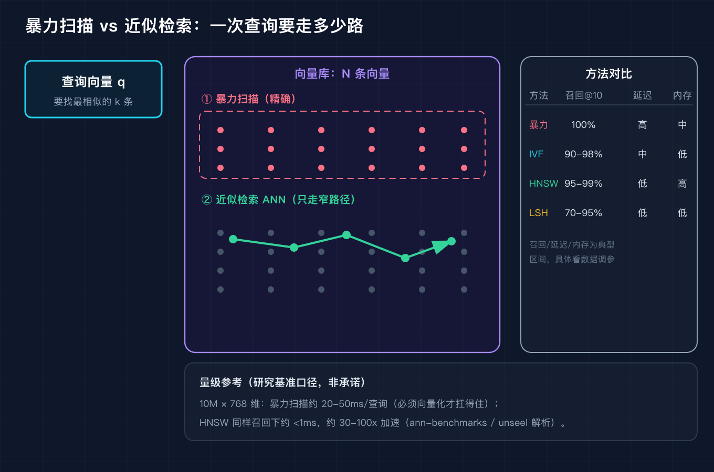
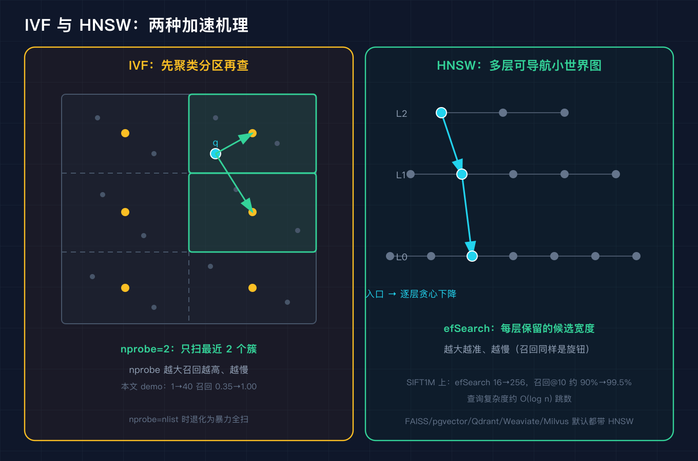
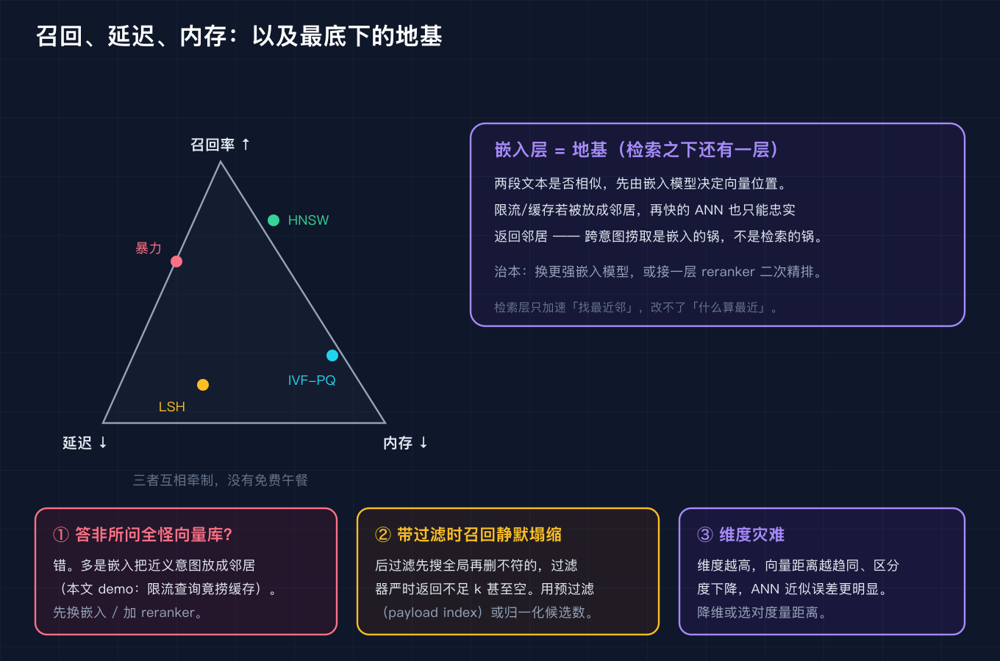

# 搜「怎么做接口限流」，向量库却把「怎么做缓存」的段落递了上来

这是「AI 工程基础设施原理」系列的第二篇。上一篇我们拆了语义缓存，讲它为什么命中率七成却答非所问。这一篇往下走一层，拆向量检索本身。下一篇我打算拆向量数据库的元数据过滤和选型，因为那是「召回被悄悄吃掉」的另一个重灾区。

先说我踩的坑。我给团队搭了个内部知识库问答，底层用向量库做语义检索。有天同事搜「怎么做接口限流」，系统却把「怎么做缓存」的几段话排在了最前面。他当场发飙：你这检索是不是坏掉了，我问限流你给我缓存干什么。

我第一反应也是：向量库不行，换一个。后来我把整条链路拆开看，才发现锅不在检索这一层。这一篇就把这件事讲清楚，顺便回答一个更普遍的问题：同样都是算余弦相似度，为什么有的向量库查得飞快，有的查着查着就把不同意图的也捞上来了。

## 先说代价：为什么不能每次都暴力扫一遍

向量检索的本质，是给一个查询向量 q，从库里 N 条向量里找出最相似的 k 条。最直白的做法是暴力扫描：拿 q 和每一条算一次余弦（或欧氏距离），排个序取前 k。这就是 O(n·d) 每查询，n 是向量条数，d 是维度。

问题在规模。真实 embedding 通常是 768 到 1536 维。假设库里有 1000 万条、每条 768 维，一次暴力查询要做约 76.8 亿次乘加。即便用 SIMD 向量化，业界基准给出的是 20 到 50 毫秒一条查询（这是研究基准口径，不是我厂里的实测，别当承诺）。到了十亿级，暴力直接不可用。

近似最近邻（ANN）就是为这件事生的：用一点点召回损失，换几十上百倍的提速。下面是暴力、IVF、HNSW、LSH 几个家族的典型区间对比（区间来自公开基准，具体数值看你的数据和调参）。



图上右边那张表里，暴力是 100% 召回但延迟高；IVF 用分区把内存压到很低；HNSW 召回和延迟都好但内存高（要存图边）；LSH 实现简单但召回下限偏低。左边那块图直观表达了区别：暴力是红框罩住全部点逐条算，ANN 是只沿一条窄路径走。

量级感受一下（同样研究基准口径）：10M 乘 768 维，HNSW 在同等召回下能做到 1 毫秒以内，相比暴力大约是 30 到 100 倍加速；ann-benchmarks 项目里 HNSW 在 SIFT1M 上常见 5000 到 20000 QPS 同时守住 95% 召回。这些数字不是承诺，是让你心里有个数：规模一大，ANN 不是可选项，是必选项。

## ANN 到底怎么加速：IVF 分区，和 HNSW 多层图

两个最主流的机理，我各画了一边。

IVF（倒排文件）的思路是先把空间切成 nlist 个簇，每个簇记一个质心，查询时只挑最近的 nprobe 个簇，在那些簇内部做暴力。nprobe 越大，扫得越全，召回越高，但也越慢。nprobe 等于 nlist 时，它退化成暴力，召回回到 100%。

HNSW（分层可导航小世界图）的思路是建一张多层图：上层稀疏、下层稠密，查询从顶层入口出发，逐层贪心往下跳，每层只保留一小撮候选（由 efSearch 控制）。查询复杂度大约是 O(log n) 跳数。efSearch 越大，候选留得越多，越准也越慢。



这两个旋钮（IVF 的 nprobe、HNSW 的 efSearch）讲的是一个道理：召回率是个旋钮，不是常数。我把这个用成簇数据在脚本里实跑了一遍，nprobe 从 1 走到 40，召回从 0.353 一路爬到 1.000，而扫描的向量数从 50 线性涨到 2000（延迟代理）。这就是你要调的那个权衡曲线，不是玄学。

```text
设置: N=2000 向量, dim=64, 10 个语义簇, nlist=40 簇, k=5
 nprobe |   扫描簇数 |   召回率@5 |  延迟代理(扫描向量)
      1 |        1 |    0.353 |            50.0
      2 |        2 |    0.460 |           100.0
      4 |        4 |    0.573 |           200.0
      8 |        8 |    0.687 |           400.0
     16 |       16 |    0.853 |           800.0
     40 |       40 |    1.000 |          2000.0
```

顺带说一句，为什么我用「成簇数据」而不是纯随机数据做这个实验。真实语料里语义相近的文档在向量空间本来就是聚成一团的，成簇数据才贴近这个现实；纯随机的各向同性数据会让召回曲线难看且失真。这本身也是个提醒：嵌入有没有把相似内容聚到一起，直接决定了检索层能有多省事。

## recall@k 是什么，以及最底下那层地基

recall@k 的定义很朴素：先用精确暴力检索得到「真实的Top-k近邻」，再看近似索引返回的Top-k里命中了几个，占真实近邻的比例。它隔离的是索引层（IVF/HNSW 的近似误差），和嵌入模型无关。这点很关键，后面要用来甩锅。

我把召回、延迟、内存三件事画成了一个互相牵制的三角，再加上最底下那层地基。



三角里没有免费午餐：HNSW 召回好、延迟低，但内存高（要存图边）；IVF 配上乘积量化（PQ）能把内存压到很低，代价是召回和延迟中庸；LSH 实现最简单，召回下限也最低。选哪个，看你手里是内存-bound 还是召回-bound。

但三角再怎么调，都救不了最底下那层地基：嵌入层。两段文本是不是相似，先由嵌入模型决定它们的向量位置。如果模型把「接口限流」和「接口缓存」放成了邻居，那么无论你用多快的 ANN，它都只会忠实地把邻居递上来。检索层只加速「找最近邻」，改不了「什么算最近」。

我用字符级词袋（纯教学替代，真实模型是稠密语义向量，但检索机制完全一样）复现了这个现象。查询「接口限流的令牌桶算法怎么做」，即便用精确暴力检索，Top4 里也只有 3 条限流，第 4 条已经是缓存：

```text
查询: 接口限流的令牌桶算法怎么做   (真实意图=限流)
暴力(精确)检索 top4:
    [限流]  cos=1.000
    [限流]  cos=0.645
    [限流]  cos=0.538
    [缓存]  cos=0.524
```

注意，这是精确暴力，没有任何近似误差。也就是说，跨意图捞取在这条链路里已经发生了，和 ANN 半点关系都没有。再叠上 IVF（nprobe=2），Top4 里限流数量还降到了 2 条，ANN 又在上面加了一层漏召回。两类毛病叠在一起，所以你既换了向量库、又调了参数，该捞错还是捞错。

## 三个生产环境的坑

坑一，把答非所问全怪向量库。我开头就犯了这个错。先确认一件事：跨意图、近义混淆，九成是嵌入层的问题。治本是换更强的嵌入模型，或者在检索后面接一层 reranker 做二次精排，而不是在检索层反复调 nprobe。

坑二，带元数据过滤时召回静默塌缩。真实业务几乎都要过滤，比如「在分类=技术的文档里搜相似向量」。后过滤的做法是先搜全局 Top-k 再删掉不符的，一旦过滤器很严（比如只有 1% 文档命中），返回可能不足 k 甚至直接空，而延迟图表看起来还很快，问题被藏起来了。正解是预过滤（像 Qdrant 的 payload index 在图遍历时就 pruning 候选），或者把候选数归一化到 min(k, 符合条件的候选数) 再谈召回。研究基准里（AIMultiple 的七引擎测试）也提到，带强过滤时各引擎的 Recall@10 仍能守住 0.96 到 1.00，前提是过滤做对了。

坑三，维度灾难。维度越高，向量之间的距离越趋同，区分度下降，ANN 本来就有的一点近似误差会被放大，看起来就是「查着查着把不相关的也捞进来」。该降维降维，该选对距离度量（余弦还是内积还是欧氏）就选对，别一股脑塞 1536 维。

## 生产数字怎么看（标个口径）

我把查到的一些公开基准数字摆在这里，全部是「研究或案例口径」，不是对任何一家产品的承诺：

- FAISS 文档与多篇解析：IVF-PQ 内存极低，HNSW 召回与延迟综合最好，LSH 流式插入友好。
- 10M 乘 768 维：暴力约 20 到 50 毫秒每查询，HNSW 同等召回约 1 毫秒以内（约 30 到 100 倍加速）。
- ann-benchmarks：HNSW 在 SIFT1M 上常见 5000 到 20000 QPS 同时 95% 召回；efSearch 从 16 提到 256，召回@10 大约从 90% 升到 99.5%。
- 七引擎 RAG 基准（2026）：在 Recall@10 约 0.95 时，各引擎 nDCG@10 只差 0.014，说明数据库层的近似误差对最终答案质量的影响其实很小，真正的差距在嵌入层。

这些数字帮你建立量级直觉，落地时请在你自己的数据和硬件上重测。

## 什么场景不适合上 ANN

数据量很小（比如库里不到一百万条）时，暴力扫描可能就够了，上 ANN 反而多一层复杂度和近似误差。需要 100% 精确返回的场景（比如精确去重、强一致性的精确匹配）也不该用近似索引。需要强一致性带过滤的检索，请优先确认用的是预过滤而非后过滤。

## 复现模块（纯标准库，免 key，可复现）

代码地址：本文同仓 `code/repro/` 目录（GitHub 见文末）。

数据源：脚本内置合成数据（成簇随机向量 + 字符级词袋语料），无需外部下载，零密钥、零第三方依赖，跨机器可复现。

运行命令：

```bash
cd code/repro
python3 vector_retrieval_core.py --self-test    # 六项断言全部 PASS
python3 vector_retrieval_core.py                # demo_ann + demo_intent
python3 vector_retrieval_sim.py                 # nprobe 扫描 + 数据量扫描
```

精确预期输出（来自 `code/repro/EXPECTED_OUT.txt`，self-test 段需逐行一致）：

```text
=== self-test ===
  [1] cosine 自相似=1                          PASS
  [2] 暴力检索 top1=自身, 余弦在[0,1]           PASS
  [3] IVF nprobe=nlist 召回=1.000              PASS
  [4] IVF nprobe=1 召回<1.000 (近似损失)       PASS
  [5] 嵌入确定性(同输入同向量)                PASS
self-test PASS
```

脚本里嵌的是字符级词袋而非真实 embedding，只为零依赖演示检索机制；真实模型产出的维度（768 到 1536）不影响这里的分区、召回、近似损失逻辑。

## 结尾钩子

回到开头那个场景：同事搜「怎么做接口限流」，系统递上来「怎么做缓存」。你现在应该能脱口而出：先别换向量库，去查嵌入层是不是把近义意图放成了邻居；再查过滤是不是后过滤在悄悄吃掉召回。你踩过类似的坑吗，是嵌入的锅还是检索的锅，评论区告诉我，最好带一段你自己的查询和返回。下一篇我拆向量数据库的元数据过滤与选型，正好接着这个坑往下讲。

## 如果你要把它讲给别人听（三句话）

向量检索用 ANN 拿一点召回损失换几十倍提速，IVF 靠分区、HNSW 靠多层图，召回是个旋钮不是常数。但跨意图捞取多半不是检索的锅，而是嵌入层把不同意图放成了邻居，检索层只加速、改不了「什么算最近」。带元数据过滤时还要小心后过滤让召回静默塌缩，以及高维下的维度灾难。

## 来源

- FAISS 官方文档（Meta）：IVF 源自 Video Google，PQ 源自 Jégou 等人 PAMI 2011，HNSW 源自 Malkov & Yashunin 2016。
- ann-benchmarks 项目（Aumüller 等人）：各 ANN 算法的标准化召回与 QPS 对比。
- unseel.com 的 HNSW 解析：10M 乘 768 暴力与 HNSW 的延迟与加速数量级。
- AIMultiple 2026 向量数据库基准：七引擎 RAG 场景下 Recall@10、nDCG@10 与带过滤表现。
- mazdek.ch / locionic.com 2026 向量数据库选型对比：pgvector、Qdrant、Weaviate、Milvus、Pinecone 的延迟、召回、内存区间。
- 本文所有具体数值均标注为研究或案例口径，落地请自测。
