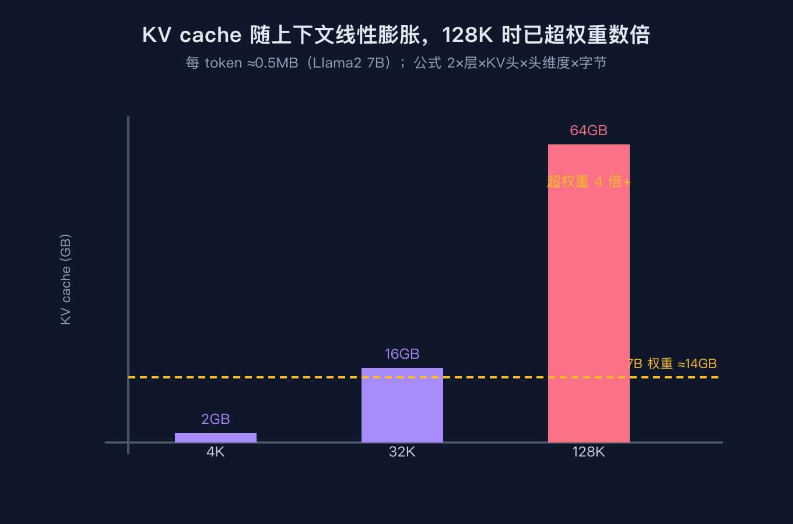
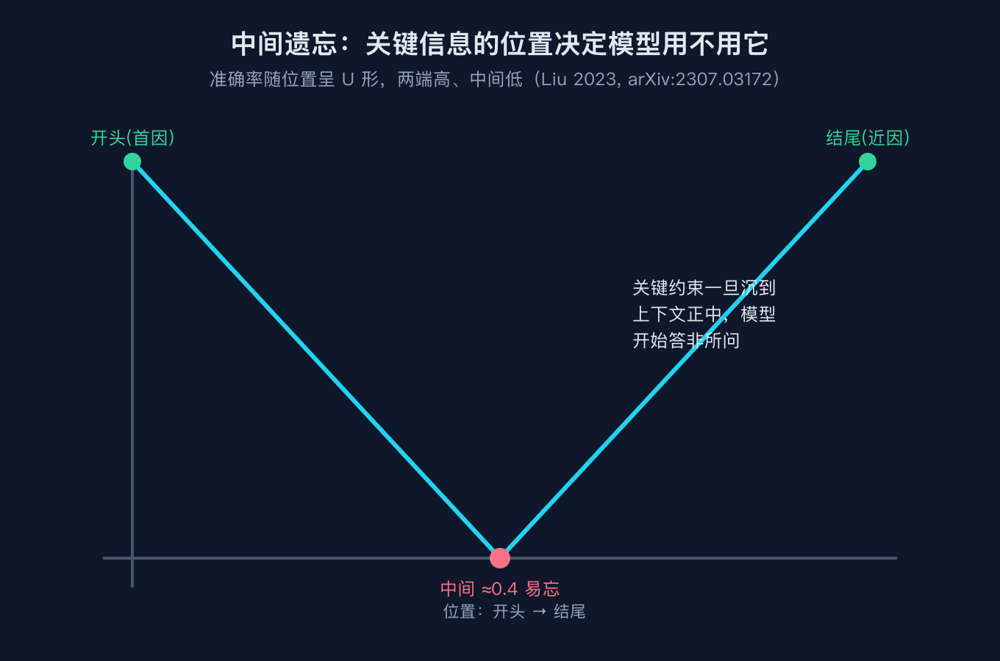
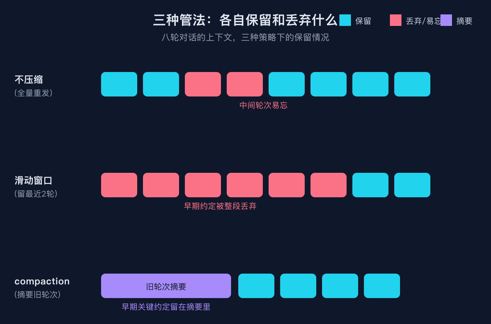

# 我把整本接口文档塞进 system prompt，前 3 轮答得准，第 8 轮开始胡说，账单还翻了 4 倍

这是 AI 工程基础设施原理系列第三篇。前两篇讲了语义缓存（为什么命中率七成还会答非所问）和向量检索（为什么搜接口限流却捞出缓存段落），这一篇讲一个更贴近日常的场景：你的上下文到底为什么又贵又不准，以及怎么把它压下去。

我是做接口联调的时候踩到这个坑的。那天接一个第三方开放平台，文档厚得像一本书。我图省事，把整本接口文档（大约八千个 token）直接塞进 system prompt，想着让模型随时能查。前几轮确实顺：问鉴权怎么写、问分页参数怎么传，它都对。到了第八轮，我问一个之前第三轮明明聊过的限流头字段，它给了我一个错的字段名，我照做直接被网关拒了。更扎心的是月底账单：我本以为把文档放 system prompt 是一次性开销，结果那八轮对话的花费是我预期的四倍左右。

我花了一晚上把它拆开，发现这两件事（答非所问、账单爆炸）其实是同一个根因的两个侧面：上下文在不受控制地长大，而你既没有管它的成本，也没有管它的质量。

## 先算一笔账：长上下文贵在哪

很多人以为长上下文贵在模型本身。错。贵在 KV cache。

大模型是自回归生成的：每生成一个新 token，都要用到前面所有 token 的 Key 和 Value 状态。这些状态不能每次现算，于是推理引擎把它们缓存下来，这就是 KV cache。它的体积有一个很朴素的公式：

    每 token 的 KV 字节数 = 2（K 和 V 各一份） × 层数 × KV 头数 × 头维度 × 每元素字节数

套一个经典结构，Llama 2 7B：32 层、32 个 KV 头、头维度 128、FP16 每元素 2 字节。算出来每个 token 大约占用 0.5 MB。这个数字看起来不大，但它随上下文长度线性增长，而且每一个并发请求都各存一份。

也就是说：

    4K 上下文：4096 × 0.5 MB ≈ 2 GB
    128K 上下文：128 × 0.5 MB ≈ 64 GB

而 7B 模型权重本身 FP16 也就大约 14 GB。一个 128K 的上下文，光 KV cache 就能胀到权重的四倍多。线上同时来几十个请求，显存墙本质就是 KV cache 墙。这也是为什么长上下文推理比短对话贵那么多，贵的不在模型，在记住整段对话的那份缓存。

需要补一句：现代模型普遍用了 GQA（分组查询注意力），让多个查询头共享一组 KV 头，KV 头数从 32 降到 8，KV cache 直接按比例缩水。Llama 3 8B 每 token 的 KV 就明显小于 Llama 2 7B。所以 KV 头数是这个公式里真正能动的杠杆，改架构比改别的都管用。



## 中间遗忘：长上下文还会变笨

成本只是第一层。更隐蔽的是，上下文越长，模型越不会用放在中间的内容。

2023 年刘等人发了一篇论文（Lost in the Middle，arXiv:2307.03172），用多文档问答和键值检索两个受控任务测了一圈，结论很反直觉：当答案所在的关键信息放在输入的开头或结尾时，模型表现最好；一旦被放到上下文中间，准确率显著下滑，而且上下文越长掉得越多。论文里画出来的准确率随位置变化的曲线是一个标准的 U 形，所以他们管这叫中间遗忘。这个现象在 GPT-4、Claude、MPT 这些当时被测的模型上全都复现了，连专门做长上下文的模型也没能幸免。最好的位置和最差的位置之间，差距能到 20 个百分点左右，有些配置下中间位置的准确率甚至不如直接闭卷。

为什么会这样？一个被广泛接受的解释和 softmax 有关。注意力权重要归一化成和为一，即使某个查询和前面的 token 没有强语义关系，它也总得把注意力分配出去。模型在训练里学坏了：开头和结尾的信息往往最有用，于是开头（首因偏差）和结尾（近因偏差）被天然偏爱，卡在正中间的那段就成了被稀释的牺牲品。



回到我的坑：第三轮提过的那个限流头字段，到第八轮时已经夹在一长串对话和那八千字文档的中间，恰好落在注意力最弱的地带。前几轮它还在靠近开头附近，模型还顾得上；轮次一多，它就沉到中间去了，模型开始胡说。这不是模型坏了，是它的工作方式决定了上下文中间是盲区。

## 三种管法，各有代价

知道了病根，怎么治？核心思路就一句话：让上下文又小、又把重要的东西放在边上。具体有三条常见的路，我把它们放在一起对比，连同那个八轮的案例。



第一种，不压缩，全量重发。每一轮都把文档加之前所有对话原样塞回去。好处是什么都不丢，坏处是两个：成本随轮次线性膨胀，而且关键信息随时可能沉到中间被遗忘。我那八轮就是这么干的。

第二种，滑动窗口，只留最近 N 轮。上下文规模被钉死了，成本可控。代价是更早的内容会被硬性丢掉。还是我的例子，如果只留最近两轮，那第八轮时第三轮提的限流字段早就被挤出去了，连被遗忘的资格都没有，直接消失。这里还有个服务器侧的坑：纯窗口注意力在文本长度超过缓存容量时会突然崩，因为模型训练时见过的最长序列是有限的。StreamingLLM（Xiao 等人，arXiv:2309.17453，ICLR 2024）发现了一个叫注意力锚点的现象来救场，开头那几个 token 不管有没有语义，都会吸走异常高的注意力，所以只要把开头的锚点 token 留住、再配一个滚动的最近窗口，模型就能稳定跑到四百万 token 还不出事，比纯滑动窗口重算快了 22 倍多。但要说清楚，注意力锚点没有扩大上下文窗口，它只是让流式部署不崩。

第三种，compaction，把旧轮次摘要掉。把比最近几轮更早的对话压缩成一段固定预算的摘要，上下文规模被约束住，而早期的关键约定被留在摘要里，不至于像滑动窗口那样彻底丢失。代价是摘要本身会丢细节，需要你设计好什么该进摘要、什么该原样保留。

还有一个容易被忽略的第四种，提示缓存。它解决的不是上下文质量，而是我账单爆炸那个问题。我的八千字文档是静态的，每一轮都一模一样，可我每轮都按全价重发了它。如果把它标记成可缓存（比如 Anthropic 的 cache_control），只需要写一次（约 1.25 倍单价），之后每轮读回来只要约 0.1 倍单价，也就是打一折。在我们的案例里，八轮对话重发这份静态前缀，不缓存的总成本和用了缓存的总成本之比大约是 3.9 倍，取整说翻了四倍一点不夸张。OpenAI 对超过一定长度的相同前缀会自动缓存，Gemini 走上下文缓存但收存储费，结构类似，最小长度和有效期各家不同，具体以厂商文档为准。

## 三个我踩过的坑

坑一，把整本文档塞进 system prompt 还每轮重发，账单翻了几倍。症状是月底一看费用远超预期，而且对话越长越贵。解法是把静态前缀标记可缓存，或者干脆别全塞，改成按需检索（也就是 RAG）只在需要时取相关片段，从源头砍掉重复发送的 token。

坑二，上下文越聊越长，第三轮提的关键约束沉到中间，第八轮开始答非所问。症状是前几轮准、后面胡说，而且错的恰好是早先聊过的细节。解法是上 compaction，把旧轮次摘要进固定预算；或者把最不能丢的约束写进 system prompt 的开头或结尾（首因和近因是注意力的安全区）；再或者直接在新一轮显式重述一遍关键约束，把它从中间捞回边上。

坑三，以为滑动窗口只留最近几轮就万事大吉，结果第一轮定义的接口约定被整段丢掉，更早的约定全忘。症状是旧约定突然失效，模型开始凭空编字段。解法是别硬丢弃，用 compaction 把旧内容摘要保留，或者在服务端用注意力锚点（StreamingLLM 思路）留住开头 token，让流式长对话既不崩也不丢根。

## 结尾钩子

你有没有也干过把一整本文档或一长串对话原样丢进 prompt 的事？后来你是怎么收场的，是上了缓存、做了摘要，还是干脆换成了检索？把你踩过的上下文相关的坑发在评论区，我下一篇想写流式网关和限流，正好接着这个场景往下拆：当上下文被压下来之后，请求是怎么在网关层被排队、被限流、被批处理的。

## 复现模块

代码地址：`code/repro/context_compression_core.py` 与 `code/repro/context_compression_sim.py`（纯标准库，零外部依赖，免 API key）。

数据源：模型规格（Llama 2 7B / Llama 3 8B / Llama 2 70B）取自公开推理成本资料；中间遗忘 U 形与注意力锚点取自 arXiv:2307.03172 与 arXiv:2309.17453；提示缓存口径取自 Anthropic / OpenAI / Gemini 官方定价页。脚本里的成本与准确率均为教学归一化模型，非厂商承诺数字。

运行命令：

    python3 code/repro/context_compression_core.py --self-test
    python3 code/repro/context_compression_sim.py --self-test

精确预期输出：

```
    $ python3 context_compression_core.py --self-test
      ok:   llama2-7b KV ~0.5MB/token
      ok:   GQA 缩小 KV (llama3-8b < llama2-7b)
      ok:   128K 上下文 KV > 14GB 权重
      ok:   middle < edge (U 形)
      ok:   none 累计 > compact 累计
      ok:   window 在第8轮丢失第1轮事实

    self-test PASS

    $ python3 context_compression_sim.py --self-test
      ok:   缓存静态前缀省约 4 倍 (ratio>3.5)
      ok:   none 累计 > compact 累计
      ok:   window 在第8轮丢失居中事实 (acc=0)
      ok:   compact 保留居中事实 (acc=0.95)
      ok:   none 居中事实弱于 compact
      ok:   U 形 center<edge

    self-test PASS
```

## 讲给别人听

如果你要把它讲给别人听，三句话就够：第一，长上下文贵在 KV cache 随长度线性膨胀，不是贵在模型；第二，上下文越长，夹在中间的关键信息越容易被模型无视，这叫中间遗忘；第三，治法是把上下文压小并把要紧的东西放在开头或结尾，具体手段有提示缓存、compaction 摘要、滑动窗口加注意力锚点，各有权衡。

## 来源

1. Liu 等人，Lost in the Middle: How Language Models Use Long Contexts，arXiv:2307.03172，2023。
2. Xiao 等人，Efficient Streaming Language Models with Attention Sinks，arXiv:2309.17453，ICLR 2024。
3. KV cache 成本公式与 Llama 2 7B 0.5 MB/token 估算，公开推理成本资料（mbrenndoerfer、nishbhana、fahimfaisal 等独立测算一致）。
4. 提示缓存厂商口径：Anthropic Prompt Caching、OpenAI Automatic Prompt Caching、Google Gemini Context Caching 官方定价页。
