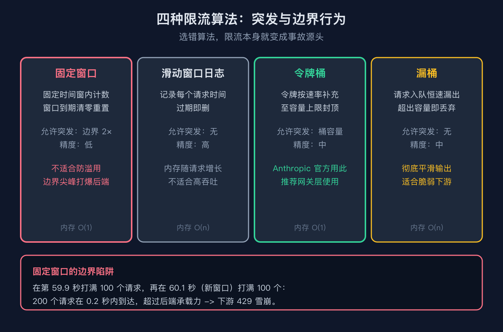
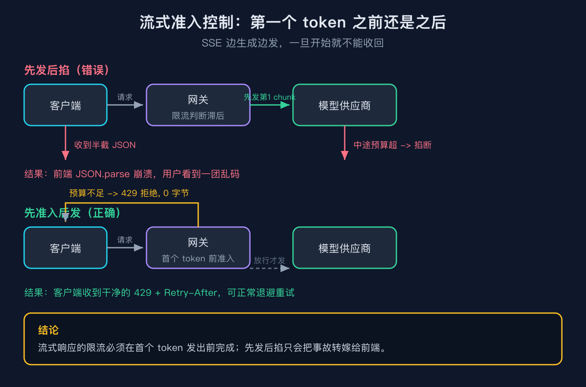
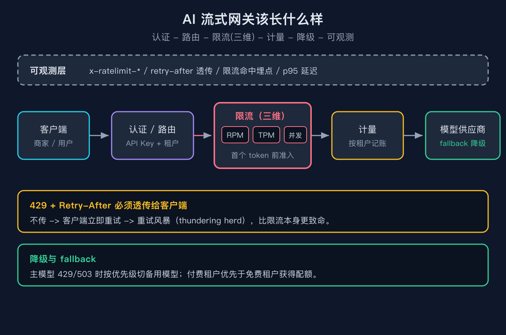

# 我把网关限流配置成每秒 100 请求，大促一来照样被打挂，还把别人也拖垮了

这是「AI 工程基础设施原理」系列的第 4 篇。第 1 篇讲语义缓存，第 2 篇讲向量检索，第 3 篇讲上下文压缩，这篇轮到流式网关与限流。下一篇我打算写计量埋点和可观测性，因为限流要想调得准，前提是你得先有数字，而不是凭感觉拍一个每秒 100 的数字。

## 一个真实的翻车现场

我之前帮一家做 SaaS 客服系统的公司搭 AI 网关。他们的想法很朴素：给每个租户配一个固定窗口限流，limit 设成 100 请求每 60 秒，换算一下大概是每秒 1.7 个请求，平时够用了吧。问题出在大促那天，商家搞活动，门口一下子涌进来十倍的咨询量。

网关按它那套固定窗口逻辑放行，结果在窗口切换的那一瞬间，旧窗口末尾的一百个请求加上新窗口开头的一百个请求，两批加起来二百个请求在零点二秒内全部砸向下游的模型供应商。下游直接 429 雪崩，不但这家租户自己的请求全失败，连带着同一个供应商配额下的其他租户也被拖下水。那天客服群里全是骂声，而网关面板上的 RPM 显示明明还没到上限。

为什么会这样。下面三个概念没弄清楚，限流配置就是个摆设，你拍的数字再好看也没用。

## 概念一：限流算法有五种，固定窗口只是最简单也最坑的一种

大多数人配限流第一反应就是固定窗口：一个时间窗内数个数，到了就清零。它实现简单，内存恒定，但有一个藏得很深的毛病，就是窗口边界会放出两倍配额。

我用一段纯标准库代码复现过这个现象。把窗口设为 100 每 60 秒，在第 59.9 秒把窗口打满，再在 60.1 秒新窗口开头发满，两批合计 200 个请求在不到 1 秒内通过，而理论峰值应该是 100 每 60 秒。代码跑出来的输出是：

```
固定窗口 limit=100/60s：窗口末尾接受 100，下一窗口开头接受 100
两批合计 200 个请求在 0.2s 内到达（理论峰值应为 100/60s）
```

除了固定窗口，还有四种常见算法。滑动窗口日志把每个请求时间戳都记下来，最精确但内存随请求数线性增长。滑动窗口计数器是它和固定窗口之间的折中，用两个窗口的加权近似消掉边界尖峰。令牌桶允许突发到桶容量再平滑补充，这也是 Anthropic 官方明说的算法。漏桶则彻底削平突发，超出队列就丢，适合下游完全扛不住尖峰的脆弱系统，比如直接写库。

对 AI 网关来说，令牌桶通常是最合适的选择，因为它既承认突发（促销开门那一下的确会来一波），又能在持续速率上兜底，不会让下游在窗口边界被两倍的量砸懵。



## 概念二：流式响应必须「先准入后发」，否则前端拿到半截 JSON 直接崩

普通 API 请求是「问完再答」，限流判断放在发请求之前就行。但大模型是流式返回，前端一边收 SSE 一边渲染。如果你的限流判断放在第一个 token 发出之后，那等发现超预算时，你已经把半截内容发给前端了。前端拿到一个没写完的 JSON 或者一段截断的 markdown，轻则显示错乱，重则整个组件抛异常白屏。

我模拟过两种做法的差别。一种是先发后掐：先发出去一截，再判断，拒绝时已经发出 10000 字节的半截流。另一种是先准入后发：在第一个 token 之前就判断，超预算直接返回 429，已发出字节是 0，前端拿到的是干净的错误，可以正常走降级逻辑。区别就是一段能处理的错误和一段没法处理的垃圾，后者你在线日志里可能根本看不到报错，因为连接是被前端解析失败搞崩的。

```
  先发后掐：拒绝=True，但已发出字节(半截流)=10000
  先准入后发：拒绝=True，已发出字节=0（干净拒绝，前端可正常处理）
```



## 概念三：网关要分三层限流，RPM、TPM、并发一个都不能少

最大的认知误区是把限流等同于「限制请求个数」。请求个数（RPM）只是其中一层。大模型还有一个更要命的维度是 token（TPM），因为一个请求可能带几万 token 的长上下文，也可能只是几十 token 的短问答，这两个请求在你网关眼里都是「一个请求」，但在下游眼里消耗差了上千倍。

我模拟过只限 RPM 不限 TPM 的网关。一个 50000 token 的大文档请求和一个 100 token 的正常请求，网关全都放行，因为 RPM 没超。但真正去打下游供应商时，那个大请求一下吃满了 token 预算，其余正常请求全被供应商挡成 429。雪崩的起点不在你的网关，而在你以为安全的下游。

```
  大文档请求(50000 tok) 网关放行=True，正常小请求(100 tok) 网关放行=True
  （网关对 token 失明，两者都放行；真正 429 的是下游供应商，雪崩从这里开始）
```

第三个维度是并发，也就是同时在进行中的流数量。流式连接会长时间占用后端连接，十个租户各开五十个长连接，后端连接池就爆了。OpenAI 的并发实际上由 RPM 和单请求延迟隐式约束，Anthropic 则会显式给出每个层级的并发请求上限，这也是为什么 Anthropic 文档把并发单独拎出来讲。不管哪个供应商，你自己网关这一层都必须把并发单独拎出来限，不能指望供应商替你兜住。很多团队上线后才发现，真正把后端打挂的往往不是请求数，而是那几千个一直挂着的空闲流式连接，它们不怎么发 token，却牢牢占着连接槽位，等到真正要处理请求时反而没槽位可用。

既然要自己计量，就得知道读哪些字段。OpenAI 在响应头里给你回了 `x-ratelimit-limit-requests`、`x-ratelimit-remaining-requests`、`x-ratelimit-reset-requests`，以及对应的 tokens 版本和 `x-ratelimit-limit-project-tokens`，外加 429 时的 `Retry-After`。Anthropic 用的是 `anthropic-ratelimit-*` 系列头加 `retry-after`。你网关本地的计量盘，最好就对齐这些字段来建，免得和供应商口径对不上，排查时两头扯皮。



## 三个你一定会踩的坑

坑一，固定窗口的边界双倍尖峰。症状就是大促时明明 RPM 没满却被打挂，复盘还找不到原因。解法是把固定窗口换成令牌桶或者滑动窗口，至少把边界尖峰压下去。这是最低成本的改动，值得第一个做。

坑二，只限 RPM 不限 TPM。症状是下游供应商 429 刷屏，而你的网关面板一片祥和，你甚至以为限流生效了。解法是网关本地就做 token 维度计量，在到达下游之前就把大请求拦下来，保住其余小请求。我的脚本里把 `check_tpm` 打开后，50000 token 的请求被本地拒绝，100 token 的正常请求顺利放行，就是这个效果。

坑三，流式没有准入控制。症状是前端偶发白屏，网关日志里却看不到明显的错误，因为连接是被前端解析半截流搞崩的。解法是在第一个 token 之前就完成准入判断，超预算直接干净拒绝，绝不发半截流。

还有一个容易忽略的坑四，是把供应商的 429 当成普通错误无脑重试。OpenAI 在流量增速过快时会返回 429 且 `error.code` 是 `slow_down`，并带 `Retry-After` 头；模型过载时是 503 带 `server_is_overloaded`。你不读 `Retry-After` 就立刻重试，等于在雪崩现场继续踩油门。正确做法是尊重 `Retry-After`，并且对 429 做指数退避加抖动，别用固定间隔猛打。OpenAI 还明确说过，一旦你的流量达到每分钟一百万输入 token 这个量级，每十五分钟最多再涨百分之五十，涨太快它本身就会回 `slow_down` 让你慢点。我见过最离谱的案例是有人把 429 当成功信号处理，失败后立刻重试，半小时内把一个本来够用的最小配额打成了永久限流，这种重试放大比限流本身更危险。

## 结尾钩子

你现在的网关是怎么限流的。翻一下配置，看看是不是只有一个 RPM 数字，TPM 和并发是不是压根没配。再问自己一句：如果现在窗口恰好切换，你的下游会不会也经历一次两倍的尖峰。欢迎在评论区说说你踩过的限流坑，或者把你的网关架构发给我，下一篇写可观测性之前，我可以先帮你看看数字缺在哪。

## 复现模块

代码地址：本仓库 `2026-10-19-流式网关与限流-每秒100请求限流翻车/code/repro/`
数据源：无需外部数据，纯标准库模拟，无需 API key
运行命令：

```
python3 rate_limit_core.py --self-test
python3 rate_limit_core.py
python3 streaming_gateway_sim.py --self-test
python3 streaming_gateway_sim.py
```

两个脚本各自 5 项 self-test 全绿，默认演示输出与正文引用一致。自检输出如下，精确逐行版本见同目录 `EXPECTED_OUT.txt`：

```
self-test START
  [PASS] token_bucket_burst
  [PASS] token_bucket_refill
  [PASS] fixed_window_boundary_2x
  [PASS] sliding_window_no_boundary
  [PASS] leaky_bucket_rejects_burst
self-test PASS (5/5)
```

```
self-test START
  [PASS] broken_gateway_admits_both
  [PASS] fixed_gateway_rejects_big_keeps_small
  [PASS] after_first_token_half_sent
  [PASS] before_first_token_clean_reject
  [PASS] concurrency_cap_enforced
self-test PASS (5/5)
```

## 如果你要把它讲给别人听

一句话版本：AI 网关的限流不是配一个数字，而是 RPM、TPM、并发三层都要管，而且流式响应必须在第一个 token 之前就完成准入。

三句话版本：第一，固定窗口在边界会放出两倍配额，换令牌桶更稳。第二，只限请求数不限 token，等于对下游失明，大请求会拖垮小请求。第三，流式必须先把关再发内容，否则前端拿到半截流只能崩。

## 来源

OpenAI 官方文档 Rate limits（多维度 RPM/TPM/RPD/IPM、响应头 `x-ratelimit-*` 字段、`slow_down` 与 `server_is_overloaded`、每分钟百万 token 量级的 ramp-rate 规则）
Anthropic 官方文档 Rate limits（令牌桶算法、RPM/ITPM/OTPM 三维度、`anthropic-ratelimit-*` 头、cache-aware ITPM 即缓存读不计入限额、`enforced_spend_limit_reached` 无 retry-after）
