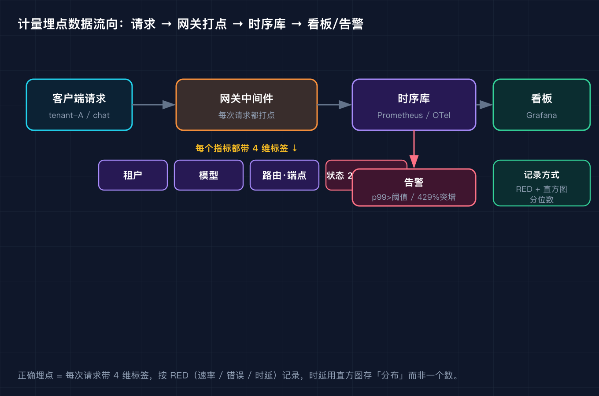
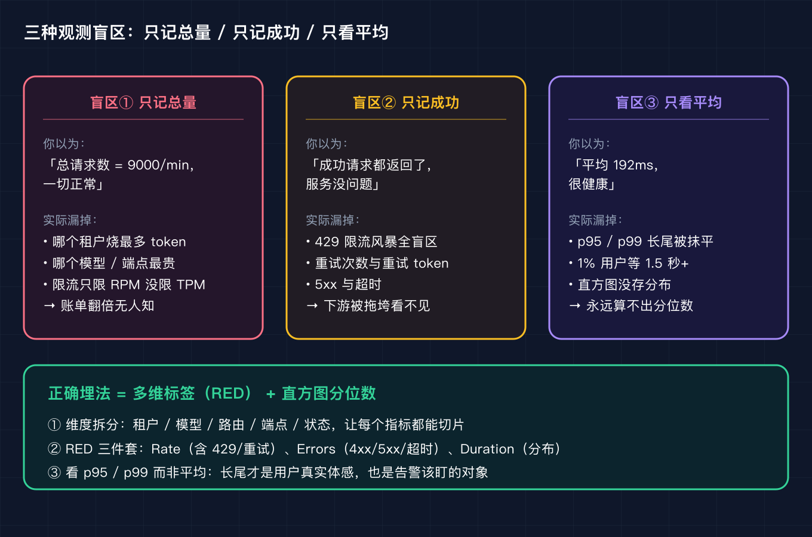
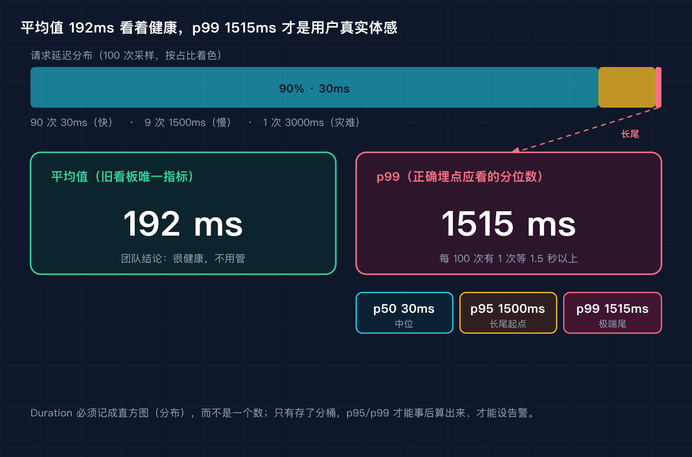

# 我给网关加了计量埋点，才发现限流配错三个月，下游账单多烧了两倍

这是「AI 工程基础设施原理」系列的第五篇。前面四篇我们分别讲了语义缓存、向量检索、上下文压缩、流式网关与限流。这一篇讲计量埋点与可观测性，下一篇讲重试与熔断。四篇连起来是一条线：网关把流量接住（限流），用计量看清流量到底长什么样（埋点），再用重试熔断兜住失控的流量。

## 三个月后才发现，那个埋点是瞎子

三个月前我给公司的 AI 客服网关做了一版限流。当时我按上篇讲的四层限流思路，把 RPM（每分钟请求数）卡在租户维度 120。配完看了一眼「总请求数」曲线，稳稳地在 9000/min 上下，觉得自己干得漂亮。

上周财务把账单甩过来：这个月 LLM 调用费用比三个月前翻了两倍。我第一反应是模型涨价了。翻了下单价，没涨。再往下查，才发现问题不在限流配没配，而在我根本看不见限流配得对不对。

那条「总请求数」曲线一直是绿的，因为它只记了一个数字。它没告诉我哪个月开始，acme 这个租户的 token 消耗量悄悄涨到了别人的三倍；没告诉我每天晚上八点有一波 429 限流风暴，客户端在不停重试；更没告诉我缓存命中率从 87% 掉到了 0，所有请求都在按全价重新算 prompt。

换句话说，我三个月前埋的那个点，是个瞎子。这篇就把这个瞎子治好。

## 概念澄清一：计量埋点不是打日志，是一条带标签的数据流

先说清楚计量埋点到底是什么。它不是在代码里 print 一句日志，而是一套贯穿请求生命周期的数据采集管线。我把完整的数据流画出来了：



一次请求从客户端进来，经过网关中间件时，中间件会给这次请求打上几个标签，再把打好的点写进时序库，最后在看板上画出曲线、在异常时触发告警。这里有两个被我之前忽略的关键词：标签和时序。

标签在 OpenTelemetry 里叫 attributes，在 Prometheus 里叫 labels，本质上就是键值对。没有标签，所有请求的数值会塌缩成一条曲线（就是我那条总请求数）。有了标签，同一个指标可以按租户、模型、路由、端点、状态切成无数条。OpenTelemetry 的数据模型定义了四类乐器（instrument）：Counter 是只增不减的累加器，像汽车里程表；UpDownCounter 能增能减，适合记队列长度；Gauge 记瞬时快照，适合内存、温度这种不可累加的值；Histogram 把观测值丢进一个个桶里，用来事后算分位数。

时序库为什么是时序而不是关系库？因为指标是带时间戳的流，Prometheus 这类系统就是把「服务 X 在特定时间段内、状态码 200 的请求数」存成一条随时间变化的数轴，方便你回看昨天八点到底发生了什么。

## 坑一：只埋总量不按维度拆，所有异常混成一个数字

我踩的第一个坑，就是只埋了总量。这对应 RED 方法里的 R（Rate），但我把 Rate 记成了一个大杂烩。

RED 是 Tom Wilkie 在 Grafana 提出、专门给微服务用的监控方法，三个字母分别是 Rate（每秒请求数）、Errors（失败请求数）、Duration（时延分布）。它和 Brendan Gregg 的 USE 方法互补：USE 看的是机器的 Utilization/Saturation/Errors，RED 看的是服务的健康。Google SRE 的「四大黄金信号」就是 RED 再加一个 Saturation（饱和度）。对网关这种请求驱动的服务，RED 正合适。

只记总量的后果，我在脚本里复现了。我把三个租户的流量按正确的方式聚合，结果长这样（完整输出在 code/repro/EXPECTED_OUT.txt）：

```
tenant     req   rpm       tok       tpm   cached  cHit%   429%  retry%   err%
------------------------------------------------------------------------------
acme       100   100    360000    360000        0    0.0   20.0    30.0   20.0
globex     100   100    427500    427500   332500   87.5    5.0     5.0    5.0
inyo        50    50    110400    110400    72000   75.0    4.0     0.0    4.0
```

注意 acme 这一行：它的 RPM 是 100，和 globex 一模一样，旧仪表盘看来两个租户一样健康。但只要按租户切开，acme 的 TPM（每分钟 token 数）是 360000，缓存命中率 0%，429 占了 20%，重试占了 30%。globex 同口径下缓存命中 87.5%，几乎没重试。不拆维度，这些全看不见。

解法就是把维度加回去。最少要有四个维度：租户、模型、路由或端点、状态（200/429/5xx）。租户让你知道谁在烧钱，模型让你知道哪个贵，端点让你知道哪条链路有问题，状态让你把成功和失败分开。这里有个工程上的坑要提醒：维度越多，时间序列的基数（cardinality）越高，存储和查询成本指数级上涨。租户 ID、user ID 这种高基数字段不能直接当标签无脑塞，要么做聚合（按租户而非按用户），要么单独走日志链路。

## 概念澄清二：埋点要记失败，要记分布，不是一个数

讲完维度，第二个概念是：埋点不仅要记成功，还要记失败；不仅要记一个数，还要记分布。我把三种最常见的观测盲区画在一张图里对比：



## 坑二：只记成功不记失败，限流风暴全在盲区

第二个坑，是只记成功不记失败。我之前的埋点只统计了返回 200 的请求，429 和重试被我当成了没发生的事。

这违背了 RED 里的 E（Errors）。Errors 不只是 5xx，它至少要把三类失败单列：客户端错误（4xx）、服务端错误（5xx）、超时。而对 LLM 网关，还有一类最容易被漏掉的失败：限流拒绝（429）和由此引发的重试。

为什么这个特别坑？上篇讲过，限流是「先准入后发」，被挡在门外的请求不会消耗下游 token，但它会消耗客户端的耐心，客户端往往选择重试。于是你看到的现象是：下游没炸，账单却因为大量重试成功请求而悄悄翻倍；而那个真正该告警的 429 比率，因为没被记录，永远躺在你视野之外。脚本里 acme 的 429 占 20%、重试占 30%，就是这种风暴的缩影。

解法很简单也很关键：把 429、5xx、超时、重试全部作为独立指标记下来，并且和正常请求用同一个维度切分。这样你才能在看板上同时看到成功率掉了和限流率飙了，而不是只看到前者。

## 坑三：有指标没设阈值告警，而且盯着错误的那个数

第三个坑，是有指标但没人盯着，或者盯着错误的那个。我那张看板挂了一条平均响应时间，三个月来一直 192ms，我从来没设过任何告警。

## 概念澄清三：平均值会撒谎，时延要存成分布

问题出在 Duration 我记成了一个数而不是一个分布。平均值会撒谎。我在第二个脚本里造了一组确定性的延迟样本：100 次请求里 90 次 30ms、9 次 1500ms、1 次 3000ms。算出来平均 192ms，看着很美。但用户真实体感是：每 100 次里有 10 次要等 1.5 秒以上，有 1 次要等 3 秒。我把这个失真画出来了：



解法是用直方图（Histogram）而不是一个数来存时延，再看分位数。Prometheus 的 Histogram 类型是累积桶（每个桶带一个 le 标签，表示小于等于该上界），它额外吐出 _bucket、_sum、_count 三类时间序列。关键能力是：你不用提前决定记 p95 还是 p99，桶存好后，用 histogram_quantile(0.99, rate(bucket[5m])) 就能在查询时算出任意分位数，还能跨维度聚合。和它对应的 Summary 类型是在客户端就把分位数算死，一旦多实例就无法跨机聚合，所以网关这种分布式场景要用 Histogram 而非 Summary。

具体盯哪条线？看 p95 和 p99，不看平均。p99 是那 1% 最倒霉用户的体感，往往正是你最活跃、请求最多的那批用户，也是最容易因为慢而触发重试、进而压垮下游的那批。把告警阈值设在 p99 上，比如 p99 超过 2 秒持续 5 分钟就告警，你就能在用户炸锅前先炸自己。

## 元凶补刀：token 维度没拆，缓存失效被总量盖住

回到开头那个让账单翻两倍的元凶。除了上面三坑，还有一个我后来才补上的漏：token 维度没拆。OpenAI 的 usage 返回里，除了 prompt_tokens、completion_tokens、total_tokens，还有 prompt_tokens_details.cached_tokens（命中缓存、按折扣价计费的 token）和 cache_write_tokens（写入缓存、按 1.25 倍计费的 token）。Anthropic 更明显，usage 里 input_tokens、cache_creation_input_tokens、cache_read_input_tokens 三者互斥，真实输入 token 是三者之和，只盯着 input_tokens 你会少算一大块。

我的 acme 租户之所以烧钱，根因就是缓存命中率掉到 0：本来该走 cache_read（约 0.1 倍价）的 token 全变成了全价 input。但如果我只记 total_tokens，这个变化会被总量两个字盖住；只有把 cached 和 uncached 拆开记，命中率这条曲线才会掉下来，我才能在它掉的那天就发现，而不是三个月后看账单。

## 复现模块

这篇的复现模块有两个纯标准库、免 key 的脚本，放在 code/repro/：

metrics_collector.py 构造一份多租户网关请求日志，按租户聚合 RPM、TPM（输入、输出、缓存命中拆分）、429 比率、重试比率、错误比率。直接跑看报告，加 --self-test 跑断言（acme 的 429 比率精确等于注入的 20%、TPM 精确等于 360000 等七项全过）。

latency_percentile.py 构造一份延迟样本，演示平均值如何掩盖 p99 长尾，并打印直方图分桶。--self-test 断言 p99 至少是平均值的 5 倍。

运行命令：

```
python3 code/repro/metrics_collector.py --self-test
python3 code/repro/latency_percentile.py --self-test
```

预期输出见 code/repro/EXPECTED_OUT.txt。

## 三句话总结

计量埋点不是记一个总数字，而是给每次请求贴上租户、模型、端点、状态这些维度，让流量可被切片。RED 三件套（速率、错误、时延）里，错误要单列 429 和重试，时延要存直方图而非平均数。真正该盯的是 p95/p99 长尾和缓存命中率，它们才是账单翻倍和限流风暴最早的信号。

## 结尾钩子

你的网关现在能答出昨天哪个租户烧了最多 token、重试了多少次、缓存命中率掉没掉吗？答不出来，说明它和我三个月前一样是个瞎子。下一篇我们讲怎么用重试与熔断，把限流没拦住、埋点已看清的那股失控流量，在它拖垮下游之前掐断。你踩过最离谱的有指标却看不见的坑是什么？评论区聊聊，我挑几个在下一篇里接着拆。

## 来源

Tom Wilkie 的 RED 方法（Grafana 官方博客，2015）；Brendan Gregg 的 USE 方法；Google SRE 手册的四大黄金信号；OpenTelemetry Metrics 数据模型与语义约定官方文档；Prometheus Histogram 与 histogram_quantile 官方文档；OpenAI 与 Anthropic 官方 API usage 字段说明。
